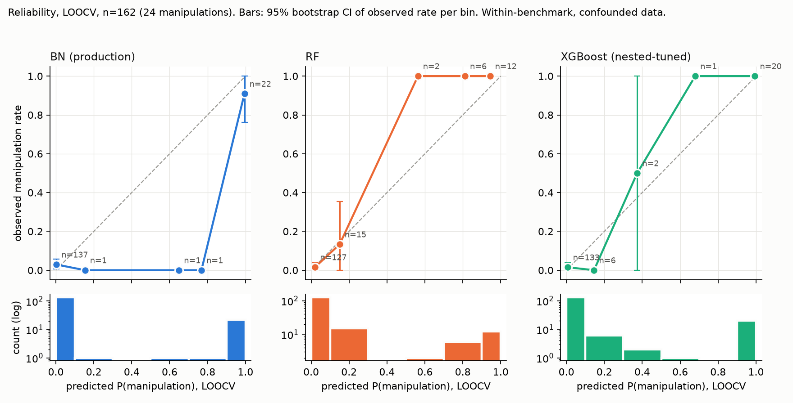

# CJSJ numbers (append-only log; one section per roadmap item, every number cites its script)

## Read-out (hand-written summary of sections 1-7; numbers repeat those sections and cite their scripts)

Label for everything below: **within-benchmark (confounded data, see research_audit.md)**, except section 2 (verified-label rerun; its negatives are still the confounded 138).

1. **Verified positive class is 9, not 24** (`cjsj_01_a2_labels.py`): A2 category M = 12, of which 9 have two independent sources (7 without the `math_enabled` sub-flag). Categories over the 24: M 12, A 5, R 3, K 2, O 2. Seven labels changed against the earlier provisional table; the largest corrections are Conic 02 (crvUSD sandwich, not read-only reentrancy), TOPBPool (governance takeover) and WiseLending 2023-10 (no retrievable source). Labels come from post-mortems, not call traces, by a single labeler who had seen model results.
   Power: minimum detectable AUC vs chance is 0.745 at n=9 (0.774 at n=7) versus 0.660 at n=24 (`cjsj_01_a2_labels.py`, from `a10_power_analysis.py` functions).
   DeFiHackLabs: 875 incidents; 295 matched to mainnet (lower bound, 104 chain-unmatched); 41 Ethereum incidents heading-flagged as price/oracle/rate manipulation (keyword heuristic, not A2 labels), roughly 20 expected to survive as 2-source M (`cjsj_01_a2_labels.py`).
2. **The forward-time BN-over-RF advantage does not reproduce on verified-M positives** (`cjsj_02_verified_rerun.py`). Baseline (24 positives) reproduces the audit exactly (McNemar p=0.125 LOOCV; p=0.0044 at 2024-01). With 9 positives: LOOCV RF 5/9 with 0/138 false alarms, BN 7/9 with 4/138 (p=0.688); at every forward cutoff RF has 0 false alarms and every McNemar p is 0.5 or 1.0. The audit's RF false-alarm bursts (12, 10, 16) are absent in this setting; I did not test why (a likely factor is the changed positive set in the training folds, but that is untested).
3. **XGBoost matches RF and beats nothing new** (`cjsj_03_xgb_heuristics.py`): LOOCV XGB 21/24, 0/138 false alarms (McNemar vs BN p=0.062, Holm 0.188). Forward-time XGB has 25/114, 22/102, 22/85, 22/70 false alarms at the first four cutoffs (BN: 2, 3, 3, 2). Deviation-threshold heuristics: price-deviation guard catches 1/24, TWAP guard 0/24 (AUC 0.11 and 0.02: volatility incidents have the large deviations, audit C3); reserve-skew guard 19/24 with 6/138 false alarms (this feature is post-exploit balance change, audit C2); the inner-CV stump picks `heartbeat_elapsed` at every forward cutoff and gives 30/102 false alarms at 2023-01.
4. **PPV** (`cjsj_04_ppv.py`, LOOCV, threshold .5): BN 0.225 / 0.602 / 0.835 at 1% / 5% / 15% prevalence (bootstrap CI at 1%: 0.119 to 0.561). RF and XGB point PPV is 1.0 (0 observed false alarms) but the Wilson-conservative PPV at 1% is 0.193 (RF) and 0.205 (XGB). Forward-time 2024-01: BN 0.246 / 0.630 / 0.851, RF 0.042 / 0.187 / 0.436, XGB 0.031 / 0.143 / 0.360. At 1% prevalence even a 1% false-positive rate caps PPV near 0.46 to 0.50.
5. **Sensitivity** (`cjsj_05_sensitivity.py`): baseline reproduces audit (p=0.0044 at 2024-01, BN false alarms 2,3,3,2,2,1,1). 23 of 24 threshold perturbations keep p<.05 at 2024-01 and 22 of 24 keep a Holm-significant cutoff; ESS 1, 2, 5, 10 leave p at 0.0044 (false alarms 14, 14, 14, 11 summed over cutoffs). The one that breaks it: halving the `reserve_skew_localization` threshold (0.025) gives 45 BN errors versus 25 and p=0.0525.
6. **Atomicity** (`cjsj_06_atomicity.py`): 24 of 24 attack txs succeeded; a flash-loan event is detected in 15/24 (6/9 verified M). Same-sender repeat scan (W=100 blocks): 21 single-tx, 3 multi-block (Harvest Finance, UwU Lend, CompoundUni); verified M: 7 single-tx, 2 multi-block. Counting any same-target tx instead gives 12 single-tx / 11 multi-block, so the conclusion depends on the repeat definition. Multi-block here is a lower bound (other senders, campaigns longer than 20 minutes, and V2 flash swaps are not seen).
7. **Calibration** (`cjsj_07_calibration_evidence.py`, LOOCV): ECE BN 0.044 [0.017, 0.077], RF 0.022 [0.016, 0.049], XGB 0.016 [0.007, 0.040]; BN calibration slope 0.45 [0.33, 0.71] (over-confident), RF 1.67 and XGB 0.93 with very wide CIs (24 positives). Evidence breakdowns: UwU Lend driven by reserve_skew_localization (+4.32), price_dev (+2.70), reserve_skew (+2.48); the BN's most confident crash false alarm (Oct 10-11 2025) is driven by the same three features (+5.42, +3.32, +2.59, plus cross_venue_spread +3.14), which is the audit's M3 and C2 mechanism in one incident.

## Read-out, round 2 (items 8-11; hand-written, numbers cite the sections and scripts)

Labels: sections 8, 9, 10 are **verified-label reruns** (positives restricted; the 138 volatility negatives are unchanged and still subject to audit C1-C3); section 11 is a data export.

- **8. Why the BN edge vanishes** (`cjsj_08_diagnose_edge.py`): mainly RF false alarms that come from non-M training attacks, plus a separate power limit. RF trained on verified M alone has 0 false alarms at all 7 cutoffs. In the 24-set its false alarms at 2023-01 / 2023-07 / 2024-01 are 11.6 / 9.2 / 14.4 (5-seed means); removing the single MEV-bot attack MEVBOTa47b (A2 category K) alone drops them by 10.6 / 9.2 / 14.2. It is necessary but not sufficient (adding only it to verified M gives 5.4 / 1.4 / 2.0; MonoX, EFLeverVault and the verified Inverse Finance add more). BN's own false alarms do not depend on the label set (2,2,2,2,2,1,1 vs 2,3,3,2,2,1,1). Power: only 3 of 7 cutoffs could reach p<0.05 even in the best case (2-6 test positives), and the observed discordant pairs cap p at 0.125. Caveat: MEVBOTa47b's K label is single-sourced; the first three cutoffs share one training set.
- **9. Shortcut findings on verified labels** (`cjsj_09_shortcuts.py`; baseline reproduces the audit exactly). ETH-market-context-only RF: AUC 0.917 [0.802, 0.989] on verified M (0.896 [0.778, 0.980] on M-all; 0.906 [0.845, 0.960] on all 24), and it is not distinguishable from venue+localization (difference +0.108 [-0.021, +0.267] on verified M). So the confound finding holds. The missingness finding holds in direction but is weaker: LogReg with vs without missingness flags is 1.000 vs 0.980 accuracy and recall 1.000 vs 0.667 on verified M (audit set: 0.994 vs 0.889, 0.958 vs 0.375), paired AUC +0.056 [+0.000, +0.129] (all 24: +0.110 [+0.007, +0.219]). RF does not use the flags (paired AUC +0.014 [+0.000, +0.043]). The venue+localization AUC drops to 0.808 [0.623, 0.941] on verified M. All CIs are wide because n_pos is 9; CIs are from LOOCV predictions only (fit variance ignored).
- **10. XGBoost on verified-M forward-time** (`cjsj_10_verified_xgb_forward.py`): nested-tuned XGB has 16/114, 16/102, 16/85 false alarms at the first three cutoffs (RF 0, BN 2) and 0 at 2024-01 onward, with 3/4 caught at 2024-01. XGB vs BN McNemar p = 0.001 at the first three cutoffs (Holm 0.010), in BN's favour; nowhere else significant. Similar on M-all-12; on strict-7 XGB also has 16 false alarms at 2024-01.
- **11. Label export** (`cjsj_11_export_labels.py`): `data/processed/labels_a2.csv`, 24 rows x 21 columns, key `incident`; only the 24 attacks are labeled (data/ is gitignored, so it is not in git).

## Read-out, round 3 (items 12-15; hand-written, numbers cite the sections and scripts)

Labels: sections 12-15 are **within-benchmark (confounded data, see research_audit.md)**; section 12's verified-M pool rows and section 13 use verified-M positives (negatives unchanged). Section 15 is figures.

- **12. Learning curve** (`cjsj_12_learning_curve.py`; 30 seeds; 10-fold held-out negatives, leave-one-out positives; XGB fixed config, CIs over seeds only). Recall vs k: BN is nearly flat (verified pool 0.73 at k=2 -> 0.78 at k=9; all-24 pool 0.81 -> 0.83), RF collapses with few positives (0.10 at k=2 -> 0.56 verified / 0.82 all-24 at k=20), XGB in between (0.43 -> 0.89; 0.48 -> 0.90). False alarms go the other way: RF 0.0 at every k, XGB <= 0.6, BN rises with k (2.1 -> 4.0; 2.2 -> 3.8 of 138). So BN degrades gracefully in recall but its false alarms grow with more positives; RF and XGB keep false alarms near zero but need about 6+ positives for usable recall. This protocol has no time drift, so it says nothing about the forward-time false-alarm bursts.
- **13. Label noise** (`cjsj_13_label_noise.py`; 30 seeds). Static held-out: the MEVBOTa47b effect does not appear (RF 0.0, XGB 0.1 false alarms with it added; none of the other 14 non-verified attacks added alone do either); RF is unmoved by 3 random or targeted flips (0.0 / 0.1), XGB is sensitive (0.0 -> 2.2 random, 4.3 targeted at k=3), BN stays at 4.0. Forward-time (2023-01 / 2023-07 / 2024-01): RF false alarms with 3 random flips are 4.0 / 1.2 / 1.2, with 3 targeted flips (negatives most like MEVBOTa47b) 11 / 6 / 1, with MEVBOTa47b itself 6 / 0 / 2 (clean 0); XGB rises similarly; BN moves by at most +1. So the MEVBOTa47b effect is one instance of a general forward-time label-noise sensitivity of RF/XGB, needs distribution shift, and is not specific to that attack. Single seed for MEVBOTa47b and targeted rows in the forward part.
- **14. Leave-one-attack-out influence** (`cjsj_14_loao_influence.py`; 10 forward cutoffs incl. 2025-10, 2026-03, 2026-07; RF 5-seed mean, XGB nested). Influence is concentrated: MEVBOTa47b (K) mean forward ΔFA -3.87 (RF) / -4.11 (XGB), Inverse Finance (verified M) -2.62 / -3.20, then MonoX -0.76 / -1.40, Cream -0.70 / -0.30, EFLeverVault -0.62 / -0.11. Only 2 of 20 evaluable attacks have RF mean ΔFA <= -1 (one verified M, one not), so **item 8's "mainly non-M attacks" needs qualifying: a verified-M attack (Inverse Finance) carries comparable influence**. Static influence is ~0 for all 24 (max |ΔFA| RF 0.00, XGB 0.60 of 138). Ajna, BalancerV1BPool, SecuredFi and USM never enter a forward training set, so they are static-only. Late cutoffs have 22, 9 and 3 test negatives, so their false-alarm changes are noisy.
- **15. Figures** (`cjsj_15_figures.py`) in `reports/figures/`: `fig_a_shortcut_auc.png` (values parsed from section 9), `fig_b_fa_vs_positives.png` (from `reports/cjsj_12_learning_curve.csv`), `fig1_sourcing_schematic.png` (hand-laid-out schematic; counts from research_audit.md).

## Read-out, round 4 (items 20-27; hand-written, numbers cite the sections and scripts)

Labels: sections 20-27 are **within-benchmark (confounded data, see research_audit.md)**; rows or pools that use verified-M positives are verified-label runs with the 138 volatility negatives unchanged (C1-C3 still apply). Sections 20 and 21 are the critical fairness/confound checks.

- **20. Fairness check on the learning curve** (`cjsj_20_fair_lc.py`; 30 seeds; recall at the false alarms the BN admits in the same seed). **The BN's recall advantage at k=2-4 survives only in reduced form.** Verified M pool, BN minus model at matched false alarms (k=2 / 3 / 4): RF unweighted +0.09 / +0.06 / +0.05 (CI excludes 0 at all three), RF class_weight='balanced' +0.04 (CI > 0) / +0.00 / -0.04, XGB with scale_pos_weight +0.20 / +0.13 / +0.04; XGB unweighted is degenerate at k=2 (constant output; AUC 0.000 is an artifact, cell excluded) and +0.12 / -0.03 at k=3 / 4. All-24 pool: RF +0.09 / +0.06 / +0.04, RF balanced +0.08 / +0.03 / +0.02, XGB weighted +0.25 / +0.17 / +0.09. From k=6 (verified) or k=10 (all 24) the balanced RF and weighted XGB match or beat BN by 0.04 to 0.12 recall. Two further points against the raw learning-curve reading: the BN has no zero-false-alarm operating point (recall at 0 false alarms 0.00, versus 0.60 RF and 0.53 weighted XGB on verified M, k<=4), and at the training-prevalence threshold RF makes 12.7 to 25.5 false alarms of 138 (BN 4.1), so prevalence thresholding is not a good fair point for the tree models. Matched budgets are only 2-4 false alarms (1.5-3%), recall resolution is 1/9, and CIs cover subsampling variance only.
- **21. Confound check on the BN's advantages** (`cjsj_21_no_shortcuts.py`; four feature sets; 30 seeds for the learning curve, 20 for label noise; RF 150 trees, XGB fixed config). **Two of the BN's three advantages survive without ETH-context features; the forward-time stability advantage does not.**
  1. *Small-k recall at matched false alarms* survives, and grows, with venue-only features (reserve_skew + localization for all three models): verified pool, BN minus RF +0.29 / +0.26 / +0.21 and BN minus XGB +0.32 / +0.30 / +0.25 at k=2 / 3 / 4, still +0.22 / +0.10 at k=9. It reverses when price_dev, cross_venue_spread and dex_oracle_spread are added (RF/XGB beat BN by 0.04 to 0.16; tree models can use their missingness, audit C3). With ETH-context features only the BN is inert (recall 0.00), RF/XGB get 0.16 to 0.30 at matched false alarms. Reading: the BN's edge is hand-set prior knowledge (fixed 5% thresholds) on the venue features, which carry the audit's C2 post-exploit-loss leakage; it is not a learning advantage.
  2. *Forward-time stability* does not survive. Training on all 24, false alarms summed over the 7 cutoffs, BN / RF / XGB: baseline 14 / 46 / 108; venue only 7 / 3 / 2; extended 14 / 0 / 4 (manipulations caught 87 / 80 / 85 and 87 / 86 / 97 of 98). Training on verified M: baseline 12 / 0 / 48; venue only 7 / 1 / 2; extended 13 / 0 / 0. So the RF/XGB false-alarm bursts are driven by the ETH-context features (ETH-context only: RF 92 and XGB 133 false alarms, BN 0 but also 0 caught).
  3. *Label-noise robustness* survives modestly. Forward false-alarm growth under 3 random flips (mean over 3 cutoffs), BN / RF / XGB: baseline +0.7 / +3.0 / +2.8; venue only +0.0 / +2.3 / +6.9; extended +0.3 / +0.7 / +4.3. Static, k=3 random flips: venue only +0.0 / +0.6 / +3.1 (baseline +0.0 / +0.0 / +2.0).
  Caveats: the venue-only sets have two features, so RF/XGB have little to learn from; the BN's fixed thresholds are not tuned on this data but were chosen by the project after the audit's earlier looks (M2); CIs cover subsampling/fold randomness only.
- **22. Time shortcut probe** (`cjsj_22_time_probe.py`): no evidence that date or block number predicts the label. Date rank AUC 0.575 (permutation p 0.23) on all 24, 0.555 (p 0.53) on M-all, 0.475 (p 0.81) on verified M; LOOCV RF AUC on date 0.588 [0.471, 0.701] (all 24). LOOCV AUCs below 0.5 on the smaller sets are a leave-one-out artifact, not a time effect. The sourcing is time-structured though: 8 of 24 attacks are from 2026 (33%) versus 12% of volatility incidents, and the attack share differs by collection cohort (29% / 28% / 8% / 12%).
- **23. Permutation tests** (`cjsj_23_permutation.py`; 1000 label shuffles; statistic = stratified 10-fold out-of-fold RF AUC, minimum attainable p 0.001). ETH-market-context AUC 0.899 / 0.933 / 0.902 on all 24 / M-all / verified M, p <= 0.001 on all three; venue + localization 0.888 / 0.857 / 0.815, p <= 0.001 / 0.001 / 0.002. Both the shortcut features and the venue features are far above chance on every label set, verified M included, and the test cannot rank them (it only rejects chance). `heartbeat_elapsed` alone is not significant on M-all (p 0.069) or verified M (p 0.139). 16 of 18 tests have p < .05; the null 95th percentile of the AUC is 0.63 to 0.69, which shows how noisy AUC is at 9 to 24 positives.
- **24. Evasion by mimicry** (`cjsj_24_mimicry.py`; leave-one-attack-out models; a = fraction moved toward the nearest volatility incident). **XGBoost is the hardest to defeat; RF vs BN depends on the metric and set.** All 24, all features shifted, recall at a=0.75: BN 0.71 / RF 0.62 / XGB 0.83 (RF minus XGB -0.21 [-0.38, -0.04]; BN minus XGB -0.12 [-0.29, 0.00]; BN minus RF +0.08 [0.00, +0.21]); recall halves (a50) at 1.00 for BN, 0.95 for RF, 1.00 for XGB. Verified M (n=9, models trained on verified M only): recall at a=0.75 BN 0.33 / RF 0.22 / XGB 0.78 (BN minus XGB -0.44 [-0.78, -0.11]); a50 is 0.80 for BN and 0.95 for RF and XGB, i.e. relative to its own unshifted recall the BN loses the most there, while RF has the lowest absolute recall throughout because it starts lowest (3/9 at a=0). Shifting only ETH-context features changes no model's recall, so none of the three flips on the shortcut features under this attack. At a=1 every model's recall is about 0 by construction. n_pos is small, CIs are wide, and the attacker is white-box.
- **25. BN recalibration** (`cjsj_25_recalibration.py`; nested LOOCV, calibrators fit on inner out-of-fold scores). Platt: calibration slope 0.45 [0.33, 0.71] -> 1.01 [0.74, 1.57], log-loss 0.283 -> 0.177, ECE 0.044 -> 0.027, Brier 0.043 -> 0.039 (paired change -0.004 [-0.011, +0.003], not significant), AUC unchanged. Isotonic: ECE 0.012, slope 0.68, Brier 0.041 (not significant), but AUC falls to 0.833 because it collapses ties. Murphy decomposition: reliability 0.0080 -> 0.0059 (Platt) / 0.0049 (isotonic), resolution about 0.091 unchanged, uncertainty 0.126: recalibration fixes over-confidence but adds no discrimination.
- **26. Cost-sensitive analysis** (`cjsj_26_cost.py`; 24 attack losses total $370M, Cream + BalancerV2 = 68%; five older losses use reported figures). Cheapest model at 1:10 / 1:100 / 1:1000 (threshold .5): LOOCV, every prevalence and both weightings: XGBoost (P(cheapest) 0.81 to 0.83; the BN is never cheapest, P=0.00, because of its 4 false halts). Forward 2024-01: BN at 1:10 and 1:100 (dollar-weighted, all prevalences), RF at 1:1000 (count-based at all prevalences, dollar-weighted at 14.8%); XGBoost is never cheapest there (22 false alarms). So the winner depends on evaluation (static vs forward) and on the ratio; no model dominates.
- **27. Explainability parity** (`cjsj_27_shap_parity.py`; UwU Lend and the Oct 10-11 2025 flash crash, models refit without the incident). Top feature: all three name `reserve_skew_localization` for UwU Lend; for the crash false alarm BN and RF name it but XGB names `ref_realized_vol`. Share of total |attribution| on ETH-context features: UwU BN 4% / XGB 47% / RF 68%; crash BN 6% / XGB 82% / RF 40%. Spearman over the 7 shared features is BN-XGB +0.02 / -0.27, BN-RF -0.02 / +0.36, XGB-RF +0.93 / +0.50 (UwU / crash). The BN's evidence for the crash comes from `price_dev` (+3.32) and `cross_venue_spread` (+3.14), which RF/XGB never see and which are missing for most attacks. Parity is limited: different feature sets, and RF attributions are in probability points.

## Read-out, round 5 (items 28-31; hand-written, numbers cite the sections and scripts)

Labels: sections 28-31 are **within-benchmark (confounded data, see research_audit.md)**; verified-M training rows are verified-label runs with the 138 volatility negatives unchanged. Items 16-18 are not in this log (I have no specification for them). Item 19 (git commit) was already done by another process: commit `802cb44` on branch `cjsj-analysis` (created by me a minute earlier in the shared working tree) contains the cjsj scripts, CSVs, figures and this file, plus the pilot session's files; `data/` and `.env` are not in it.

- **28. Which ETH-context feature drives the bursts** (`cjsj_28_drop_one.py`): **the expectation holds: `heartbeat_elapsed` is necessary and sufficient.** It is the only ETH-context feature that drifts (before vs from 2024, p = 8.4e-07; all others p >= 0.18). Training on all 24 attacks, forward false alarms summed over 7 cutoffs: starting from ALW + congestion, dropping heartbeat removes 100% of RF's false alarms (75.0 -> 0.0) and 85% of XGBoost's (110 -> 17); training on verified M, XGBoost 48 -> 0 (RF has no burst there, 4.2). Dropping any other single feature removes 27-43% of RF's (noisy; RF is unstable across feature sets: ALW without congestion has 43.2) and at most 6% of XGBoost's. Sufficiency: venue features plus heartbeat alone keep 75.2 (RF) and 120 (XGBoost) false alarms; venue plus any other single ETH feature stays at or below 31 (most 0-10). Dropping all four temporal features makes RF worse (+23%).
- **29. Bootstrap CIs on the attribution share** (`cjsj_29_share_ci.py`; 200 refits, held-out incidents). ETH-context share, manipulation incidents: BN 8% [3%, 15%], RF 32% [23%, 44%], XGBoost 36% [19%, 50%]; volatility incidents: BN 14% [9%, 19%], RF 44% [31%, 56%], XGBoost 44% [21%, 60%]. RF minus BN +24% [+11%, +36%], XGBoost minus BN +28% [+8%, +43%] (the ML model's share exceeds the BN's in 100% and 98.5% of replicates). **The earlier 47-82% vs 4-6% contrast was specific to the two incidents in item 27; across incidents the contrast is about 8% vs 32-36% (attacks).** The direction is robust; the size is smaller and the XGBoost interval is wide.
- **30. Shortcut reliance vs failure under shift** (`cjsj_30_share_vs_fa.py`; 88 model x feature-set x training-set configurations). Spearman rho between ETH-context share and forward false alarms: **+0.40 [+0.21, +0.57]** excluding the ETH-context-only sets (n = 82; +0.39 [+0.19, +0.56] including them, n = 88). By subset: training on all 24 +0.63 [+0.42, +0.77]; verified M +0.23 [-0.07, +0.51] (not significant); RF +0.42, XGBoost +0.66; group A only (24 configurations) +0.38 [-0.11, +0.79]. Moderate, not strong. Caveats: configurations share incidents and feature sets (the interval describes this set, not independent studies), share is in-sample, and item 28 shows one feature does most of the work, so the correlation is partly a proxy for whether `heartbeat_elapsed` is in the model.
- **31. Figure** (`cjsj_31_figure.py`): `reports/figures/fig_shortcut_reliance_and_failure.png`; left, ETH-market share by model with 95% intervals; right, forward false alarms with vs without ETH-market features (all 24 attacks: BN 14 -> 7, RF 46 -> 3, XGBoost 108 -> 2; verified 9: BN 12 -> 7, RF 0 -> 1, XGBoost 48 -> 2). One run per bar.

## Read-out, round 6 (items 32-36; hand-written, numbers cite the sections and scripts)

Labels: sections 32-36 are **within-benchmark (confounded data, see research_audit.md)**, except where stated (35 and 36 also report verified-M rows; 34 checks numbers and adds recomputations only where marked).

- **32. Intervals for Figure 3's right panel** (`cjsj_32_fig3_ci.py`; trained on all 24, 7 cutoffs, 30 seeds; combined interval = incident bootstrap with a random seed per replicate). All features: BN 14.0 [0, 33], RF 40.3 [13, 70] (seed range 17-60), XGBoost 99.3 [61, 141]. Without market-context (venue only): BN 7.0 [0, 21], RF 1.2 [0, 6], XGBoost 10.5 [2, 23]. Market-context only: BN 0 [0, 0], RF 101.8 [62, 147], XGBoost 131.2 [83, 181]. Two consequences for the paper's numbers: the RF's 46 is one seed (the 30-seed mean is 40) and XGBoost's 2 "without market features" is the deterministic run (with row/column sampling it is 10.5). XGBoost needed sampling to have seeds at all; the deterministic bars are 108 / 2 / 133.
- **33. Why `heartbeat_elapsed` drifts** (`cjsj_33_chainlink.py`, `cjsj_33b_config.py`, `cjsj_33_finalize.py`; sampled round history, the free RPC tier cannot scan logs). The rise is real and recomputable from the chain (median 271 s before the phase-7 aggregator launch on 2024-09-18, 576 s after, p = 6.7e-08; recomputation matches the dataset within 30 s for 83% of incidents). The feed's update behavior changed at that launch: updates triggered by moves under 0.5% disappeared (10th percentile of non-heartbeat update size 0.05% before, 0.50% after) and heartbeat-only gaps rose from about 30% to about 45%; the current aggregator has had 7 configuration changes since (2025-01-06, 2025-06-27, 2025-07-08, 2026-02-05, 2026-05-20, 2026-06-11, 2026-07-18). It is not a slowdown of updates during large moves (local median gap 816 s -> 540 s, p = 0.13), but the elapsed-to-gap ratio doubled (0.27 -> 0.60, p = 0.003): incident blocks now sit later in the update cycle. The jump already appears in 2024Q4, so it is tied to the launch rather than to a later configuration change; a causal split between trigger behavior and incident anchoring is not possible here. The request's quarterly medians of 504 s and 786 s are not reproduced (2025-2026 quarterly medians: 492, 402, 1140, 606, 960, 1068, 564 s; 3-8 incidents per quarter).
- **34. Independent check of the paper** (`cjsj_34_paper_check.py`; third pass, against the current docx; PDF and docx numerically identical). 86 claim rows: 75 MATCH, 2 MISMATCH, 5 UNVERIFIABLE, 4 SUPERSEDED (removed sentences); every row's quoted phrase was found in the current text (`reports/cjsj_34_paper_check.csv`). All six mismatches from the earlier passes are fixed (nested vs fixed XGBoost, shuffle count, two post-mortems, "no Chainlink feed", "as stable", 24 vs 23 venues). **Remaining MISMATCH:** (T2) "the random forest raised 16 false alarms among 70 ... p = 0.0044" is the audit's single-run 300-tree forest while the same paragraph's totals (40 [13, 70], 99 [61, 141]) are 150-tree 30-seed means, whose January 2024 mean is 12.9 (section 39c); (M6b) the 30-seed XGBoost numbers (99, 10.5, 131) use row and column subsampling of 0.8 to vary seeds, which "fixed configuration" does not disclose (the deterministic config gives 108 / 2 / 133). **UNVERIFIABLE:** (N3) the second labeler was blind to categories but shown the first labeler's source links; (T6d) "the drift is a change in the oracle itself" is supported as timing plus a documented update-rule change (18 September 2024 launch; updates under 0.5% stopped, heartbeat-only share 30% -> 45%) but not established as the sole cause; reference [6] volume, number and pages and reference [13] page range (sources disagree); the code-availability promise. New numbers that MATCH: 30-seed false alarms, the aggregator dates and 271 -> 576 s (p = 6.7e-08), the $370 million, second-labeler kappa, the UwU replay, Figure 3 (checked against the image), and references [1]-[5], [7]-[9], [11], [12] (web-checked).
- **35. Is the shortcut model-specific?** (`cjsj_35_shortcut_models.py`; LOOCV AUC with bootstrap CIs, market-context features only, all 24 / verified M). Logistic regression 0.850 [0.765, 0.926] / 0.929 [0.873, 0.974]; XGBoost 0.923 [0.868, 0.968] / 0.963 [0.912, 0.997]; naive Bayes 0.828 [0.719, 0.917] / 0.880 [0.739, 0.990]; random forest (reference) 0.906 / 0.917; BN 0.353 [0.272, 0.440] / 0.329 [0.236, 0.430]. So four flexible model families find the shortcut and the BN cannot extract it (its fixed thresholds make those features uninformative to it). The table's logistic-regression AUC of 0.042 on signed venue features is misspecification, not a result (noted in the section).
- **36. Static cost of dropping `heartbeat_elapsed`** (`cjsj_36_heartbeat_static.py`; LOOCV). Accuracy is unchanged for BN (0.951) and RF (0.975) and changes by -0.006 [-0.019, 0.000] for XGBoost (22 to 21 of 24 caught), so dropping the drifting feature costs nothing at the .5 threshold on this benchmark; on verified M accuracy is unchanged for all three, but AUC falls for RF (0.961 -> 0.907) and XGBoost (0.976 -> 0.895) (n_pos = 9; not investigated).

## 1. A2 labels, DeFiHackLabs counts, A10 rerun

**Label: within-benchmark (confounded data, see research_audit.md).**  Script: `src/cjsj_01_a2_labels.py`  (run 2026-09-30 08:10)

### 1a. A2 label sheet (24 current manipulations) -> `reports/a2_label_sheet.csv`

Labels are from retrieved post-mortems, not call traces (trace RPC is paid-tier). Single labeler, model results seen: A9 blind second labeler is still required. `provisional_category_a2_protocol_5` keeps the old table for comparison.

| Incident | Provisional (protocol §5) | A2 category | Tier | Subflags | Atomic | Conf |
|---|---|---|---|---|---|---|
| Harvest Finance | M | **M** | 2-source | share_price | per-cycle atomic; campaign multi-tx | high |
| Cream Finance | M | **M** | 2-source | donation;share_price | Y | high |
| Indexed Finance | M? | **A** | 2-source | own_pool_math | Y | medium |
| Inverse Finance | M | **M** | 2-source | atomic;twap_oracle | Y | high |
| UwU Lend | M | **M** | 2-source | atomic;multi_source_median | Y | high |
| MonoX Finance | boundary | **A** | 2-source | same_token_swap | Y | high |
| MEVBOTa47b | K | **K** | single | mev_bot | Y | medium |
| Conic Finance 02 | M | **O** | 2-source-weak | sandwich;mev_arbitrage | Y(per tx) | low |
| ZunamiProtocol | M | **M** | 2-source | donation;atomic | Y | high |
| CompoundUni | M | **M** | single | atomic;twap | Y | medium |
| CurveLlamaLend | M | **M** | 2-source | donation;atomic;share_price | Y | high |
| ResupplyFi | M | **M** | 2-source | donation;math_enabled;atomic | Y | medium |
| BalancerV2 | R | **R** | 2-source | rounding;atomic | Y | high |
| Makina | M | **M** | 2-source | atomic;flash_loan_280M | Y | high |
| TOPBPool | A | **K** | 2-source-weak | governance_takeover;mint_and_dump | Y | high |
| WiseLending | A | **O** | single | - | unknown | low |
| BalancerV1BPool | R | **R** | 2-source-weak | rounding;flash_loan | Y | high |
| AjnaFinance | O | **A** | 2-source-weak | liquidation_accounting | Y | high |
| BalancerBoostedPool2023 | boundary | **M** | 2-source | math_enabled;atomic;flash_swap | Y | medium |
| DRLVaultV3 | M? | **M** | single | atomic;spot_price;flash_loan_14M | Y | high |
| EFLeverVault | A | **A** | 2-source-weak | access_control;flash_loan_callback | Y | high |
| SecuredFi | M | **M** | single | atomic;self_trade;flash_loan | Y | medium |
| ThetanutsIndexVault | A | **A** | 2-source | rounding;share_accounting | Y | high |
| USM | R | **R** | single | rounding;redemption_curve;flash_loan | Y | medium |

- Category counts (n=24): A=5, K=2, M=12, O=2, R=3  [cjsj_01_a2_labels.py]
- Evidence tiers: 2-source=13, single=6, 2-source-weak=5
- **M total (any tier) = 12; verified M (M and 2-source) = 9; verified M excluding `math_enabled` = 7**. Old audit positive class: 24; protocol §5 provisional M: 11 to 15.
- Verified M: Harvest Finance, Cream Finance, Inverse Finance, UwU Lend, ZunamiProtocol, CurveLlamaLend, ResupplyFi, Makina, BalancerBoostedPool2023
- Provisional M (single source, excluded from verified): CompoundUni, DRLVaultV3, SecuredFi
- Changes vs protocol §5 provisional table (labeler's own earlier read): Indexed Finance: M? -> A; MonoX Finance: boundary -> A; Conic Finance 02: M -> O; TOPBPool: A -> K; WiseLending: A -> O; AjnaFinance: O -> A; BalancerBoostedPool2023: boundary -> M

Labels that overturn earlier notes (flag for review): **Conic Finance 02** is the crvUSD-omnipool sandwich, not the read-only reentrancy; **TOPBPool** is a governance takeover; **Ajna** and **EFLeverVault** are resolved as non-price bugs; **WiseLending (2023-10)** has no retrievable source (web results are for the Jan-2024 incident); **Indexed Finance** moved to A on snippet-level evidence (medium confidence).

### 1b. DeFiHackLabs incident counts (repo commit `1dee165`, parsed from README headings; `reports/defihacklabs_index.csv`)

- Parsed incidents: 875  (README banner says 875); chain matched from PoC `createSelectFork` for 771, unmatched 104.  [cjsj_01_a2_labels.py]
- By chain: bsc=335, mainnet=295, unmatched=104, arbitrum=40, base=38, polygon=22, avalanche=11, optimism=9, unknown=7, linea=2, fantom=2, gnosis=2, blast=2, citrea=1, moonriver=1, _chain=1, mantle=1, sei=1, zksync=1
- Chain counts are lower bounds per chain: incidents whose PoC file could not be matched to a README heading stay `unmatched` and are excluded from the Ethereum columns below.
- By year: 2017=2, 2018=3, 2020=9, 2021=37, 2022=129, 2023=214, 2024=189, 2025=161, 2026=131
- By category (**keyword heuristic on the heading, not A2 labels**): logic / other=425, access control / missing check=183, price/oracle/rate manipulation=145, reentrancy=59, governance / key / rugpull=33, rounding / precision / math=30

| Year | Ethereum (mainnet) all | Ethereum price/oracle/rate-like | All chains price/oracle/rate-like |
|---|---|---|---|
| 2017 | 1 | 0 | 0 |
| 2018 | 2 | 0 | 0 |
| 2020 | 3 | 0 | 0 |
| 2021 | 9 | 1 | 5 |
| 2022 | 32 | 4 | 25 |
| 2023 | 62 | 12 | 45 |
| 2024 | 79 | 6 | 20 |
| 2025 | 56 | 10 | 28 |
| 2026 | 51 | 8 | 22 |
| **total** | 295 | 41 | 145 |

- Keyword flag vs A2 label on our 24 matched attacks (names matched to README headings, best-effort): flagged & M = 9, flagged & not-M = 5, M not flagged = 3. Precision of the flag for M is 9/14 = 0.64 (n tiny; treat as a rough guide only).
- Expected verified-M-like Ethereum incidents available in DeFiHackLabs at that precision: 41 x 0.64 = **~26** (before requiring a second source, which currently cuts M by 12->9), i.e. roughly 20.

### 1c. A10 power analysis rerun with the verified counts (`a10_power_analysis.py` functions; N_NEG=138)

| Positive set | n_pos | Null SE | MDE AUC (single test) | MDE AUC (Holm m=4) | Wilson 95% CI at 85% recall* |
|---|---|---|---|---|---|
| audit: all 24 (old) | 24 | 0.064 | 0.660 | 0.697 | 20/24: [0.64, 0.93] |
| A2 M, any tier | 12 | 0.087 | 0.716 | 0.765 | 10/12: [0.55, 0.95] |
| verified M | 9 | 0.100 | 0.745 | 0.799 | 8/9: [0.57, 0.98] |
| verified M, no math_enabled | 7 | 0.112 | 0.774 | 0.833 | 6/7: [0.49, 0.97] |

*recall of 85% assumed only to size the interval; not a result.

Positives needed (alpha .05 one-sided, power .80) to detect a true AUC vs 0.5, by negative:positive ratio:

| Target AUC | ratio 1 | ratio 2 | ratio 5.75 (current 138:24) | ratio 15.3 (138:9) |
|---|---|---|---|---|
| 0.70 | 25 | 19 | 16 | 14 |
| 0.75 | 16 | 12 | 10 | 9 |
| 0.80 | 11 | 8 | 7 | 6 |
| 0.85 | 8 | 6 | 5 | 5 |

Triggered anomalies A0 must produce to obtain n_pos verified attacks, by attack prevalence among triggered anomalies:

| Prevalence | n_pos=30 | n_pos=50 | n_pos=80 |
|---|---|---|---|
| 0.30 | 100 | 167 | 267 |
| 0.15 | 200 | 334 | 534 |
| 0.05 | 600 | 1000 | 1600 |
| 0.02 | 1500 | 2500 | 4000 |

Bottom line: the verified positive class is n=9 (7 without `math_enabled`), not 24. At n=9 the smallest true AUC detectable vs chance is 0.75 (single test), i.e. only a true AUC of about that size or larger can be told apart from chance with 80% power. DeFiHackLabs, at the heuristic precision above, offers on the order of 20 more verified-M-like Ethereum incidents, so reaching n_pos=30 needs multi-chain data (C6) or a looser class.

## 2. Verified-M rerun of label_sensitivity / forward_time / dependence_significance

**Label: verified-label rerun (positives restricted to 2-source-verified M; negatives unchanged and still subject to audit C1-C3).**  Script: `src/cjsj_02_verified_rerun.py`  (run 2026-09-30 08:14)

Positives restricted to A2 **verified M** (category M and 2-source; `reports/a2_label_sheet.csv`). The 138 volatility negatives are unchanged, so audit flaws C1-C3 still apply to the negative class and to every feature. With 9 (or 7) positives, per-cutoff forward tests are mostly not evaluable under the audit's own skip rule (train pos >= 3, test pos >= 2), and every recall interval is wide.

#### all 24 (audit baseline): n=162, positives=24, negatives=138

**A. label_sensitivity analog (LOOCV, threshold .5)** [cjsj_02_verified_rerun.py]

| Model | Result |
|---|---|
| RF (ALW 8 features) | acc 0.975; AUC 0.977; manip 20/24 (Wilson 0.64-0.93); FA 0/138; Brier 0.027 |
| BN (production) | acc 0.951; AUC 0.896; manip 20/24 (Wilson 0.64-0.93); FA 4/138; Brier 0.043 |
| RF, ETH-market-context features only (7) | acc 0.907; AUC 0.906; manip 11/24 (Wilson 0.28-0.65); FA 2/138; Brier 0.074 |

BN vs RF McNemar (exact): BN-only errors 4, RF-only errors 0, p=0.125

**B. forward_time analog** (train < cutoff, test >= cutoff; skipped = train positives < 3 or test positives < 2)

| Cutoff | train n (pos) | test n (pos) | RF acc / manip / FA | BN acc / manip / FA | NB acc / FA | McNemar p (BN vs RF) |
|---|---|---|---|---|---|---|
| 2022-07 | 29 (5) | 133 (19) | 0.955 / 13/19 / 0/114 | 0.962 / 16/19 / 2/114 | 0.368 / 83/114 | 1.0000 |
| 2023-01 | 43 (7) | 119 (17) | 0.882 / 15/17 / 12/102 | 0.958 / 15/17 / 3/102 | 0.370 / 74/102 | 0.0490 |
| 2023-07 | 60 (7) | 102 (17) | 0.863 / 13/17 / 10/85 | 0.951 / 15/17 / 3/85 | 0.382 / 62/85 | 0.0490 |
| 2024-01 | 79 (11) | 83 (13) | 0.807 / 13/13 / 16/70 | 0.964 / 12/13 / 2/70 | 0.422 / 47/70 | 0.0044 |
| 2024-07 | 98 (13) | 64 (11) | 0.984 / 10/11 / 0/53 | 0.953 / 10/11 / 2/53 | 0.469 / 33/53 | 0.5000 |
| 2025-01 | 113 (13) | 49 (11) | 0.980 / 10/11 / 0/38 | 0.959 / 10/11 / 1/38 | 0.551 / 21/38 | 1.0000 |
| 2025-07 | 125 (14) | 37 (10) | 0.973 / 9/10 / 0/27 | 0.946 / 9/10 / 1/27 | 0.541 / 16/27 | 1.0000 |

**C. dependence_significance analog**: 162 incidents form 149 date clusters (<=3 days); 11 have >1 incident; largest=3.

| Split | RF | BN |
|---|---|---|
| plain LOOCV | acc 0.975; AUC 0.977; manip 20/24 (Wilson 0.64-0.93); FA 0/138; Brier 0.027 | acc 0.951; AUC 0.896; manip 20/24 (Wilson 0.64-0.93); FA 4/138; Brier 0.043 |
| leave-one-event-cluster-out | acc 0.975; AUC 0.980; manip 20/24 (Wilson 0.64-0.93); FA 0/138; Brier 0.026 | acc 0.951; AUC 0.896; manip 20/24 (Wilson 0.64-0.93); FA 4/138; Brier 0.043 |
| train<2024, test>=2024 (train pos 11, test pos 13) | acc 0.783; AUC 0.982; manip 13/13 (Wilson 0.77-1.00); FA 18/70; Brier 0.091 | acc 0.964; AUC 0.981; manip 12/13 (Wilson 0.67-0.99); FA 2/70; Brier 0.034 |

Brier (2-class, sum-of-both-classes convention of the audit) BN=0.086 RF=0.054; diff 95% bootstrap CI [-0.001, 0.077]. Manipulation recall BN=0.833 RF=0.833; identical caught sets: True.
(set runtime 20s)

#### verified M (9): n=147, positives=9, negatives=138

**A. label_sensitivity analog (LOOCV, threshold .5)** [cjsj_02_verified_rerun.py]

| Model | Result |
|---|---|
| RF (ALW 8 features) | acc 0.973; AUC 0.961; manip 5/9 (Wilson 0.27-0.81); FA 0/138; Brier 0.022 |
| BN (production) | acc 0.959; AUC 0.976; manip 7/9 (Wilson 0.45-0.94); FA 4/138; Brier 0.032 |
| RF, ETH-market-context features only (7) | acc 0.952; AUC 0.917; manip 2/9 (Wilson 0.06-0.55); FA 0/138; Brier 0.037 |

BN vs RF McNemar (exact): BN-only errors 4, RF-only errors 2, p=0.688

**B. forward_time analog** (train < cutoff, test >= cutoff; skipped = train positives < 3 or test positives < 2)

| Cutoff | train n (pos) | test n (pos) | RF acc / manip / FA | BN acc / manip / FA | NB acc / FA | McNemar p (BN vs RF) |
|---|---|---|---|---|---|---|
| 2022-07 | 27 (3) | 120 (6) | 0.975 / 3/6 / 0/114 | 0.975 / 5/6 / 2/114 | 0.375 / 75/114 | 1.0000 |
| 2023-01 | 39 (3) | 108 (6) | 0.972 / 3/6 / 0/102 | 0.972 / 5/6 / 2/102 | 0.417 / 63/102 | 1.0000 |
| 2023-07 | 56 (3) | 91 (6) | 0.967 / 3/6 / 0/85 | 0.967 / 5/6 / 2/85 | 0.473 / 48/85 | 1.0000 |
| 2024-01 | 73 (5) | 74 (4) | 0.973 / 2/4 / 0/70 | 0.959 / 3/4 / 2/70 | 0.432 / 42/70 | 1.0000 |
| 2024-07 | 91 (6) | 56 (3) | 0.982 / 2/3 / 0/53 | 0.946 / 2/3 / 2/53 | 0.518 / 27/53 | 0.5000 |
| 2025-01 | 106 (6) | 41 (3) | 0.976 / 2/3 / 0/38 | 0.951 / 2/3 / 1/38 | 0.585 / 17/38 | 1.0000 |
| 2025-07 | 118 (7) | 29 (2) | 0.966 / 1/2 / 0/27 | 0.931 / 1/2 / 1/27 | 0.586 / 12/27 | 1.0000 |

**C. dependence_significance analog**: 147 incidents form 140 date clusters (<=3 days); 6 have >1 incident; largest=3.

| Split | RF | BN |
|---|---|---|
| plain LOOCV | acc 0.973; AUC 0.961; manip 5/9 (Wilson 0.27-0.81); FA 0/138; Brier 0.022 | acc 0.959; AUC 0.976; manip 7/9 (Wilson 0.45-0.94); FA 4/138; Brier 0.032 |
| leave-one-event-cluster-out | acc 0.973; AUC 0.969; manip 5/9 (Wilson 0.27-0.81); FA 0/138; Brier 0.021 | acc 0.959; AUC 0.976; manip 7/9 (Wilson 0.45-0.94); FA 4/138; Brier 0.032 |
| train<2024, test>=2024 (train pos 5, test pos 4) | acc 0.973; AUC 0.909; manip 2/4 (Wilson 0.15-0.85); FA 0/70; Brier 0.057 | acc 0.959; AUC 0.971; manip 3/4 (Wilson 0.30-0.95); FA 2/70; Brier 0.034 |

Brier (2-class, sum-of-both-classes convention of the audit) BN=0.064 RF=0.044; diff 95% bootstrap CI [-0.015, 0.065]. Manipulation recall BN=0.778 RF=0.556; identical caught sets: False.
(set runtime 16s)

#### verified M strict, no math_enabled (7): n=145, positives=7, negatives=138

**A. label_sensitivity analog (LOOCV, threshold .5)** [cjsj_02_verified_rerun.py]

| Model | Result |
|---|---|
| RF (ALW 8 features) | acc 0.972; AUC 0.928; manip 3/7 (Wilson 0.16-0.75); FA 0/138; Brier 0.022 |
| BN (production) | acc 0.959; AUC 0.973; manip 5/7 (Wilson 0.36-0.92); FA 4/138; Brier 0.033 |
| RF, ETH-market-context features only (7) | acc 0.966; AUC 0.894; manip 2/7 (Wilson 0.08-0.64); FA 0/138; Brier 0.032 |

BN vs RF McNemar (exact): BN-only errors 4, RF-only errors 2, p=0.688

**B. forward_time analog** (train < cutoff, test >= cutoff; skipped = train positives < 3 or test positives < 2)

| Cutoff | train n (pos) | test n (pos) | RF acc / manip / FA | BN acc / manip / FA | NB acc / FA | McNemar p (BN vs RF) |
|---|---|---|---|---|---|---|
| 2022-07 | 27 (3) | 118 (4) | 0.983 / 2/4 / 0/114 | 0.975 / 3/4 / 2/114 | 0.364 / 75/114 | 1.0000 |
| 2023-01 | 39 (3) | 106 (4) | 0.981 / 2/4 / 0/102 | 0.972 / 3/4 / 2/102 | 0.406 / 63/102 | 1.0000 |
| 2023-07 | 56 (3) | 89 (4) | 0.978 / 2/4 / 0/85 | 0.966 / 3/4 / 2/85 | 0.461 / 48/85 | 1.0000 |
| 2024-01 | 72 (4) | 73 (3) | 0.973 / 1/3 / 0/70 | 0.959 / 2/3 / 2/70 | 0.479 / 38/70 | 1.0000 |
| 2024-07 | 90 (5) | 55 (2) | 0.982 / 1/2 / 0/53 | 0.945 / 1/2 / 2/53 | 0.600 / 22/53 | 0.5000 |
| 2025-01 | 105 (5) | 40 (2) | 0.975 / 1/2 / 0/38 | 0.950 / 1/2 / 1/38 | 0.700 / 12/38 | 1.0000 |
| 2025-07 | 116 (5) | 29 (2) | 0.966 / 1/2 / 0/27 | 0.931 / 1/2 / 1/27 | 0.724 / 8/27 | 1.0000 |

**C. dependence_significance analog**: 145 incidents form 140 date clusters (<=3 days); 4 have >1 incident; largest=3.

| Split | RF | BN |
|---|---|---|
| plain LOOCV | acc 0.972; AUC 0.928; manip 3/7 (Wilson 0.16-0.75); FA 0/138; Brier 0.022 | acc 0.959; AUC 0.973; manip 5/7 (Wilson 0.36-0.92); FA 4/138; Brier 0.033 |
| leave-one-event-cluster-out | acc 0.972; AUC 0.933; manip 3/7 (Wilson 0.16-0.75); FA 0/138; Brier 0.022 | acc 0.959; AUC 0.973; manip 5/7 (Wilson 0.36-0.92); FA 4/138; Brier 0.033 |
| train<2024, test>=2024 (train pos 4, test pos 3) | acc 0.973; AUC 0.855; manip 1/3 (Wilson 0.06-0.79); FA 0/70; Brier 0.056 | acc 0.959; AUC 0.967; manip 2/3 (Wilson 0.21-0.94); FA 2/70; Brier 0.035 |

Brier (2-class, sum-of-both-classes convention of the audit) BN=0.066 RF=0.044; diff 95% bootstrap CI [-0.015, 0.068]. Manipulation recall BN=0.714 RF=0.429; identical caught sets: False.
(set runtime 16s)

## 3. B10 XGBoost and deviation-threshold heuristics (nested CV) vs BN

**Label: within-benchmark (confounded data, see research_audit.md).**  Script: `src/cjsj_03_xgb_heuristics.py`  (run 2026-09-30 08:17)

Positives = all 24 manipulations, negatives = 138 volatility incidents (the audit benchmark). Nested CV: hyperparameters / heuristic choice are picked on outer-TRAIN rows only by inner stratified K-fold.

### 3a. LOOCV (n=162, 24 positives; threshold .5 for BN/RF/XGB; heuristics are hard flags, AUC uses the raw score)

| Model | acc | AUC | manip caught (Wilson 95%) | false alarms | McNemar vs BN (BN-only/model-only errors; p; Holm p) | vs RF p |
|---|---|---|---|---|---|---|
| BN (production) | 0.951 | 0.896 | 20/24 (0.64-0.93) | 4/138 | - | 0.125 |
| RF (150 trees) | 0.975 | 0.977 | 20/24 (0.64-0.93) | 0/138 | 4/0; 0.125; 0.250 | - |
| XGBoost (nested-tuned) | 0.981 | 0.976 | 21/24 (0.69-0.96) | 0/138 | 5/0; 0.062; 0.188 | 1.000 |
| H1 price-deviation guard | 0.840 | 0.111 | 1/24 (0.01-0.20) | 3/138 | 1/19; 0.000; 0.000 | 0.000 |
| H2 TWAP guard | 0.846 | 0.024 | 0/24 (0.00-0.14) | 1/138 | 3/20; 0.000; 0.003 | 0.000 |
| H3 reserve-skew guard | 0.932 | 0.959 | 19/24 (0.60-0.91) | 6/138 | 0/3; 0.250; 0.250 | 0.016 |
| H4 localization guard | 0.870 | 0.966 | 20/24 (0.64-0.93) | 17/138 | 0/13; 0.000; 0.002 | 0.000 |
| H5 best stump | 0.907 | 0.963 | 19/24 (0.60-0.91) | 10/138 | 0/7; 0.016; 0.078 | 0.001 |
| H-best (inner-CV pick of H1-H5) | 0.907 | 0.963 | 19/24 (0.60-0.91) | 10/138 | 0/7; 0.016; 0.078 | 0.001 |

XGB configs chosen across the 162 outer folds (top 3): {'learning_rate': 0.3, 'max_depth': 2, 'n_estimators': 50, 'spw': 'balanced'} x86; {'learning_rate': 0.1, 'max_depth': 2, 'n_estimators': 150, 'spw': 'balanced'} x71; {'learning_rate': 0.1, 'max_depth': 3, 'n_estimators': 150, 'spw': 'balanced'} x2
H5 stump feature chosen: reserve_skew x135, reserve_skew_localization x27
H-best chosen: H3:H3 x135, H4:H4 x27
Median fitted tau (across outer folds): H1 0.08518, H2 0.09511, H3 0.06606, H4 0.04926, H5 0.06606, Hbest 0.06606

### 3b. Forward-time splits (train < cutoff, test >= cutoff; audit skip rule train pos >= 3 and test pos >= 2)

#### cutoff 2022-07: train 29 (5 pos), test 133 (19 pos)

| Model | acc | AUC | manip caught (Wilson 95%) | false alarms | McNemar vs BN (BN-only/model-only errors; p; Holm p) | vs RF p |
|---|---|---|---|---|---|---|
| BN (production) | 0.962 | 0.945 | 16/19 (0.62-0.94) | 2/114 | - | 1.000 |
| RF (150 trees) | 0.955 | 0.961 | 13/19 (0.46-0.85) | 0/114 | 2/3; 1.000; 1.000 | - |
| XGBoost (nested-tuned) | 0.789 | 0.946 | 16/19 (0.62-0.94) | 25/114 | 4/27; 0.000; 0.000 | 0.000 |
| H1 price-deviation guard | 0.857 | 0.072 | 0/19 (0.00-0.17) | 0/114 | 2/16; 0.001; 0.005 | 0.000 |
| H2 TWAP guard | 0.774 | 0.020 | 0/19 (0.00-0.17) | 11/114 | 0/25; 0.000; 0.000 | 0.000 |
| H3 reserve-skew guard | 0.962 | 0.964 | 15/19 (0.57-0.91) | 1/114 | 1/1; 1.000; 1.000 | 1.000 |
| H4 localization guard | 0.970 | 0.966 | 15/19 (0.57-0.91) | 0/114 | 2/1; 1.000; 1.000 | 0.500 |
| H5 best stump | 0.752 | 0.823 | 16/19 (0.62-0.94) | 30/114 | 4/32; 0.000; 0.000 | 0.000 |
| H-best (inner-CV pick of H1-H5) | 0.752 | 0.823 | 16/19 (0.62-0.94) | 30/114 | 4/32; 0.000; 0.000 | 0.000 |

Nested choices at this cutoff: XGB {'learning_rate': 0.3, 'max_depth': 2, 'n_estimators': 150, 'spw': 'one'}; H5 stump feature heartbeat_elapsed (tau 421.5); H-best H5:S:heartbeat_elapsed.

#### cutoff 2023-01: train 43 (7 pos), test 119 (17 pos)

| Model | acc | AUC | manip caught (Wilson 95%) | false alarms | McNemar vs BN (BN-only/model-only errors; p; Holm p) | vs RF p |
|---|---|---|---|---|---|---|
| BN (production) | 0.958 | 0.984 | 15/17 (0.66-0.97) | 3/102 | - | 0.049 |
| RF (150 trees) | 0.882 | 0.954 | 15/17 (0.66-0.97) | 12/102 | 4/13; 0.049; 0.147 | - |
| XGBoost (nested-tuned) | 0.790 | 0.847 | 14/17 (0.59-0.94) | 22/102 | 4/24; 0.000; 0.001 | 0.001 |
| H1 price-deviation guard | 0.857 | 0.059 | 0/17 (0.00-0.18) | 0/102 | 3/15; 0.008; 0.030 | 0.701 |
| H2 TWAP guard | 0.798 | 0.000 | 0/17 (0.00-0.18) | 7/102 | 0/19; 0.000; 0.000 | 0.121 |
| H3 reserve-skew guard | 0.966 | 0.980 | 14/17 (0.59-0.94) | 1/102 | 2/1; 1.000; 1.000 | 0.021 |
| H4 localization guard | 0.975 | 0.991 | 14/17 (0.59-0.94) | 0/102 | 3/1; 0.625; 1.000 | 0.007 |
| H5 best stump | 0.723 | 0.801 | 14/17 (0.59-0.94) | 30/102 | 4/32; 0.000; 0.000 | 0.000 |
| H-best (inner-CV pick of H1-H5) | 0.723 | 0.801 | 14/17 (0.59-0.94) | 30/102 | 4/32; 0.000; 0.000 | 0.000 |

Nested choices at this cutoff: XGB {'learning_rate': 0.3, 'max_depth': 2, 'n_estimators': 150, 'spw': 'one'}; H5 stump feature heartbeat_elapsed (tau 421.5); H-best H5:S:heartbeat_elapsed.

#### cutoff 2023-07: train 60 (7 pos), test 102 (17 pos)

| Model | acc | AUC | manip caught (Wilson 95%) | false alarms | McNemar vs BN (BN-only/model-only errors; p; Holm p) | vs RF p |
|---|---|---|---|---|---|---|
| BN (production) | 0.951 | 0.981 | 15/17 (0.66-0.97) | 3/85 | - | 0.049 |
| RF (150 trees) | 0.863 | 0.926 | 13/17 (0.53-0.90) | 10/85 | 4/13; 0.049; 0.147 | - |
| XGBoost (nested-tuned) | 0.755 | 0.858 | 14/17 (0.59-0.94) | 22/85 | 4/24; 0.000; 0.001 | 0.003 |
| H1 price-deviation guard | 0.833 | 0.059 | 0/17 (0.00-0.18) | 0/85 | 3/15; 0.008; 0.030 | 0.678 |
| H2 TWAP guard | 0.765 | 0.000 | 0/17 (0.00-0.18) | 7/85 | 0/19; 0.000; 0.000 | 0.099 |
| H3 reserve-skew guard | 0.961 | 0.979 | 14/17 (0.59-0.94) | 1/85 | 2/1; 1.000; 1.000 | 0.013 |
| H4 localization guard | 0.912 | 0.990 | 16/17 (0.73-0.99) | 8/85 | 1/5; 0.219; 0.438 | 0.405 |
| H5 best stump | 0.676 | 0.780 | 14/17 (0.59-0.94) | 30/85 | 4/32; 0.000; 0.000 | 0.000 |
| H-best (inner-CV pick of H1-H5) | 0.676 | 0.780 | 14/17 (0.59-0.94) | 30/85 | 4/32; 0.000; 0.000 | 0.000 |

Nested choices at this cutoff: XGB {'learning_rate': 0.3, 'max_depth': 2, 'n_estimators': 150, 'spw': 'one'}; H5 stump feature heartbeat_elapsed (tau 421.5); H-best H5:S:heartbeat_elapsed.

#### cutoff 2024-01: train 79 (11 pos), test 83 (13 pos)

| Model | acc | AUC | manip caught (Wilson 95%) | false alarms | McNemar vs BN (BN-only/model-only errors; p; Holm p) | vs RF p |
|---|---|---|---|---|---|---|
| BN (production) | 0.964 | 0.981 | 12/13 (0.67-0.99) | 2/70 | - | 0.004 |
| RF (150 trees) | 0.807 | 0.988 | 13/13 (0.77-1.00) | 16/70 | 3/16; 0.004; 0.018 | - |
| XGBoost (nested-tuned) | 0.735 | 0.970 | 13/13 (0.77-1.00) | 22/70 | 3/22; 0.000; 0.001 | 0.031 |
| H1 price-deviation guard | 0.843 | 0.077 | 0/13 (0.00-0.23) | 0/70 | 2/12; 0.013; 0.039 | 0.711 |
| H2 TWAP guard | 0.831 | 0.000 | 0/13 (0.00-0.23) | 1/70 | 1/12; 0.003; 0.017 | 0.856 |
| H3 reserve-skew guard | 0.964 | 0.979 | 11/13 (0.58-0.96) | 1/70 | 1/1; 1.000; 1.000 | 0.004 |
| H4 localization guard | 0.904 | 0.991 | 12/13 (0.67-0.99) | 7/70 | 0/5; 0.062; 0.125 | 0.152 |
| H5 best stump | 0.602 | 0.784 | 12/13 (0.67-0.99) | 32/70 | 3/33; 0.000; 0.000 | 0.000 |
| H-best (inner-CV pick of H1-H5) | 0.602 | 0.784 | 12/13 (0.67-0.99) | 32/70 | 3/33; 0.000; 0.000 | 0.000 |

Nested choices at this cutoff: XGB {'learning_rate': 0.1, 'max_depth': 3, 'n_estimators': 150, 'spw': 'balanced'}; H5 stump feature heartbeat_elapsed (tau 325.5); H-best H5:S:heartbeat_elapsed.

#### cutoff 2024-07: train 98 (13 pos), test 64 (11 pos)

| Model | acc | AUC | manip caught (Wilson 95%) | false alarms | McNemar vs BN (BN-only/model-only errors; p; Holm p) | vs RF p |
|---|---|---|---|---|---|---|
| BN (production) | 0.953 | 0.974 | 10/11 (0.62-0.98) | 2/53 | - | 0.500 |
| RF (150 trees) | 0.984 | 0.986 | 10/11 (0.62-0.98) | 0/53 | 2/0; 0.500; 0.578 | - |
| XGBoost (nested-tuned) | 0.891 | 0.965 | 10/11 (0.62-0.98) | 6/53 | 2/6; 0.289; 0.578 | 0.031 |
| H1 price-deviation guard | 0.812 | 0.000 | 0/11 (0.00-0.26) | 1/53 | 1/10; 0.012; 0.059 | 0.001 |
| H2 TWAP guard | 0.812 | 0.000 | 0/11 (0.00-0.26) | 1/53 | 1/10; 0.012; 0.059 | 0.001 |
| H3 reserve-skew guard | 0.828 | 0.974 | 10/11 (0.62-0.98) | 10/53 | 0/8; 0.008; 0.047 | 0.002 |
| H4 localization guard | 0.875 | 0.986 | 10/11 (0.62-0.98) | 7/53 | 0/5; 0.062; 0.188 | 0.016 |
| H5 best stump | 0.500 | 0.770 | 10/11 (0.62-0.98) | 31/53 | 3/32; 0.000; 0.000 | 0.000 |
| H-best (inner-CV pick of H1-H5) | 0.500 | 0.770 | 10/11 (0.62-0.98) | 31/53 | 3/32; 0.000; 0.000 | 0.000 |

Nested choices at this cutoff: XGB {'learning_rate': 0.3, 'max_depth': 2, 'n_estimators': 50, 'spw': 'one'}; H5 stump feature heartbeat_elapsed (tau 325.5); H-best H5:S:heartbeat_elapsed.

#### cutoff 2025-01: train 113 (13 pos), test 49 (11 pos)

| Model | acc | AUC | manip caught (Wilson 95%) | false alarms | McNemar vs BN (BN-only/model-only errors; p; Holm p) | vs RF p |
|---|---|---|---|---|---|---|
| BN (production) | 0.959 | 0.967 | 10/11 (0.62-0.98) | 1/38 | - | 1.000 |
| RF (150 trees) | 0.980 | 0.993 | 10/11 (0.62-0.98) | 0/38 | 1/0; 1.000; 1.000 | - |
| XGBoost (nested-tuned) | 0.980 | 0.981 | 10/11 (0.62-0.98) | 0/38 | 1/0; 1.000; 1.000 | 1.000 |
| H1 price-deviation guard | 0.755 | 0.000 | 0/11 (0.00-0.26) | 1/38 | 0/10; 0.002; 0.012 | 0.001 |
| H2 TWAP guard | 0.755 | 0.000 | 0/11 (0.00-0.26) | 1/38 | 0/10; 0.002; 0.012 | 0.001 |
| H3 reserve-skew guard | 0.816 | 0.971 | 10/11 (0.62-0.98) | 8/38 | 0/7; 0.016; 0.062 | 0.008 |
| H4 localization guard | 0.857 | 0.983 | 10/11 (0.62-0.98) | 6/38 | 0/5; 0.062; 0.188 | 0.031 |
| H5 best stump | 0.408 | 0.725 | 10/11 (0.62-0.98) | 28/38 | 2/29; 0.000; 0.000 | 0.000 |
| H-best (inner-CV pick of H1-H5) | 0.408 | 0.725 | 10/11 (0.62-0.98) | 28/38 | 2/29; 0.000; 0.000 | 0.000 |

Nested choices at this cutoff: XGB {'learning_rate': 0.3, 'max_depth': 2, 'n_estimators': 150, 'spw': 'one'}; H5 stump feature heartbeat_elapsed (tau 325.5); H-best H5:S:heartbeat_elapsed.

#### cutoff 2025-07: train 125 (14 pos), test 37 (10 pos)

| Model | acc | AUC | manip caught (Wilson 95%) | false alarms | McNemar vs BN (BN-only/model-only errors; p; Holm p) | vs RF p |
|---|---|---|---|---|---|---|
| BN (production) | 0.946 | 0.956 | 9/10 (0.60-0.98) | 1/27 | - | 1.000 |
| RF (150 trees) | 0.973 | 0.967 | 9/10 (0.60-0.98) | 0/27 | 1/0; 1.000; 1.000 | - |
| XGBoost (nested-tuned) | 0.946 | 0.974 | 9/10 (0.60-0.98) | 1/27 | 1/1; 1.000; 1.000 | 1.000 |
| H1 price-deviation guard | 0.703 | 0.000 | 0/10 (0.00-0.28) | 1/27 | 0/9; 0.004; 0.023 | 0.002 |
| H2 TWAP guard | 0.703 | 0.000 | 0/10 (0.00-0.28) | 1/27 | 0/9; 0.004; 0.023 | 0.002 |
| H3 reserve-skew guard | 0.811 | 0.970 | 9/10 (0.60-0.98) | 6/27 | 0/5; 0.062; 0.250 | 0.031 |
| H4 localization guard | 0.838 | 0.981 | 9/10 (0.60-0.98) | 5/27 | 0/4; 0.125; 0.375 | 0.062 |
| H5 best stump | 0.459 | 0.680 | 9/10 (0.60-0.98) | 19/27 | 2/20; 0.000; 0.001 | 0.000 |
| H-best (inner-CV pick of H1-H5) | 0.459 | 0.680 | 9/10 (0.60-0.98) | 19/27 | 2/20; 0.000; 0.001 | 0.000 |

Nested choices at this cutoff: XGB {'learning_rate': 0.1, 'max_depth': 2, 'n_estimators': 150, 'spw': 'balanced'}; H5 stump feature heartbeat_elapsed (tau 341.1); H-best H5:S:heartbeat_elapsed.

#### Holm correction across the evaluable forward cutoffs (per model, McNemar p vs BN)

| Model | raw p by cutoff | Holm-adjusted p | min adjusted |
|---|---|---|---|
| RF (150 trees) | 1.000, 0.049, 0.049, 0.004, 0.500, 1.000, 1.000 | 1.000, 0.294, 0.294, 0.031, 1.000, 1.000, 1.000 | 0.031 |
| XGBoost (nested-tuned) | 0.000, 0.000, 0.000, 0.000, 0.289, 1.000, 1.000 | 0.000, 0.001, 0.001, 0.001, 0.867, 1.000, 1.000 | 0.000 |
| H1 price-deviation guard | 0.001, 0.008, 0.008, 0.013, 0.012, 0.002, 0.004 | 0.009, 0.030, 0.030, 0.030, 0.030, 0.012, 0.020 | 0.009 |
| H2 TWAP guard | 0.000, 0.000, 0.000, 0.003, 0.012, 0.002, 0.004 | 0.000, 0.000, 0.000, 0.010, 0.012, 0.008, 0.010 | 0.000 |
| H3 reserve-skew guard | 1.000, 1.000, 1.000, 1.000, 0.008, 0.016, 0.062 | 1.000, 1.000, 1.000, 1.000, 0.055, 0.094, 0.312 | 0.055 |
| H4 localization guard | 1.000, 0.625, 0.219, 0.062, 0.062, 0.062, 0.125 | 1.000, 1.000, 0.656, 0.438, 0.438, 0.438, 0.500 | 0.438 |
| H5 best stump | 0.000, 0.000, 0.000, 0.000, 0.000, 0.000, 0.000 | 0.000, 0.000, 0.000, 0.000, 0.000, 0.000, 0.000 | 0.000 |
| H-best (inner-CV pick of H1-H5) | 0.000, 0.000, 0.000, 0.000, 0.000, 0.000, 0.000 | 0.000, 0.000, 0.000, 0.000, 0.000, 0.000, 0.000 | 0.000 |

(runtime 29s; script cjsj_03_xgb_heuristics.py)

## 4. B7 PPV at 1%, 5%, 15% prevalence (BN, RF, XGBoost)

**Label: within-benchmark (confounded data, see research_audit.md).**  Script: `src/cjsj_04_ppv.py`  (run 2026-09-30 08:18)

Prevalence = share of triggered anomalies that are manipulations. Benchmark prevalence is 24/162 = 14.8%; 15% row is approximately the benchmark itself; 1% and 5% are the audit/roadmap deployment scenarios (A0 will estimate the real value).

#### 4a. LOOCV (n=162)

| Model | TPR (caught/24-type) | FPR (FA/neg) | prevalence | PPV | 95% bootstrap CI | conservative PPV (Wilson) | false alarms per true alert |
|---|---|---|---|---|---|---|---|
| BN (production) | 20/24 = 0.833 | 4/138 = 0.029 | 1% | 0.225 | [0.119, 0.561] | 0.082 | 3.44 |
| BN (production) | 20/24 = 0.833 | 4/138 = 0.029 | 5% | 0.602 | [0.414, 0.869] | 0.319 | 0.66 |
| BN (production) | 20/24 = 0.833 | 4/138 = 0.029 | 15% | 0.835 | [0.703, 0.957] | 0.611 | 0.20 |
| RF (150 trees) | 20/24 = 0.833 | 0/138 = 0.000 | 1% | 1.000 | [1.000, 1.000] | 0.193 | 0.00 |
| RF (150 trees) | 20/24 = 0.833 | 0/138 = 0.000 | 5% | 1.000 | [1.000, 1.000] | 0.555 | 0.00 |
| RF (150 trees) | 20/24 = 0.833 | 0/138 = 0.000 | 15% | 1.000 | [1.000, 1.000] | 0.807 | 0.00 |
| XGBoost (nested-tuned) | 21/24 = 0.875 | 0/138 = 0.000 | 1% | 1.000 | [1.000, 1.000] | 0.205 | 0.00 |
| XGBoost (nested-tuned) | 21/24 = 0.875 | 0/138 = 0.000 | 5% | 1.000 | [1.000, 1.000] | 0.573 | 0.00 |
| XGBoost (nested-tuned) | 21/24 = 0.875 | 0/138 = 0.000 | 15% | 1.000 | [1.000, 1.000] | 0.818 | 0.00 |

PPV sensitivity to the false-positive rate a deployed detector would face (TPR fixed at each model's measured TPR):

| Model | prevalence | FPR 0.5% | FPR 1% | FPR 2% | FPR 5% |
|---|---|---|---|---|---|
| BN (production) | 1% | 0.627 | 0.457 | 0.296 | 0.144 |
| BN (production) | 5% | 0.898 | 0.814 | 0.687 | 0.467 |
| BN (production) | 15% | 0.967 | 0.936 | 0.880 | 0.746 |
| RF (150 trees) | 1% | 0.627 | 0.457 | 0.296 | 0.144 |
| RF (150 trees) | 5% | 0.898 | 0.814 | 0.687 | 0.467 |
| RF (150 trees) | 15% | 0.967 | 0.936 | 0.880 | 0.746 |
| XGBoost (nested-tuned) | 1% | 0.639 | 0.469 | 0.306 | 0.150 |
| XGBoost (nested-tuned) | 5% | 0.902 | 0.822 | 0.697 | 0.479 |
| XGBoost (nested-tuned) | 15% | 0.969 | 0.939 | 0.885 | 0.755 |

#### 4b. Forward-time, train < 2024-01, test >= 2024-01 (13 pos / 70 neg)

| Model | TPR (caught/24-type) | FPR (FA/neg) | prevalence | PPV | 95% bootstrap CI | conservative PPV (Wilson) | false alarms per true alert |
|---|---|---|---|---|---|---|---|
| BN (production) | 12/13 = 0.923 | 2/70 = 0.029 | 1% | 0.246 | [0.115, 1.000] | 0.064 | 3.06 |
| BN (production) | 12/13 = 0.923 | 2/70 = 0.029 | 5% | 0.630 | [0.405, 1.000] | 0.263 | 0.59 |
| BN (production) | 12/13 = 0.923 | 2/70 = 0.029 | 15% | 0.851 | [0.695, 1.000] | 0.545 | 0.18 |
| RF (150 trees) | 13/13 = 1.000 | 16/70 = 0.229 | 1% | 0.042 | [0.030, 0.073] | 0.022 | 22.63 |
| RF (150 trees) | 13/13 = 1.000 | 16/70 = 0.229 | 5% | 0.187 | [0.138, 0.290] | 0.107 | 4.34 |
| RF (150 trees) | 13/13 = 1.000 | 16/70 = 0.229 | 15% | 0.436 | [0.349, 0.579] | 0.286 | 1.30 |
| XGBoost (nested-tuned) | 13/13 = 1.000 | 22/70 = 0.314 | 1% | 0.031 | [0.023, 0.048] | 0.018 | 31.11 |
| XGBoost (nested-tuned) | 13/13 = 1.000 | 22/70 = 0.314 | 5% | 0.143 | [0.109, 0.208] | 0.086 | 5.97 |
| XGBoost (nested-tuned) | 13/13 = 1.000 | 22/70 = 0.314 | 15% | 0.360 | [0.292, 0.469] | 0.240 | 1.78 |

PPV sensitivity to the false-positive rate a deployed detector would face (TPR fixed at each model's measured TPR):

| Model | prevalence | FPR 0.5% | FPR 1% | FPR 2% | FPR 5% |
|---|---|---|---|---|---|
| BN (production) | 1% | 0.651 | 0.483 | 0.318 | 0.157 |
| BN (production) | 5% | 0.907 | 0.829 | 0.708 | 0.493 |
| BN (production) | 15% | 0.970 | 0.942 | 0.891 | 0.765 |
| RF (150 trees) | 1% | 0.669 | 0.503 | 0.336 | 0.168 |
| RF (150 trees) | 5% | 0.913 | 0.840 | 0.725 | 0.513 |
| RF (150 trees) | 15% | 0.972 | 0.946 | 0.898 | 0.779 |
| XGBoost (nested-tuned) | 1% | 0.669 | 0.503 | 0.336 | 0.168 |
| XGBoost (nested-tuned) | 5% | 0.913 | 0.840 | 0.725 | 0.513 |
| XGBoost (nested-tuned) | 15% | 0.972 | 0.946 | 0.898 | 0.779 |

## 5. B11 forward-time BN-vs-RF sensitivity to thresholds and BDeu ESS

**Label: within-benchmark (confounded data, see research_audit.md).**  Script: `src/cjsj_05_sensitivity.py`  (run 2026-09-30 08:18)

Evaluable forward cutoffs (train pos >= 3, test pos >= 2): 2022-07, 2023-01, 2023-07, 2024-01, 2024-07, 2025-01, 2025-07. RF errors summed over these cutoffs (fixed across BN configs): 53.

| BN config | BN errors (sum) | BN-better cutoffs | BN-worse cutoffs | p at 2024-01 | cutoffs with p<.05 | Holm min p (7 cutoffs) | BN false alarms by cutoff | BN manip caught by cutoff |
|---|---|---|---|---|---|---|---|---|
| baseline (thr x1, ESS 2) | 25 | 4 | 3 | 0.0044 | 3 | 0.031 | 2, 3, 3, 2, 2, 1, 1 | 16, 15, 15, 12, 10, 10, 9 |
| ALL thresholds x0.5 | 28 | 4 | 3 | 0.0118 | 1 | 0.083 | 3, 4, 4, 3, 3, 2, 1 | 17, 16, 16, 12, 10, 10, 9 |
| ALL thresholds x1.5 | 22 | 4 | 3 | 0.0044 | 3 | 0.031 | 1, 1, 1, 1, 1, 1, 1 | 15, 14, 14, 11, 10, 10, 9 |
| ESS 1 | 25 | 4 | 3 | 0.0044 | 3 | 0.031 | 2, 3, 3, 2, 2, 1, 1 | 16, 15, 15, 12, 10, 10, 9 |
| ESS 5 | 25 | 4 | 3 | 0.0044 | 3 | 0.031 | 2, 3, 3, 2, 2, 1, 1 | 16, 15, 15, 12, 10, 10, 9 |
| ESS 10 | 22 | 4 | 3 | 0.0044 | 3 | 0.031 | 1, 2, 2, 2, 2, 1, 1 | 16, 15, 15, 12, 10, 10, 9 |
| price_dev x0.5 | 25 | 4 | 3 | 0.0044 | 3 | 0.031 | 2, 3, 3, 2, 2, 1, 1 | 16, 15, 15, 12, 10, 10, 9 |
| price_dev x1.5 | 23 | 4 | 3 | 0.0044 | 3 | 0.031 | 2, 2, 2, 2, 2, 1, 1 | 16, 15, 15, 12, 10, 10, 9 |
| cross_venue_spread x0.5 | 26 | 3 | 3 | 0.0044 | 3 | 0.031 | 3, 3, 3, 2, 2, 1, 1 | 16, 15, 15, 12, 10, 10, 9 |
| cross_venue_spread x1.5 | 20 | 4 | 3 | 0.0013 | 3 | 0.009 | 1, 2, 2, 1, 1, 1, 1 | 16, 15, 15, 12, 10, 10, 9 |
| dex_oracle_spread x0.5 | 26 | 3 | 3 | 0.0044 | 3 | 0.031 | 3, 3, 3, 2, 2, 1, 1 | 16, 15, 15, 12, 10, 10, 9 |
| dex_oracle_spread x1.5 | 25 | 4 | 3 | 0.0044 | 3 | 0.031 | 2, 3, 3, 2, 2, 1, 1 | 16, 15, 15, 12, 10, 10, 9 |
| reserve_skew x0.5 | 24 | 4 | 3 | 0.0044 | 3 | 0.031 | 1, 3, 3, 2, 2, 1, 1 | 16, 15, 15, 12, 10, 10, 9 |
| reserve_skew x1.5 | 23 | 4 | 3 | 0.0044 | 3 | 0.031 | 2, 2, 2, 2, 2, 1, 1 | 16, 15, 15, 12, 10, 10, 9 |
| ref_realized_vol x0.5 | 25 | 4 | 3 | 0.0044 | 3 | 0.031 | 2, 3, 3, 2, 2, 1, 1 | 16, 15, 15, 12, 10, 10, 9 |
| ref_realized_vol x1.5 | 25 | 4 | 3 | 0.0044 | 3 | 0.031 | 2, 3, 3, 2, 2, 1, 1 | 16, 15, 15, 12, 10, 10, 9 |
| heartbeat_elapsed x0.5 | 25 | 4 | 3 | 0.0044 | 3 | 0.031 | 2, 3, 3, 2, 2, 1, 1 | 16, 15, 15, 12, 10, 10, 9 |
| heartbeat_elapsed x1.5 | 25 | 4 | 3 | 0.0044 | 3 | 0.031 | 2, 3, 3, 2, 2, 1, 1 | 16, 15, 15, 12, 10, 10, 9 |
| congestion x0.5 | 25 | 4 | 3 | 0.0044 | 3 | 0.031 | 2, 3, 3, 2, 2, 1, 1 | 16, 15, 15, 12, 10, 10, 9 |
| congestion x1.5 | 25 | 4 | 3 | 0.0044 | 3 | 0.031 | 2, 3, 3, 2, 2, 1, 1 | 16, 15, 15, 12, 10, 10, 9 |
| temporal_deviation_persistence x0.5 | 25 | 4 | 3 | 0.0044 | 3 | 0.031 | 2, 3, 3, 2, 2, 1, 1 | 16, 15, 15, 12, 10, 10, 9 |
| temporal_deviation_persistence x1.5 | 25 | 4 | 3 | 0.0044 | 3 | 0.031 | 2, 3, 3, 2, 2, 1, 1 | 16, 15, 15, 12, 10, 10, 9 |
| temporal_slope x0.5 | 25 | 4 | 3 | 0.0044 | 3 | 0.031 | 2, 3, 3, 2, 2, 1, 1 | 16, 15, 15, 12, 10, 10, 9 |
| temporal_slope x1.5 | 25 | 4 | 3 | 0.0044 | 3 | 0.031 | 2, 3, 3, 2, 2, 1, 1 | 16, 15, 15, 12, 10, 10, 9 |
| temporal_step_change_count x0.5 | 25 | 4 | 3 | 0.0044 | 3 | 0.031 | 2, 3, 3, 2, 2, 1, 1 | 16, 15, 15, 12, 10, 10, 9 |
| temporal_step_change_count x1.5 | 25 | 4 | 3 | 0.0044 | 3 | 0.031 | 2, 3, 3, 2, 2, 1, 1 | 16, 15, 15, 12, 10, 10, 9 |
| reserve_skew_localization x0.5 | 45 | 3 | 4 | 0.0525 | 0 | 0.367 | 5, 6, 6, 5, 5, 4, 3 | 16, 15, 15, 12, 10, 10, 9 |
| reserve_skew_localization x1.5 | 25 | 4 | 3 | 0.0044 | 3 | 0.031 | 2, 3, 3, 2, 2, 1, 1 | 16, 15, 15, 12, 10, 10, 9 |

Baseline reproduces the audit: p at 2024-01 = 0.0044, BN false alarms by cutoff [2, 3, 3, 2, 2, 1, 1] (audit: 2, 3, 3, 2, 2, 1, 1).
Across the 24 threshold-perturbed configs: p at 2024-01 ranges 0.0013 to 0.0525; 23 of 24 keep p<.05 at 2024-01; 22 of 24 keep a Holm-significant cutoff.
Across ESS 1/2/5/10: p at 2024-01 ranges 0.0044 to 0.0044; BN false alarms (sum over cutoffs) baseline (thr x1, ESS 2): 14, ESS 1: 14, ESS 5: 14, ESS 10: 11.

Per-cutoff detail is in `reports/cjsj_05_detail.csv` (config, cutoff, BN caught/pos, BN FA/neg, RF caught, RF FA, McNemar p).
(runtime 8s; script cjsj_05_sensitivity.py)

## 6. B8 single-tx vs multi-block classification from tx receipts

**Label: within-benchmark (confounded data, see research_audit.md).**  Script: `src/cjsj_06_atomicity.py`  (run 2026-09-30 08:30)

Window W=100 blocks (about 20 min) each side; sensitivity W=20. Per-attack CSV: `reports/cjsj_06_atomicity.csv`. Sender-only scan: see limits in the script docstring.

| Incident | A2 cat | class (repeat-verified, W=100) | class (W=20) | class (raw same-target, W=100) | flash-loan events in tx | repeat txs before/after (span in blocks) | same-target successful (any) | reverted same-target | tx logs |
|---|---|---|---|---|---|---|---|---|---|
| Harvest Finance | M (verified) | multi-block | multi-block | multi-block | none detected | 0/17 (+3..+26) | 32 | 0 | 86 |
| Cream Finance | M (verified) | single-tx | single-tx | multi-block | Aave V2, Balancer/Maker | 0/0 (-) | 6 | 1 | 164 |
| Indexed Finance | A | single-tx | single-tx | single-tx | none detected | 0/0 (-) | 0 | 0 | 464 |
| Inverse Finance | M (verified) | single-tx | single-tx | multi-block | Aave V2 | 0/0 (-) | 2 | 0 | 54 |
| UwU Lend | M (verified) | multi-block | multi-block | multi-block | Aave V2, Aave V3, Balancer/Maker, Uniswap V3 | 0/2 (+3..+33) | 2 | 0 | 561 |
| MonoX Finance | A | single-tx | single-tx | single-tx | none detected | 0/0 (-) | 0 | 0 | 296 |
| MEVBOTa47b | K | single-tx | single-tx | single-tx | Balancer/Maker | 0/0 (-) | 0 | 0 | 19 |
| Conic Finance 02 | O | single-tx | single-tx | multi-block | Balancer/Maker | 0/0 (-) | 1 | 1 | 593 |
| ZunamiProtocol | M (verified) | single-tx | single-tx | multi-block | Balancer/Maker, Uniswap V3 | 0/0 (-) | 1 | 0 | 87 |
| CompoundUni | M | multi-block | multi-block | multi-block | Balancer/Maker | 0/5 (+3..+30) | 5 | 0 | 27 |
| CurveLlamaLend | M (verified) | single-tx | single-tx | multi-block | none detected | 0/0 (-) | 2 | 0 | 298 |
| ResupplyFi | M (verified) | single-tx | single-tx | single-tx | none detected | 0/0 (-) | 0 | 0 | 54 |
| BalancerV2 | R | single-tx | single-tx | single-tx | none detected | 0/0 (-) | 0 | 0 | 361 |
| Makina | M (verified) | single-tx | single-tx | single-tx | Aave V3 | 0/0 (-) | 0 | 0 | 100 |
| TOPBPool | K | single-tx | single-tx | multi-block | none detected | 0/0 (-) | 1 | 0 | 154 |
| WiseLending | O | single-tx | single-tx | single-tx | Balancer/Maker | 0/0 (-) | 0 | 0 | 136 |
| BalancerV1BPool | R | single-tx | single-tx | multi-block | Aave V3, Uniswap V3 | 0/0 (-) | 1 | 0 | 1496 |
| AjnaFinance | A | single-tx | single-tx | single-tx | Balancer/Maker | 0/0 (-) | 0 | 0 | 30 |
| BalancerBoostedPool2023 | M (verified) | single-tx | single-tx | single-tx | Aave V3 | 0/0 (-) | 0 | 0 | 47 |
| DRLVaultV3 | M | single-tx | single-tx | multi-tx same block | none detected | 0/0 (-) | 1 | 0 | 26 |
| EFLeverVault | A | single-tx | single-tx | single-tx | Balancer/Maker | 0/0 (-) | 0 | 0 | 57 |
| SecuredFi | M | single-tx | single-tx | multi-block | Balancer/Maker | 0/0 (-) | 3 | 0 | 74 |
| ThetanutsIndexVault | A | single-tx | single-tx | single-tx | Aave V2 | 0/0 (-) | 0 | 0 | 429 |
| USM | R | single-tx | single-tx | single-tx | none detected | 0/0 (-) | 0 | 0 | 201 |

'Repeat-verified' counts a later same-sender same-target tx only if it is successful, touches >=50% of the attack tx's non-token log emitters and uses >=10% of its gas (so cleanup/withdrawal calls do not count); 'raw' counts any successful same-target tx.

- All 24, W=100 repeat-verified: single-tx=21, multi-block=3.  W=20: single-tx=21, multi-block=3.  Raw same-target W=100: single-tx=12, multi-block=11, multi-tx same block=1.  [cjsj_06_atomicity.py]
- Verified M (9), W=100: single-tx=7, multi-block=2.
- A2 category M any tier (12), W=100: single-tx=9, multi-block=3.
- Flash-loan event detected in the attack tx: 15/24 (verified M: 6/9).
- Attack txs with status success: 24/24.

## 7. B2 reliability diagrams with bootstrap CIs; B5 evidence breakdown

**Label: within-benchmark (confounded data, see research_audit.md).**  Script: `src/cjsj_07_calibration_evidence.py`  (run 2026-09-30 08:31)

### 7a. B2 reliability, LOOCV (n=162, 24 positives), 2000-rep bootstrap over incidents, 95% percentile CIs

  (`reports/cjsj_07_reliability.png`)

| Model | ECE (6 bins) | Brier (per-class, mean (p-y)^2) | log-loss | calibration slope | calibration intercept |
|---|---|---|---|---|---|
| BN (production) | 0.044 [0.017, 0.077] | 0.043 [0.016, 0.075] | 0.283 [0.091, 0.521] | 0.453 [0.331, 0.707] | -0.668 [-1.479, 0.169] |
| RF | 0.022 [0.016, 0.049] | 0.027 [0.010, 0.049] | 0.109 [0.059, 0.174] | 1.669 [1.235, 5.234] | 1.446 [0.592, 4.724] |
| XGBoost (nested-tuned) | 0.016 [0.007, 0.040] | 0.018 [0.003, 0.038] | 0.082 [0.020, 0.171] | 0.932 [0.697, 10.536] | 0.120 [-1.887, 11.929] |

Slope 1 / intercept 0 = perfect calibration; slope > 1 means under-confident, < 1 over-confident. Per-bin values (n, mean predicted, observed rate, 95% CI):

| Model | bin | n | mean predicted | observed | 95% CI |
|---|---|---|---|---|---|
| BN (production) | [0.0, 0.1) | 137 | 0.003 | 0.029 | [0.007, 0.058] |
| BN (production) | [0.1, 0.3) | 1 | 0.154 | 0.000 | [0.000, 0.000] |
| BN (production) | [0.5, 0.7) | 1 | 0.649 | 0.000 | [0.000, 0.000] |
| BN (production) | [0.7, 0.9) | 1 | 0.768 | 0.000 | [0.000, 0.000] |
| BN (production) | [0.9, 1.0) | 22 | 0.995 | 0.909 | [0.762, 1.000] |
| RF | [0.0, 0.1) | 127 | 0.021 | 0.016 | [0.000, 0.040] |
| RF | [0.1, 0.3) | 15 | 0.150 | 0.133 | [0.000, 0.353] |
| RF | [0.5, 0.7) | 2 | 0.563 | 1.000 | [1.000, 1.000] |
| RF | [0.7, 0.9) | 6 | 0.811 | 1.000 | [1.000, 1.000] |
| RF | [0.9, 1.0) | 12 | 0.943 | 1.000 | [1.000, 1.000] |
| XGBoost (nested-tuned) | [0.0, 0.1) | 133 | 0.008 | 0.015 | [0.000, 0.038] |
| XGBoost (nested-tuned) | [0.1, 0.3) | 6 | 0.146 | 0.000 | [0.000, 0.000] |
| XGBoost (nested-tuned) | [0.3, 0.5) | 2 | 0.373 | 0.500 | [0.000, 1.000] |
| XGBoost (nested-tuned) | [0.5, 0.7) | 1 | 0.679 | 1.000 | [1.000, 1.000] |
| XGBoost (nested-tuned) | [0.9, 1.0) | 20 | 0.994 | 1.000 | [1.000, 1.000] |

Bins with few incidents (see n) have wide intervals; with 24 positives the upper bins are thin for every model.

### 7b. B5 evidence breakdown (BN exact log-likelihood-ratio contributions vs RF single score vs XGBoost contributions)

Incidents: manipulation = UwU Lend; crash false alarm = Oct 10-11 2025 flash crash (BN P=1.000); correctly classified crash = Nov 2022 FTX collapse (BN P=0.000). Crash names are volatility-class incidents from `features.parquet`.

#### UwU Lend (manipulation, 2024-06-10); BN refit without this incident

BN P(manipulation) = 1.000; RF = 0.543; XGBoost = 0.994. Decomposition check (prior + sum of LLRs equals VE log-odds): OK.

| BN evidence (discretized node = observed state) | raw value | LLR manip:vol (natural log) | direction |
|---|---|---|---|
| prior (training class frequencies) | - | -1.76 | vol |
| reserve_skew_localization_d = rsl_high | 0.07019 | +4.32 | manip |
| price_dev_d = pd_high | 0.1398 | +2.70 | manip |
| reserve_skew_d = rs_high | 0.07053 | +2.48 | manip |
| temporal_step_change_count_d = tsc_low | 0 | +0.24 | manip |
| temporal_deviation_persistence_d = tdp_low | 0 | +0.13 | manip |
| ref_realized_vol_d = vol_low | 0.0002764 | -0.02 | vol |
| temporal_slope_d = tsl_low | -0.00022 | -0.02 | vol |
| heartbeat_elapsed_d = hb_low | 624 | -0.02 | vol |
| **total log-odds** | | **+8.06** | P=1.000 |

Missing evidence (omitted by the BN, so it contributes nothing): cross_venue_spread, dex_oracle_spread.

XGBoost native per-feature contributions (log-odds, same held-out incident; features are the 8 ALW features):

| feature | value | contribution |
|---|---|---|
| reserve_skew_localization | 0.07019 | +3.20 |
| temporal_slope | -0.00022 | +1.05 |
| ref_realized_vol | 0.0002764 | +1.01 |
| heartbeat_elapsed | 624 | +0.39 |
| temporal_gap_trend | -0.165 | -0.36 |
| reserve_skew | 0.07053 | +0.19 |
| temporal_step_change_count | 0 | -0.17 |
| temporal_deviation_persistence | 0 | +0.00 |
| (bias) | | -0.10 |

#### Oct 10-11 2025 flash crash (large volatility event, 2025-10-10); BN refit without this incident

BN P(manipulation) = 1.000; RF = 0.263; XGBoost = 0.022. Decomposition check (prior + sum of LLRs equals VE log-odds): OK.

| BN evidence (discretized node = observed state) | raw value | LLR manip:vol (natural log) | direction |
|---|---|---|---|
| prior (training class frequencies) | - | -1.71 | vol |
| reserve_skew_localization_d = rsl_high | 0.05965 | +5.42 | manip |
| price_dev_d = pd_high | -0.1071 | +3.32 | manip |
| cross_venue_spread_d = cvs_high | -0.1135 | +3.14 | manip |
| reserve_skew_d = rs_high | -0.1405 | +2.59 | manip |
| temporal_step_change_count_d = tsc_high | 14 | -0.83 | vol |
| dex_oracle_spread_d = do_low | -0.007172 | -0.28 | vol |
| temporal_deviation_persistence_d = tdp_low | 540 | +0.13 | manip |
| heartbeat_elapsed_d = hb_low | 36 | -0.02 | vol |
| ref_realized_vol_d = vol_low | 0.00455 | -0.02 | vol |
| temporal_slope_d = tsl_low | -0.008939 | -0.02 | vol |
| **total log-odds** | | **+11.73** | P=1.000 |

Missing evidence (omitted by the BN, so it contributes nothing): none.

XGBoost native per-feature contributions (log-odds, same held-out incident; features are the 8 ALW features):

| feature | value | contribution |
|---|---|---|
| ref_realized_vol | 0.00455 | -4.06 |
| reserve_skew_localization | 0.05965 | +1.31 |
| heartbeat_elapsed | 36 | -1.14 |
| temporal_gap_trend | -43.59 | +0.52 |
| temporal_slope | -0.008939 | -0.42 |
| temporal_step_change_count | 14 | +0.21 |
| reserve_skew | -0.1405 | -0.11 |
| temporal_deviation_persistence | 540 | +0.00 |
| (bias) | | -0.11 |

#### Nov 2022 FTX collapse (large volatility event, 2022-11-09); BN refit without this incident

BN P(manipulation) = 0.000; RF = 0.000; XGBoost = 0.013. Decomposition check (prior + sum of LLRs equals VE log-odds): OK.

| BN evidence (discretized node = observed state) | raw value | LLR manip:vol (natural log) | direction |
|---|---|---|---|
| prior (training class frequencies) | - | -1.71 | vol |
| temporal_deviation_persistence_d = tdp_high | 7128 | -1.90 | vol |
| reserve_skew_localization_d = rsl_low | 0.02123 | -1.70 | vol |
| reserve_skew_d = rs_low | -0.04388 | -1.64 | vol |
| temporal_step_change_count_d = tsc_high | 14 | -0.83 | vol |
| price_dev_d = pd_low | -0.00294 | -0.67 | vol |
| dex_oracle_spread_d = do_low | 0.001547 | -0.28 | vol |
| cross_venue_spread_d = cvs_low | -0.001398 | -0.27 | vol |
| heartbeat_elapsed_d = hb_low | 132 | -0.02 | vol |
| ref_realized_vol_d = vol_low | 0.00408 | -0.02 | vol |
| temporal_slope_d = tsl_low | -0.008198 | -0.02 | vol |
| **total log-odds** | | **-9.06** | P=0.000 |

Missing evidence (omitted by the BN, so it contributes nothing): none.

XGBoost native per-feature contributions (log-odds, same held-out incident; features are the 8 ALW features):

| feature | value | contribution |
|---|---|---|
| ref_realized_vol | 0.00408 | -4.04 |
| reserve_skew_localization | 0.02123 | +1.66 |
| heartbeat_elapsed | 132 | -1.14 |
| temporal_slope | -0.008198 | -0.45 |
| temporal_gap_trend | -1.203 | -0.36 |
| temporal_step_change_count | 14 | +0.20 |
| reserve_skew | -0.04388 | -0.13 |
| temporal_deviation_persistence | 7128 | +0.00 |
| (bias) | | -0.11 |

## 8. Why the forward-time BN edge vanishes on verified-M

**Label: verified-label rerun (positives restricted to 2-source-verified M; negatives unchanged and still subject to audit C1-C3).**  Script: `src/cjsj_08_diagnose_edge.py`  (run 2026-09-30 09:20)

### 8a. Per-cutoff training positives, manipulations caught, false alarms (BN / RF / XGBoost nested-tuned)

#### verified M (9)

| Cutoff | train n (pos) | test pos / neg | BN caught / FA | RF caught / FA | XGB caught / FA | McNemar p BN vs RF |
|---|---|---|---|---|---|---|
| 2022-07 | 27 (3) | 6 / 114 | 5/6 / 2 | 3/6 / 0 | 4/6 / 16 | 1.0000 |
| 2023-01 | 39 (3) | 6 / 102 | 5/6 / 2 | 3/6 / 0 | 4/6 / 16 | 1.0000 |
| 2023-07 | 56 (3) | 6 / 85 | 5/6 / 2 | 3/6 / 0 | 4/6 / 16 | 1.0000 |
| 2024-01 | 73 (5) | 4 / 70 | 3/4 / 2 | 2/4 / 0 | 3/4 / 0 | 1.0000 |
| 2024-07 | 91 (6) | 3 / 53 | 2/3 / 2 | 2/3 / 0 | 2/3 / 0 | 0.5000 |
| 2025-01 | 106 (6) | 3 / 38 | 2/3 / 1 | 2/3 / 0 | 2/3 / 0 | 1.0000 |
| 2025-07 | 118 (7) | 2 / 27 | 1/2 / 1 | 1/2 / 0 | 1/2 / 0 | 1.0000 |

#### A2 M, any tier (12)

| Cutoff | train n (pos) | test pos / neg | BN caught / FA | RF caught / FA | XGB caught / FA | McNemar p BN vs RF |
|---|---|---|---|---|---|---|
| 2022-07 | 27 (3) | 9 / 114 | 8/9 / 2 | 5/9 / 0 | 4/9 / 16 | 1.0000 |
| 2023-01 | 39 (3) | 9 / 102 | 8/9 / 2 | 5/9 / 0 | 4/9 / 16 | 1.0000 |
| 2023-07 | 56 (3) | 9 / 85 | 8/9 / 2 | 5/9 / 0 | 4/9 / 16 | 1.0000 |
| 2024-01 | 73 (5) | 7 / 70 | 6/7 / 2 | 4/7 / 0 | 6/7 / 0 | 1.0000 |
| 2024-07 | 92 (7) | 5 / 53 | 4/5 / 2 | 3/5 / 0 | 4/5 / 0 | 1.0000 |
| 2025-01 | 107 (7) | 5 / 38 | 4/5 / 1 | 3/5 / 0 | 4/5 / 0 | 1.0000 |
| 2025-07 | 119 (8) | 4 / 27 | 3/4 / 1 | 2/4 / 0 | 2/4 / 0 | 1.0000 |

#### all 24 (audit baseline)

| Cutoff | train n (pos) | test pos / neg | BN caught / FA | RF caught / FA | XGB caught / FA | McNemar p BN vs RF |
|---|---|---|---|---|---|---|
| 2022-07 | 29 (5) | 19 / 114 | 16/19 / 2 | 13/19 / 0 | 16/19 / 25 | 1.0000 |
| 2023-01 | 43 (7) | 17 / 102 | 15/17 / 3 | 15/17 / 12 | 14/17 / 22 | 0.0490 |
| 2023-07 | 60 (7) | 17 / 85 | 15/17 / 3 | 13/17 / 10 | 14/17 / 22 | 0.0490 |
| 2024-01 | 79 (11) | 13 / 70 | 12/13 / 2 | 13/13 / 16 | 13/13 / 22 | 0.0044 |
| 2024-07 | 98 (13) | 11 / 53 | 10/11 / 2 | 10/11 / 0 | 10/11 / 6 | 0.5000 |
| 2025-01 | 113 (13) | 11 / 38 | 10/11 / 1 | 10/11 / 0 | 10/11 / 0 | 1.0000 |
| 2025-07 | 125 (14) | 10 / 27 | 9/10 / 1 | 9/10 / 0 | 9/10 / 1 | 1.0000 |

Training positives by cutoff (all 24 set; A2 category in brackets; * = verified M):

- 2022-07 (5): Harvest Finance [M*], Indexed Finance [A], Cream Finance [M*], MonoX Finance [A], Inverse Finance [M*]
- 2023-01 (7): Harvest Finance [M*], Indexed Finance [A], Cream Finance [M*], MonoX Finance [A], Inverse Finance [M*], MEVBOTa47b [K], EFLeverVault [A]
- 2023-07 (7): Harvest Finance [M*], Indexed Finance [A], Cream Finance [M*], MonoX Finance [A], Inverse Finance [M*], MEVBOTa47b [K], EFLeverVault [A]
- 2024-01 (11): Harvest Finance [M*], Indexed Finance [A], Cream Finance [M*], MonoX Finance [A], Inverse Finance [M*], MEVBOTa47b [K], EFLeverVault [A], Conic Finance 02 [O], ZunamiProtocol [M*], BalancerBoostedPool2023 [M*], WiseLending [O]
- 2024-07 (13): Harvest Finance [M*], Indexed Finance [A], Cream Finance [M*], MonoX Finance [A], Inverse Finance [M*], MEVBOTa47b [K], EFLeverVault [A], Conic Finance 02 [O], ZunamiProtocol [M*], BalancerBoostedPool2023 [M*], WiseLending [O], CompoundUni [M], UwU Lend [M*]
- 2025-01 (13): Harvest Finance [M*], Indexed Finance [A], Cream Finance [M*], MonoX Finance [A], Inverse Finance [M*], MEVBOTa47b [K], EFLeverVault [A], Conic Finance 02 [O], ZunamiProtocol [M*], BalancerBoostedPool2023 [M*], WiseLending [O], CompoundUni [M], UwU Lend [M*]
- 2025-07 (14): Harvest Finance [M*], Indexed Finance [A], Cream Finance [M*], MonoX Finance [A], Inverse Finance [M*], MEVBOTa47b [K], EFLeverVault [A], Conic Finance 02 [O], ZunamiProtocol [M*], BalancerBoostedPool2023 [M*], WiseLending [O], CompoundUni [M], UwU Lend [M*], ResupplyFi [M*]

Cutoffs sharing an identical verified-M training set (their model fits are not independent): 2022-07/2023-01/2023-07; 2024-07/2025-01.

### 8b. RF false alarms after adding ONE group of non-verified attacks to the verified-M training set

RF, 300 trees, mean (sd) over 5 seeds of false alarms on the volatility incidents at/after the cutoff. Group sizes are the training-period members.

| Cutoff (test volatility n) | verified M only | + M single-source | + A | + R | + K | + O | all 24 |
|---|---|---|---|---|---|---|---|
| 2022-07 (114) | 0.0 (0.0) [3 pos] | 0.0 (0.0) [3 pos] | 0.8 (1.6) [5 pos] | 0.0 (0.0) [3 pos] | 0.0 (0.0) [3 pos] | 0.0 (0.0) [3 pos] | 0.8 (1.6) [5 pos] |
| 2023-01 (102) | 0.0 (0.0) [3 pos] | 0.0 (0.0) [3 pos] | 1.0 (0.9) [6 pos] | 0.0 (0.0) [3 pos] | 5.4 (0.8) [4 pos] | 0.0 (0.0) [3 pos] | 11.6 (2.1) [7 pos] |
| 2023-07 (85) | 0.0 (0.0) [3 pos] | 0.0 (0.0) [3 pos] | 0.0 (0.0) [6 pos] | 0.0 (0.0) [3 pos] | 1.4 (1.4) [4 pos] | 0.0 (0.0) [3 pos] | 9.2 (1.5) [7 pos] |
| 2024-01 (70) | 0.0 (0.0) [5 pos] | 0.0 (0.0) [5 pos] | 0.0 (0.0) [8 pos] | 0.0 (0.0) [5 pos] | 2.0 (2.1) [6 pos] | 0.0 (0.0) [7 pos] | 14.4 (1.0) [11 pos] |
| 2024-07 (53) | 0.0 (0.0) [6 pos] | 0.0 (0.0) [7 pos] | 0.0 (0.0) [9 pos] | 0.0 (0.0) [6 pos] | 0.2 (0.4) [7 pos] | 0.0 (0.0) [8 pos] | 0.8 (0.7) [13 pos] |
| 2025-01 (38) | 0.0 (0.0) [6 pos] | 0.0 (0.0) [7 pos] | 0.0 (0.0) [9 pos] | 0.0 (0.0) [6 pos] | 0.0 (0.0) [7 pos] | 0.0 (0.0) [8 pos] | 0.0 (0.0) [13 pos] |
| 2025-07 (27) | 0.0 (0.0) [7 pos] | 0.0 (0.0) [8 pos] | 0.0 (0.0) [10 pos] | 0.0 (0.0) [7 pos] | 0.0 (0.0) [8 pos] | 0.0 (0.0) [9 pos] | 0.0 (0.0) [14 pos] |

### 8c. Leave-one-attack-out: RF false alarms when one training positive is removed from the 24-set

#### cutoff 2023-01: full 24-set RF FA = 11.6 (sd 2.1) on 102 test volatility incidents

| Removed training positive | A2 category | verified M | RF FA after removal | change |
|---|---|---|---|---|
| MEVBOTa47b | K | no | 1.0 | -10.6 |
| Inverse Finance | M | yes | 5.8 | -5.8 |
| Harvest Finance | M | yes | 10.0 | -1.6 |
| Cream Finance | M | yes | 10.2 | -1.4 |
| MonoX Finance | A | no | 10.4 | -1.2 |
| EFLeverVault | A | no | 10.6 | -1.0 |
| Indexed Finance | A | no | 12.0 | +0.4 |

#### cutoff 2023-07: full 24-set RF FA = 9.2 (sd 1.5) on 85 test volatility incidents

| Removed training positive | A2 category | verified M | RF FA after removal | change |
|---|---|---|---|---|
| MEVBOTa47b | K | no | 0.0 | -9.2 |
| Inverse Finance | M | yes | 3.8 | -5.4 |
| Cream Finance | M | yes | 5.4 | -3.8 |
| MonoX Finance | A | no | 6.4 | -2.8 |
| Harvest Finance | M | yes | 6.6 | -2.6 |
| EFLeverVault | A | no | 8.0 | -1.2 |
| Indexed Finance | A | no | 10.6 | +1.4 |

#### cutoff 2024-01: full 24-set RF FA = 14.4 (sd 1.0) on 70 test volatility incidents

| Removed training positive | A2 category | verified M | RF FA after removal | change |
|---|---|---|---|---|
| MEVBOTa47b | K | no | 0.2 | -14.2 |
| Inverse Finance | M | yes | 0.8 | -13.6 |
| MonoX Finance | A | no | 11.4 | -3.0 |
| EFLeverVault | A | no | 11.6 | -2.8 |
| WiseLending | O | no | 12.4 | -2.0 |
| Cream Finance | M | yes | 13.0 | -1.4 |
| ZunamiProtocol | M | yes | 13.0 | -1.4 |
| Indexed Finance | A | no | 13.6 | -0.8 |
| BalancerBoostedPool2023 | M | yes | 14.0 | -0.4 |
| Harvest Finance | M | yes | 14.8 | +0.4 |
| Conic Finance 02 | O | no | 15.2 | +0.8 |

### 8d. Power: how small a McNemar p can each cutoff reach?

Two bounds: (i) from the test positives alone (BN catches all k, RF none: p = 2 x 0.5^k); (ii) from the observed discordant pairs (p = 2 x 0.5^(b+c) if all went one way). 'BN-only / RF-only' are errors unique to each model (BN wrong & RF right, RF wrong & BN right).

| Set | Cutoff | test pos | min p from positives | BN-only / RF-only errors | min p from discordant pairs | observed p |
|---|---|---|---|---|---|---|
| verified M (9) | 2022-07 | 6 | 0.031 | 2 / 2 | 0.1250 | 1.0000 |
| verified M (9) | 2023-01 | 6 | 0.031 | 2 / 2 | 0.1250 | 1.0000 |
| verified M (9) | 2023-07 | 6 | 0.031 | 2 / 2 | 0.1250 | 1.0000 |
| verified M (9) | 2024-01 | 4 | 0.125 | 2 / 1 | 0.2500 | 1.0000 |
| verified M (9) | 2024-07 | 3 | 0.250 | 2 / 0 | 0.5000 | 0.5000 |
| verified M (9) | 2025-01 | 3 | 0.250 | 1 / 0 | 1.0000 | 1.0000 |
| verified M (9) | 2025-07 | 2 | 0.500 | 1 / 0 | 1.0000 | 1.0000 |
| all 24 (audit baseline) | 2022-07 | 19 | 0.000 | 2 / 3 | 0.0625 | 1.0000 |
| all 24 (audit baseline) | 2023-01 | 17 | 0.000 | 4 / 13 | 0.0000 | 0.0490 |
| all 24 (audit baseline) | 2023-07 | 17 | 0.000 | 4 / 13 | 0.0000 | 0.0490 |
| all 24 (audit baseline) | 2024-01 | 13 | 0.000 | 3 / 16 | 0.0000 | 0.0044 |
| all 24 (audit baseline) | 2024-07 | 11 | 0.001 | 2 / 0 | 0.5000 | 0.5000 |
| all 24 (audit baseline) | 2025-01 | 11 | 0.001 | 1 / 0 | 1.0000 | 1.0000 |
| all 24 (audit baseline) | 2025-07 | 10 | 0.002 | 1 / 0 | 1.0000 | 1.0000 |

### 8e. Verdict (computed from the tables above)

- 2024-01: RF false alarms by training set: verified M only 0.0, + M single-source 0.0, + A 0.0, + R 0.0, + K 2.0, + O 0.0, all 24 14.4. Largest drops from removing one attack: MEVBOTa47b [K] -14.2; Inverse Finance [M] -13.6; MonoX Finance [A] -3.0.
- 2023-01: RF false alarms by training set: verified M only 0.0, + M single-source 0.0, + A 1.0, + R 0.0, + K 5.4, + O 0.0, all 24 11.6. Largest drops from removing one attack: MEVBOTa47b [K] -10.6; Inverse Finance [M] -5.8; Harvest Finance [M] -1.6.
- 2023-07: RF false alarms by training set: verified M only 0.0, + M single-source 0.0, + A 0.0, + R 0.0, + K 1.4, + O 0.0, all 24 9.2. Largest drops from removing one attack: MEVBOTa47b [K] -9.2; Inverse Finance [M] -5.4; Cream Finance [M] -3.8.

**Answer: mainly RF false alarms that come from non-M training attacks; lack of power is a second, separate limit.**

1. Mechanism (8b, 8c). RF has 0 false alarms at every cutoff when trained on verified M alone, and adding the single-source M attacks, the A, R or O attacks one group at a time leaves it at <= 1.0. In the 24-set the false alarms at 2023-01, 2023-07, 2024-01 are 11.6, 9.2, 14.4 (mean of 5 seeds). Removing MEVBOTa47b (A2 category K, the only MEV-bot exploit, on the same WETH/USDC pool as the volatility class) alone changes them by -10.6, -9.2, -14.2. Adding only that K attack to the verified set gives 5.4, 1.4, 2.0, so it is necessary but not sufficient: the remaining non-M attacks that were in training (MonoX, EFLeverVault, Indexed, WiseLending) add further false alarms (removal effects -1.0 to -3.0 in 8c), and Inverse Finance (verified M) also matters (removal -5.8, -5.4, -13.6), i.e. an interaction with the K attack that this design does not separate. So the audit's forward-time edge came from RF being hurt by these training rows, not from BN doing better on M attacks. Interpretation, not tested here: the BN's discretization thresholds are fixed, so extra training positives change only its CPD counts, which may make it less sensitive to them.
2. The BN itself does not change: its false alarms are 2, 2, 2, 2, 2, 1, 1 over the evaluable cutoffs on verified M and 2, 3, 3, 2, 2, 1, 1 on the 24-set (same volatility incidents).
3. Power (8d). With verified M only 3 of 7 cutoffs could reach p<0.05 even if BN caught every test positive and RF none (2-6 test positives), and the observed discordant pairs (2/2 at the first three cutoffs) cap the reachable p at 0.125. So even a real recall advantage could not be detected here; the absence of an edge is uninformative about recall, but informative about false alarms (RF: 0 in all seven cutoffs, so BN cannot win on specificity).
4. Caveats. MEVBOTa47b's K label rests on a single source (two tweets I could not fetch); if it is really an oracle-type event the reading changes. The first three cutoffs share an identical verified-M training set, so they are one experiment, not three. Seeds: RF false-alarm sd is 0.8-2.1 across 5 seeds in the 24-set columns.

## 9. confound_ablation and baseline_leakcheck rerun on verified-M (9) and M-all (12)

**Label: verified-label rerun (positives restricted to 2-source-verified M; negatives unchanged and still subject to audit C1-C3).**  Script: `src/cjsj_09_shortcuts.py`  (run 2026-09-30 09:23)

Bootstrap: 2000 stratified resamples of the LOOCV predictions. Negatives = 138 volatility incidents in every set.

### 9a. confound_ablation.py rerun (RF LOOCV; threshold .5; AUC with 95% bootstrap CI)

#### all 24 (audit baseline): n=162, positives=24; majority-class accuracy = 0.852

| Features | acc | AUC [95% CI] | manip caught | false alarms |
|---|---|---|---|---|
| ETH-market context only (7) | 0.907 | 0.906 [0.845, 0.960] | 11/24 | 2/138 |
| heartbeat_elapsed alone | 0.809 | 0.692 [0.579, 0.799] | 6/24 | 13/138 |
| temporal features alone (4) | 0.907 | 0.851 [0.752, 0.933] | 13/24 | 4/138 |
| venue signal only (reserve_skew) | 0.926 | 0.846 [0.739, 0.946] | 17/24 | 5/138 |
| localization only | 0.951 | 0.879 [0.781, 0.973] | 19/24 | 3/138 |
| venue + localization | 0.963 | 0.901 [0.811, 0.974] | 18/24 | 0/138 |

#### A2 M, any tier (12): n=150, positives=12; majority-class accuracy = 0.920

| Features | acc | AUC [95% CI] | manip caught | false alarms |
|---|---|---|---|---|
| ETH-market context only (7) | 0.940 | 0.896 [0.778, 0.980] | 3/12 | 0/138 |
| heartbeat_elapsed alone | 0.880 | 0.703 [0.544, 0.841] | 2/12 | 8/138 |
| temporal features alone (4) | 0.953 | 0.828 [0.640, 0.979] | 6/12 | 1/138 |
| venue signal only (reserve_skew) | 0.953 | 0.849 [0.711, 0.980] | 8/12 | 3/138 |
| localization only | 0.967 | 0.867 [0.732, 0.999] | 9/12 | 2/138 |
| venue + localization | 0.973 | 0.928 [0.820, 0.998] | 8/12 | 0/138 |

#### verified M (9): n=147, positives=9; majority-class accuracy = 0.939

| Features | acc | AUC [95% CI] | manip caught | false alarms |
|---|---|---|---|---|
| ETH-market context only (7) | 0.952 | 0.917 [0.802, 0.989] | 2/9 | 0/138 |
| heartbeat_elapsed alone | 0.912 | 0.643 [0.465, 0.839] | 2/9 | 6/138 |
| temporal features alone (4) | 0.959 | 0.772 [0.556, 0.970] | 4/9 | 1/138 |
| venue signal only (reserve_skew) | 0.946 | 0.749 [0.572, 0.930] | 4/9 | 3/138 |
| localization only | 0.966 | 0.822 [0.650, 0.945] | 6/9 | 2/138 |
| venue + localization | 0.973 | 0.808 [0.623, 0.941] | 5/9 | 0/138 |

#### Paired AUC differences (same resamples; a CI containing 0 means the two feature sets are not distinguishable at this n)

| Set | Comparison | difference [95% CI] |
|---|---|---|
| all 24 (audit baseline) | AUC(ETH-market context only (7)) - AUC(venue + localization) | +0.005 [-0.085, +0.101] |
| all 24 (audit baseline) | AUC(ETH-market context only (7)) - AUC(venue signal only (reserve_skew)) | +0.060 [-0.050, +0.172] |
| all 24 (audit baseline) | AUC(heartbeat_elapsed alone) - AUC(venue + localization) | -0.210 [-0.331, -0.082] |
| all 24 (audit baseline) | AUC(temporal features alone (4)) - AUC(venue + localization) | -0.051 [-0.161, +0.054] |
| all 24 (audit baseline) | AUC(ETH-market context only) - 0.5 | +0.406 [+0.345, +0.460] |
| A2 M, any tier (12) | AUC(ETH-market context only (7)) - AUC(venue + localization) | -0.031 [-0.158, +0.101] |
| A2 M, any tier (12) | AUC(ETH-market context only (7)) - AUC(venue signal only (reserve_skew)) | +0.047 [-0.065, +0.179] |
| A2 M, any tier (12) | AUC(heartbeat_elapsed alone) - AUC(venue + localization) | -0.225 [-0.381, -0.088] |
| A2 M, any tier (12) | AUC(temporal features alone (4)) - AUC(venue + localization) | -0.099 [-0.278, +0.064] |
| A2 M, any tier (12) | AUC(ETH-market context only) - 0.5 | +0.396 [+0.278, +0.480] |
| verified M (9) | AUC(ETH-market context only (7)) - AUC(venue + localization) | +0.108 [-0.021, +0.267] |
| verified M (9) | AUC(ETH-market context only (7)) - AUC(venue signal only (reserve_skew)) | +0.168 [+0.027, +0.331] |
| verified M (9) | AUC(heartbeat_elapsed alone) - AUC(venue + localization) | -0.165 [-0.341, -0.025] |
| verified M (9) | AUC(temporal features alone (4)) - AUC(venue + localization) | -0.036 [-0.267, +0.181] |
| verified M (9) | AUC(ETH-market context only) - 0.5 | +0.417 [+0.302, +0.489] |

### 9b. baseline_leakcheck.py rerun (all 10 raw features + temporal; LOOCV; with vs without missingness-indicator columns)

#### 2-class manip/vol (the paper task)

| Set | Model | missingness flags | acc [Wilson] | macro-F1 | manip recall [Wilson] | false alarms (vol called manip) | AUC(manip vs rest) [95% CI] |
|---|---|---|---|---|---|---|---|
| all 24 (audit baseline) | logreg | yes | 0.994 [0.966, 0.999] | 0.988 | 23/24 = 0.958 [0.80, 0.99] | 0/138 | 0.960 [0.878, 1.000] |
| all 24 (audit baseline) | logreg | no | 0.889 [0.831, 0.929] | 0.719 | 9/24 = 0.375 [0.21, 0.57] | 3/138 | 0.850 [0.761, 0.928] |
| all 24 (audit baseline) | rf | yes | 0.994 [0.966, 0.999] | 0.988 | 23/24 = 0.958 [0.80, 0.99] | 0/138 | 0.993 [0.974, 1.000] |
| all 24 (audit baseline) | rf | no | 0.988 [0.956, 0.997] | 0.975 | 22/24 = 0.917 [0.74, 0.98] | 0/138 | 0.997 [0.989, 1.000] |
| A2 M, any tier (12) | logreg | yes | 1.000 [0.975, 1.000] | 1.000 | 12/12 = 1.000 [0.76, 1.00] | 0/138 | 1.000 [1.000, 1.000] |
| A2 M, any tier (12) | logreg | no | 0.947 [0.898, 0.973] | 0.764 | 5/12 = 0.417 [0.19, 0.68] | 1/138 | 0.864 [0.714, 0.970] |
| A2 M, any tier (12) | rf | yes | 1.000 [0.975, 1.000] | 1.000 | 12/12 = 1.000 [0.76, 1.00] | 0/138 | 1.000 [1.000, 1.000] |
| A2 M, any tier (12) | rf | no | 0.973 [0.933, 0.990] | 0.893 | 8/12 = 0.667 [0.39, 0.86] | 0/138 | 0.994 [0.984, 1.000] |
| verified M (9) | logreg | yes | 1.000 [0.975, 1.000] | 1.000 | 9/9 = 1.000 [0.70, 1.00] | 0/138 | 1.000 [1.000, 1.000] |
| verified M (9) | logreg | no | 0.980 [0.942, 0.993] | 0.895 | 6/9 = 0.667 [0.35, 0.88] | 0/138 | 0.944 [0.871, 1.000] |
| verified M (9) | rf | yes | 1.000 [0.975, 1.000] | 1.000 | 9/9 = 1.000 [0.70, 1.00] | 0/138 | 1.000 [1.000, 1.000] |
| verified M (9) | rf | no | 0.980 [0.942, 0.993] | 0.895 | 6/9 = 0.667 [0.35, 0.88] | 0/138 | 0.986 [0.957, 1.000] |

Paired AUC difference, with flags minus without flags (2-class):

| Set | Model | difference [95% CI] |
|---|---|---|
| all 24 (audit baseline) | logreg | +0.110 [+0.007, +0.219] |
| all 24 (audit baseline) | rf | -0.004 [-0.015, +0.000] |
| A2 M, any tier (12) | logreg | +0.136 [+0.030, +0.286] |
| A2 M, any tier (12) | rf | +0.006 [+0.000, +0.016] |
| verified M (9) | logreg | +0.056 [+0.000, +0.129] |
| verified M (9) | rf | +0.014 [+0.000, +0.043] |

#### 3-class (adds the 3 malfunction incidents)

| Set | Model | missingness flags | acc [Wilson] | macro-F1 | manip recall [Wilson] | false alarms (vol called manip) | AUC(manip vs rest) [95% CI] |
|---|---|---|---|---|---|---|---|
| all 24 (audit baseline) | logreg | yes | 0.982 [0.948, 0.994] | 0.817 | 23/24 = 0.958 [0.80, 0.99] | 0/138 | 0.952 [0.866, 1.000] |
| all 24 (audit baseline) | logreg | no | 0.861 [0.800, 0.905] | 0.399 | 4/24 = 0.167 [0.07, 0.36] | 0/138 | 0.745 [0.633, 0.848] |
| all 24 (audit baseline) | rf | yes | 0.976 [0.939, 0.991] | 0.639 | 23/24 = 0.958 [0.80, 0.99] | 0/138 | 0.980 [0.939, 1.000] |
| all 24 (audit baseline) | rf | no | 0.970 [0.931, 0.987] | 0.635 | 22/24 = 0.917 [0.74, 0.98] | 0/138 | 0.990 [0.974, 1.000] |
| A2 M, any tier (12) | logreg | yes | 0.993 [0.964, 0.999] | 0.932 | 12/12 = 1.000 [0.76, 1.00] | 0/138 | 1.000 [1.000, 1.000] |
| A2 M, any tier (12) | logreg | no | 0.935 [0.884, 0.964] | 0.508 | 5/12 = 0.417 [0.19, 0.68] | 0/138 | 0.707 [0.493, 0.903] |
| A2 M, any tier (12) | rf | yes | 0.980 [0.944, 0.993] | 0.630 | 12/12 = 1.000 [0.76, 1.00] | 0/138 | 0.997 [0.989, 1.000] |
| A2 M, any tier (12) | rf | no | 0.954 [0.909, 0.978] | 0.570 | 8/12 = 0.667 [0.39, 0.86] | 0/138 | 0.989 [0.973, 0.999] |
| verified M (9) | logreg | yes | 0.987 [0.953, 0.996] | 0.815 | 9/9 = 1.000 [0.70, 1.00] | 0/138 | 1.000 [1.000, 1.000] |
| verified M (9) | logreg | no | 0.953 [0.907, 0.977] | 0.536 | 5/9 = 0.556 [0.27, 0.81] | 0/138 | 0.771 [0.553, 0.951] |
| verified M (9) | rf | yes | 0.980 [0.943, 0.993] | 0.619 | 9/9 = 1.000 [0.70, 1.00] | 0/138 | 0.996 [0.987, 1.000] |
| verified M (9) | rf | no | 0.960 [0.915, 0.982] | 0.564 | 6/9 = 0.667 [0.35, 0.88] | 0/138 | 0.975 [0.939, 0.998] |

### 9c. Do the shortcut findings hold on verified labels? (computed)

- all 24 (audit baseline): (i) ETH-context-only AUC above chance? AUC-0.5 = +0.406 [+0.345, +0.460] -> yes (CI excludes 0). (ii) ETH-context vs venue+localization: +0.005 [-0.085, +0.101] -> not distinguishable. (iii) LogReg with vs without missingness flags: accuracy 0.994 vs 0.889, manip recall 0.958 vs 0.375, paired AUC +0.110 [+0.007, +0.219].
- A2 M, any tier (12): (i) ETH-context-only AUC above chance? AUC-0.5 = +0.396 [+0.278, +0.480] -> yes (CI excludes 0). (ii) ETH-context vs venue+localization: -0.031 [-0.158, +0.101] -> not distinguishable. (iii) LogReg with vs without missingness flags: accuracy 1.000 vs 0.947, manip recall 1.000 vs 0.417, paired AUC +0.136 [+0.030, +0.286].
- verified M (9): (i) ETH-context-only AUC above chance? AUC-0.5 = +0.417 [+0.302, +0.489] -> yes (CI excludes 0). (ii) ETH-context vs venue+localization: +0.108 [-0.021, +0.267] -> not distinguishable. (iii) LogReg with vs without missingness flags: accuracy 1.000 vs 0.980, manip recall 1.000 vs 0.667, paired AUC +0.056 [+0.000, +0.129].

## 10. XGBoost added to the verified-M forward-time run

**Label: verified-label rerun (positives restricted to 2-source-verified M; negatives unchanged and still subject to audit C1-C3).**  Script: `src/cjsj_10_verified_xgb_forward.py`  (run 2026-09-30 09:18)

Positives restricted as labeled; negatives unchanged (138 volatility, audit C1-C3 still apply). XGB = nested-tuned as in cjsj_03 (inner stratified K-fold on the training rows only; with 3-7 training positives K is 3-5).

#### verified M (9): n=147, positives=9

| Cutoff | train n (pos) | test n (pos) | BN acc / caught / FA | RF acc / caught / FA | XGB acc / caught / FA | McNemar p: XGB vs BN | XGB vs RF | BN vs RF |
|---|---|---|---|---|---|---|---|---|
| 2022-07 | 27 (3) | 120 (6) | 0.975 / 5/6 / 2/114 | 0.975 / 3/6 / 0/114 | 0.850 / 4/6 / 16/114 | 0.001 | 0.000 | 1.000 |
| 2023-01 | 39 (3) | 108 (6) | 0.972 / 5/6 / 2/102 | 0.972 / 3/6 / 0/102 | 0.833 / 4/6 / 16/102 | 0.001 | 0.000 | 1.000 |
| 2023-07 | 56 (3) | 91 (6) | 0.967 / 5/6 / 2/85 | 0.967 / 3/6 / 0/85 | 0.802 / 4/6 / 16/85 | 0.001 | 0.000 | 1.000 |
| 2024-01 | 73 (5) | 74 (4) | 0.959 / 3/4 / 2/70 | 0.973 / 2/4 / 0/70 | 0.986 / 3/4 / 0/70 | 0.500 | 1.000 | 1.000 |
| 2024-07 | 91 (6) | 56 (3) | 0.946 / 2/3 / 2/53 | 0.982 / 2/3 / 0/53 | 0.982 / 2/3 / 0/53 | 0.500 | 1.000 | 0.500 |
| 2025-01 | 106 (6) | 41 (3) | 0.951 / 2/3 / 1/38 | 0.976 / 2/3 / 0/38 | 0.976 / 2/3 / 0/38 | 1.000 | 1.000 | 1.000 |
| 2025-07 | 118 (7) | 29 (2) | 0.931 / 1/2 / 1/27 | 0.966 / 1/2 / 0/27 | 0.966 / 1/2 / 0/27 | 1.000 | 1.000 | 1.000 |

Holm-adjusted p across the evaluable cutoffs (2022-07, 2023-01, 2023-07, 2024-01, 2024-07, 2025-01, 2025-07): XGB vs BN 0.010, 0.010, 0.010, 1.000, 1.000, 1.000, 1.000; XGB vs RF 0.002, 0.002, 0.002, 1.000, 1.000, 1.000, 1.000; BN vs RF 1.000, 1.000, 1.000, 1.000, 1.000, 1.000, 1.000

#### verified M strict, no math_enabled (7): n=145, positives=7

| Cutoff | train n (pos) | test n (pos) | BN acc / caught / FA | RF acc / caught / FA | XGB acc / caught / FA | McNemar p: XGB vs BN | XGB vs RF | BN vs RF |
|---|---|---|---|---|---|---|---|---|
| 2022-07 | 27 (3) | 118 (4) | 0.975 / 3/4 / 2/114 | 0.983 / 2/4 / 0/114 | 0.856 / 3/4 / 16/114 | 0.003 | 0.000 | 1.000 |
| 2023-01 | 39 (3) | 106 (4) | 0.972 / 3/4 / 2/102 | 0.981 / 2/4 / 0/102 | 0.840 / 3/4 / 16/102 | 0.003 | 0.000 | 1.000 |
| 2023-07 | 56 (3) | 89 (4) | 0.966 / 3/4 / 2/85 | 0.978 / 2/4 / 0/85 | 0.809 / 3/4 / 16/85 | 0.003 | 0.000 | 1.000 |
| 2024-01 | 72 (4) | 73 (3) | 0.959 / 2/3 / 2/70 | 0.973 / 1/3 / 0/70 | 0.767 / 2/3 / 16/70 | 0.003 | 0.000 | 1.000 |
| 2024-07 | 90 (5) | 55 (2) | 0.945 / 1/2 / 2/53 | 0.982 / 1/2 / 0/53 | 0.964 / 1/2 / 1/53 | 1.000 | 1.000 | 0.500 |
| 2025-01 | 105 (5) | 40 (2) | 0.950 / 1/2 / 1/38 | 0.975 / 1/2 / 0/38 | 0.975 / 1/2 / 0/38 | 1.000 | 1.000 | 1.000 |
| 2025-07 | 116 (5) | 29 (2) | 0.931 / 1/2 / 1/27 | 0.966 / 1/2 / 0/27 | 0.966 / 1/2 / 0/27 | 1.000 | 1.000 | 1.000 |

Holm-adjusted p across the evaluable cutoffs (2022-07, 2023-01, 2023-07, 2024-01, 2024-07, 2025-01, 2025-07): XGB vs BN 0.018, 0.018, 0.018, 0.018, 1.000, 1.000, 1.000; XGB vs RF 0.002, 0.002, 0.002, 0.002, 1.000, 1.000, 1.000; BN vs RF 1.000, 1.000, 1.000, 1.000, 1.000, 1.000, 1.000

#### A2 M, any tier (12): n=150, positives=12

| Cutoff | train n (pos) | test n (pos) | BN acc / caught / FA | RF acc / caught / FA | XGB acc / caught / FA | McNemar p: XGB vs BN | XGB vs RF | BN vs RF |
|---|---|---|---|---|---|---|---|---|
| 2022-07 | 27 (3) | 123 (9) | 0.976 / 8/9 / 2/114 | 0.967 / 5/9 / 0/114 | 0.829 / 4/9 / 16/114 | 0.000 | 0.000 | 1.000 |
| 2023-01 | 39 (3) | 111 (9) | 0.973 / 8/9 / 2/102 | 0.964 / 5/9 / 0/102 | 0.811 / 4/9 / 16/102 | 0.000 | 0.000 | 1.000 |
| 2023-07 | 56 (3) | 94 (9) | 0.968 / 8/9 / 2/85 | 0.957 / 5/9 / 0/85 | 0.777 / 4/9 / 16/85 | 0.000 | 0.000 | 1.000 |
| 2024-01 | 73 (5) | 77 (7) | 0.961 / 6/7 / 2/70 | 0.961 / 4/7 / 0/70 | 0.987 / 6/7 / 0/70 | 0.500 | 0.500 | 1.000 |
| 2024-07 | 92 (7) | 58 (5) | 0.948 / 4/5 / 2/53 | 0.966 / 3/5 / 0/53 | 0.983 / 4/5 / 0/53 | 0.500 | 1.000 | 1.000 |
| 2025-01 | 107 (7) | 43 (5) | 0.953 / 4/5 / 1/38 | 0.953 / 3/5 / 0/38 | 0.977 / 4/5 / 0/38 | 1.000 | 1.000 | 1.000 |
| 2025-07 | 119 (8) | 31 (4) | 0.935 / 3/4 / 1/27 | 0.935 / 2/4 / 0/27 | 0.935 / 2/4 / 0/27 | 1.000 | 1.000 | 1.000 |

Holm-adjusted p across the evaluable cutoffs (2022-07, 2023-01, 2023-07, 2024-01, 2024-07, 2025-01, 2025-07): XGB vs BN 0.002, 0.002, 0.002, 1.000, 1.000, 1.000, 1.000; XGB vs RF 0.001, 0.001, 0.001, 1.000, 1.000, 1.000, 1.000; BN vs RF 1.000, 1.000, 1.000, 1.000, 1.000, 1.000, 1.000

## 11. Label sheet exported to data/processed/labels_a2.csv

**Label: within-benchmark (confounded data, see research_audit.md).**  Script: `src/cjsj_11_export_labels.py`  (run 2026-09-30 09:17)

Wrote `data/processed/labels_a2.csv` (24 rows x 21 columns); join key `incident` matches `features.parquet` (all 24 matched, none missing). a2_category counts: {'M': 12, 'A': 5, 'R': 3, 'K': 2, 'O': 2}; a2_verified_M=9, strict=7, a2_M_any=12. single_tx_class: {'single-tx': 21, 'multi-block': 3}. `data/` is gitignored: local file only. Only the 24 manipulation incidents are labeled; volatility/malfunction rows are absent, so left-join on `incident` and treat missing as 'not an A2-labeled attack'.  [cjsj_11_export_labels.py]

## 12. Learning curve: false alarms and recall vs training positives (BN, RF, XGBoost)

**Label: within-benchmark (confounded data, see research_audit.md); verified-M pool rows are verified-label runs (negatives unchanged).**  Script: `src/cjsj_12_learning_curve.py`  (run 2026-09-30 09:38)

Protocol: `cjsj_lc.py` (10-fold over negatives, leave-one-out over the pool positives; XGB fixed config, not nested-tuned). 30 seeds per (pool, k). CIs are 95% percentile bootstrap over seeds (subsampling variance only).

#### Pool: verified M (9) (recall is over the pool's positives, each held out once; false alarms are out of 138)

| k training positives | BN FA [CI] | RF FA [CI] | XGB FA [CI] | BN recall [CI] | RF recall [CI] | XGB recall [CI] |
|---|---|---|---|---|---|---|
| 2 | 2.1 [2.0, 2.2] | 0.0 [0.0, 0.0] | 0.4 [0.2, 0.6] | 0.73 [0.71, 0.75] | 0.10 [0.07, 0.13] | 0.43 [0.38, 0.47] |
| 3 | 2.4 [2.2, 2.6] | 0.0 [0.0, 0.0] | 0.5 [0.2, 0.8] | 0.78 [0.78, 0.78] | 0.30 [0.27, 0.34] | 0.53 [0.47, 0.58] |
| 4 | 2.6 [2.3, 2.8] | 0.0 [0.0, 0.0] | 0.6 [0.3, 0.9] | 0.78 [0.78, 0.78] | 0.44 [0.41, 0.48] | 0.63 [0.59, 0.67] |
| 6 | 3.0 [2.7, 3.2] | 0.0 [0.0, 0.0] | 0.3 [0.1, 0.4] | 0.78 [0.78, 0.78] | 0.54 [0.53, 0.55] | 0.81 [0.78, 0.84] |
| 9 | 4.0 [4.0, 4.0] | 0.0 [0.0, 0.0] | 0.0 [0.0, 0.0] | 0.78 [0.78, 0.78] | 0.56 [0.56, 0.56] | 0.89 [0.89, 0.89] |

#### Pool: all 24 (recall is over the pool's positives, each held out once; false alarms are out of 138)

| k training positives | BN FA [CI] | RF FA [CI] | XGB FA [CI] | BN recall [CI] | RF recall [CI] | XGB recall [CI] |
|---|---|---|---|---|---|---|
| 2 | 2.2 [2.1, 2.4] | 0.0 [0.0, 0.0] | 0.4 [0.2, 0.7] | 0.81 [0.80, 0.82] | 0.10 [0.08, 0.12] | 0.48 [0.45, 0.51] |
| 3 | 2.3 [2.1, 2.5] | 0.0 [0.0, 0.0] | 0.5 [0.3, 0.8] | 0.83 [0.83, 0.83] | 0.30 [0.28, 0.32] | 0.57 [0.54, 0.60] |
| 4 | 2.5 [2.3, 2.7] | 0.0 [0.0, 0.0] | 0.3 [0.2, 0.5] | 0.83 [0.83, 0.83] | 0.47 [0.44, 0.51] | 0.65 [0.62, 0.68] |
| 5 | 2.6 [2.4, 2.8] | 0.0 [0.0, 0.0] | 0.3 [0.1, 0.5] | 0.83 [0.83, 0.83] | 0.58 [0.56, 0.60] | 0.71 [0.68, 0.74] |
| 6 | 2.6 [2.3, 2.9] | 0.0 [0.0, 0.0] | 0.3 [0.1, 0.6] | 0.83 [0.83, 0.83] | 0.65 [0.63, 0.67] | 0.77 [0.75, 0.78] |
| 8 | 2.8 [2.5, 3.0] | 0.0 [0.0, 0.0] | 0.3 [0.2, 0.5] | 0.83 [0.83, 0.83] | 0.71 [0.70, 0.72] | 0.80 [0.78, 0.82] |
| 10 | 3.0 [2.7, 3.3] | 0.0 [0.0, 0.0] | 0.2 [0.1, 0.3] | 0.83 [0.83, 0.83] | 0.74 [0.73, 0.75] | 0.82 [0.81, 0.83] |
| 12 | 3.1 [2.8, 3.3] | 0.0 [0.0, 0.0] | 0.4 [0.2, 0.8] | 0.83 [0.83, 0.83] | 0.76 [0.74, 0.77] | 0.83 [0.81, 0.84] |
| 14 | 3.2 [2.9, 3.4] | 0.0 [0.0, 0.0] | 0.5 [0.3, 0.8] | 0.83 [0.83, 0.83] | 0.78 [0.77, 0.79] | 0.85 [0.84, 0.86] |
| 16 | 3.3 [3.0, 3.6] | 0.0 [0.0, 0.0] | 0.1 [0.0, 0.3] | 0.83 [0.83, 0.83] | 0.79 [0.78, 0.80] | 0.88 [0.87, 0.88] |
| 18 | 3.6 [3.3, 3.8] | 0.0 [0.0, 0.0] | 0.2 [0.1, 0.4] | 0.83 [0.83, 0.83] | 0.81 [0.80, 0.82] | 0.88 [0.87, 0.89] |
| 20 | 3.8 [3.6, 3.9] | 0.0 [0.0, 0.0] | 0.3 [0.1, 0.5] | 0.83 [0.83, 0.83] | 0.82 [0.81, 0.83] | 0.90 [0.89, 0.90] |

#### Degradation summary (computed): change from the smallest to the largest k

| Pool | Model | FA at k_min -> k_max | recall at k_min -> k_max | worst FA over k (mean) |
|---|---|---|---|---|
| verified M (9) | BN | 2.1 -> 4.0 | 0.73 -> 0.78 | 4.0 |
| verified M (9) | RF | 0.0 -> 0.0 | 0.10 -> 0.56 | 0.0 |
| verified M (9) | XGB | 0.4 -> 0.0 | 0.43 -> 0.89 | 0.6 |
| all 24 | BN | 2.2 -> 3.8 | 0.81 -> 0.83 | 3.8 |
| all 24 | RF | 0.0 -> 0.0 | 0.10 -> 0.82 | 0.0 |
| all 24 | XGB | 0.4 -> 0.3 | 0.48 -> 0.90 | 0.5 |

(runtime 629s; cjsj_12_learning_curve.py)

## 13. Label-noise injection: false alarms vs flipped training labels (BN, RF, XGBoost)

**Label: verified-label rerun (positives restricted to 2-source-verified M; negatives unchanged and still subject to audit C1-C3).**  Script: `src/cjsj_13_label_noise.py`  (run 2026-09-30 09:49)

Protocol: `cjsj_lc.py`. False alarms are out of 138 held-out negatives; recall over the 9 verified positives. CI = 95% bootstrap over seeds (fold randomness only). Positives are never flipped; only training negatives are.

#### 13a. Injection conditions

| Condition | BN FA [CI] | RF FA [CI] | XGB FA [CI] | BN recall | RF recall | XGB recall |
|---|---|---|---|---|---|---|
| clean | 4.0 [4.0, 4.0] | 0.0 [0.0, 0.0] | 0.0 [0.0, 0.0] | 0.78 | 0.56 | 0.89 |
| random flips k=1 | 4.0 [4.0, 4.0] | 0.0 [0.0, 0.1] | 0.8 [0.5, 1.1] | 0.78 | 0.56 | 0.83 |
| random flips k=2 | 4.0 [4.0, 4.0] | 0.1 [0.0, 0.2] | 1.1 [0.7, 1.5] | 0.78 | 0.59 | 0.83 |
| random flips k=3 | 4.0 [4.0, 4.0] | 0.0 [0.0, 0.1] | 2.2 [1.7, 2.7] | 0.78 | 0.58 | 0.84 |
| targeted flips k=1 | 4.0 [4.0, 4.0] | 0.0 [0.0, 0.0] | 0.9 [0.8, 1.1] | 0.78 | 0.56 | 0.89 |
| targeted flips k=2 | 4.0 [4.0, 4.0] | 0.0 [0.0, 0.0] | 1.6 [1.3, 2.0] | 0.78 | 0.56 | 0.89 |
| targeted flips k=3 | 4.0 [4.0, 4.0] | 0.1 [0.0, 0.2] | 4.3 [3.8, 4.7] | 0.78 | 0.56 | 0.78 |
| + MEVBOTa47b (K) | 4.0 [4.0, 4.0] | 0.0 [0.0, 0.0] | 0.1 [0.0, 0.3] | 0.78 | 0.56 | 0.89 |

#### 13b. Each non-verified attack added alone as an extra training positive (5 seeds; mean false alarms of 138)

| Added attack [A2 category] | BN FA | RF FA | XGB FA | BN recall | RF recall | XGB recall |
|---|---|---|---|---|---|---|
| AjnaFinance [A] | 4.0 | 0.0 | 0.0 | 0.78 | 0.56 | 0.89 |
| BalancerV1BPool [R] | 4.0 | 0.0 | 0.0 | 0.78 | 0.56 | 0.89 |
| BalancerV2 [R] | 4.0 | 0.0 | 0.0 | 0.78 | 0.56 | 0.89 |
| CompoundUni [M] | 4.0 | 0.0 | 0.0 | 0.78 | 0.56 | 0.89 |
| Conic Finance 02 [O] | 4.0 | 0.0 | 0.0 | 0.78 | 0.78 | 0.89 |
| DRLVaultV3 [M] | 4.0 | 0.0 | 0.0 | 0.78 | 0.56 | 0.89 |
| EFLeverVault [A] | 4.0 | 0.0 | 0.0 | 0.78 | 0.56 | 0.89 |
| Indexed Finance [A] | 4.0 | 0.0 | 0.0 | 0.78 | 0.56 | 0.89 |
| MonoX Finance [A] | 4.0 | 0.0 | 0.0 | 0.78 | 0.56 | 0.89 |
| SecuredFi [M] | 4.0 | 0.0 | 0.0 | 0.78 | 0.67 | 0.89 |
| TOPBPool [K] | 4.0 | 0.0 | 0.0 | 0.78 | 0.56 | 0.89 |
| ThetanutsIndexVault [A] | 4.0 | 0.0 | 0.0 | 0.78 | 0.56 | 0.78 |
| USM [R] | 4.0 | 0.0 | 0.0 | 0.78 | 0.56 | 0.89 |
| WiseLending [O] | 4.0 | 0.0 | 0.0 | 0.78 | 0.56 | 0.89 |
| MEVBOTa47b (K) | 4.0 | 0.0 | 0.1 | 0.78 | 0.56 | 0.89 |

#### 13d. Forward-time label noise (false alarms on volatility incidents at/after the cutoff; mean [95% CI over seeds] for random flips, single value otherwise)

| Cutoff (test volatility n) | Condition | BN FA | RF FA | XGB FA |
|---|---|---|---|---|
| 2023-01 (102) | clean | 2 | 0 | 16 |
| 2023-01 (102) | random flips k=1 | 3.0 [3.0, 3.0] | 0.6 [0.3, 1.0] | 18.1 [14.1, 22.0] |
| 2023-01 (102) | random flips k=2 | 3.0 [3.0, 3.0] | 1.8 [1.2, 2.6] | 19.9 [17.0, 22.8] |
| 2023-01 (102) | random flips k=3 | 3.0 [3.0, 3.1] | 4.0 [2.8, 5.4] | 20.7 [16.5, 25.0] |
| 2023-01 (102) | targeted flips k=1 | 3 | 1 | 46 |
| 2023-01 (102) | targeted flips k=2 | 3 | 10 | 56 |
| 2023-01 (102) | targeted flips k=3 | 3 | 11 | 47 |
| 2023-01 (102) | + MEVBOTa47b (K) | 3 | 6 | 21 |
| 2023-07 (85) | clean | 2 | 0 | 16 |
| 2023-07 (85) | random flips k=1 | 3.0 [3.0, 3.0] | 0.0 [0.0, 0.1] | 15.5 [12.9, 17.9] |
| 2023-07 (85) | random flips k=2 | 3.0 [3.0, 3.0] | 0.7 [0.3, 1.2] | 15.0 [11.9, 18.2] |
| 2023-07 (85) | random flips k=3 | 3.0 [3.0, 3.0] | 1.2 [0.7, 1.7] | 13.3 [10.7, 16.0] |
| 2023-07 (85) | targeted flips k=1 | 3 | 0 | 16 |
| 2023-07 (85) | targeted flips k=2 | 3 | 4 | 36 |
| 2023-07 (85) | targeted flips k=3 | 3 | 6 | 32 |
| 2023-07 (85) | + MEVBOTa47b (K) | 3 | 0 | 21 |
| 2024-01 (70) | clean | 2 | 0 | 0 |
| 2024-01 (70) | random flips k=1 | 2.0 [2.0, 2.0] | 0.0 [0.0, 0.1] | 1.8 [1.1, 2.7] |
| 2024-01 (70) | random flips k=2 | 2.0 [2.0, 2.0] | 0.4 [0.1, 0.7] | 5.5 [3.3, 8.3] |
| 2024-01 (70) | random flips k=3 | 2.0 [2.0, 2.0] | 1.2 [0.8, 1.6] | 6.6 [4.8, 8.6] |
| 2024-01 (70) | targeted flips k=1 | 2 | 0 | 0 |
| 2024-01 (70) | targeted flips k=2 | 2 | 1 | 2 |
| 2024-01 (70) | targeted flips k=3 | 2 | 1 | 14 |
| 2024-01 (70) | + MEVBOTa47b (K) | 2 | 2 | 21 |

#### 13c. Answer (computed)

- BN: FA clean 4.0; random flips k=1 4.0, k=3 4.0; targeted flips k=1 4.0, k=3 4.0; + MEVBOTa47b 4.0; the other 14 non-verified attacks added alone give 4.0 to 4.0 (median 4.0); MEVBOTa47b ranks 15 of 15.
- RF: FA clean 0.0; random flips k=1 0.0, k=3 0.0; targeted flips k=1 0.0, k=3 0.1; + MEVBOTa47b 0.0; the other 14 non-verified attacks added alone give 0.0 to 0.0 (median 0.0); MEVBOTa47b ranks 15 of 15.
- XGB: FA clean 0.0; random flips k=1 0.8, k=3 2.2; targeted flips k=1 0.9, k=3 4.3; + MEVBOTa47b 0.1; the other 14 non-verified attacks added alone give 0.0 to 0.0 (median 0.0); MEVBOTa47b ranks 1 of 15.

Forward-time (13d), RF false alarms, random flips k=3 / targeted flips k=3 / + MEVBOTa47b, by cutoff: 2023-01: 4.0 / 11.0 / 6.0 (clean 0.0); 2023-07: 1.2 / 6.0 / 0.0 (clean 0.0); 2024-01: 1.2 / 1.0 / 2.0 (clean 0.0).
XGB, same order: 2023-01: 20.7 / 47.0 / 21.0 (clean 16.0); 2023-07: 13.3 / 32.0 / 21.0 (clean 16.0); 2024-01: 6.6 / 14.0 / 21.0 (clean 0.0).
BN, same order: 2023-01: 3.0 / 3.0 / 3.0 (clean 2.0); 2023-07: 3.0 / 3.0 / 3.0 (clean 2.0); 2024-01: 2.0 / 2.0 / 2.0 (clean 2.0).

(runtime 308s; cjsj_13_label_noise.py)

## 14. Leave-one-attack-out influence on forward-time RF/XGBoost false alarms (all 24 attacks)

**Label: within-benchmark (confounded data, see research_audit.md).**  Script: `src/cjsj_14_loao_influence.py`  (run 2026-09-30 09:54)

#### 14a. Baseline false alarms by cutoff (all attacks in training) and number of test volatility incidents

| Cutoff | train attacks | test volatility n | RF FA (5-seed mean) | XGB FA (nested) |
|---|---|---|---|---|
| 2022-07 | 5 | 114 | 0.8 | 25 |
| 2023-01 | 7 | 102 | 11.6 | 22 |
| 2023-07 | 7 | 85 | 9.2 | 22 |
| 2024-01 | 11 | 70 | 14.4 | 22 |
| 2024-07 | 13 | 53 | 0.8 | 6 |
| 2025-01 | 13 | 38 | 0.0 | 0 |
| 2025-07 | 14 | 27 | 0.0 | 1 |
| 2025-10 | 14 | 22 | 0.0 | 0 |
| 2026-03 | 17 | 9 | 0.0 | 0 |
| 2026-07 | 20 | 3 | 0.0 | 0 |

#### 14b. Influence ranking (dropping the attack changes false alarms by ΔFA; negative = the attack was causing false alarms)

Forward columns average ΔFA over the cutoffs where the attack is in the training set (n cutoffs shown) and give the most negative single-cutoff change; static columns are ΔFA of 10-fold held-out negatives (out of 138) relative to the no-drop baseline (RF 0.0, XGB 0.0 false alarms).

| Rank | Attack | A2 cat | verified M | n cutoffs | RF mean ΔFA (min) | XGB mean ΔFA (min) | static RF ΔFA | static XGB ΔFA |
|---|---|---|---|---|---|---|---|---|
| 1 | MEVBOTa47b | K | no | 9 | -3.87 (-14.2) | -4.11 (-22.0) | +0.00 | +0.00 |
| 2 | Inverse Finance | M | yes | 10 | -2.62 (-13.6) | -3.20 (-25.0) | +0.00 | +0.00 |
| 3 | MonoX Finance | A | no | 10 | -0.76 (-3.0) | -1.40 (-10.0) | +0.00 | +0.60 |
| 4 | Cream Finance | M | yes | 10 | -0.70 (-3.8) | -0.30 (-7.0) | +0.00 | +0.00 |
| 5 | EFLeverVault | A | no | 9 | -0.62 (-2.8) | -0.11 (-6.0) | +0.00 | +0.00 |
| 6 | WiseLending | O | no | 7 | -0.29 (-2.0) | +0.00 (+0.0) | +0.00 | +0.00 |
| 7 | BalancerV2 | R | no | 2 | +0.00 (+0.0) | +0.00 (+0.0) | +0.00 | +0.00 |
| 7 | CurveLlamaLend | M | yes | 1 | +0.00 (+0.0) | +0.00 (+0.0) | +0.00 | +0.60 |
| 7 | DRLVaultV3 | M | no | 2 | +0.00 (+0.0) | +0.00 (+0.0) | +0.00 | +0.00 |
| 7 | Makina | M | yes | 2 | +0.00 (+0.0) | +0.00 (+0.0) | +0.00 | +0.00 |
| 7 | ResupplyFi | M | yes | 4 | +0.00 (+0.0) | +0.00 (+0.0) | +0.00 | +0.20 |
| 7 | TOPBPool | K | no | 1 | +0.00 (+0.0) | +0.00 (+0.0) | +0.00 | +0.00 |
| 7 | ThetanutsIndexVault | A | no | 1 | +0.00 (+0.0) | +0.00 (+0.0) | +0.00 | +0.00 |
| 14 | Conic Finance 02 | O | no | 7 | +0.20 (+0.0) | -1.43 (-8.0) | +0.00 | +0.00 |
| 14 | Indexed Finance | A | no | 10 | +0.06 (-0.8) | -0.40 (-9.0) | +0.00 | +0.00 |
| 16 | Harvest Finance | M | yes | 10 | -0.42 (-2.6) | +0.80 (+0.0) | +0.00 | +0.00 |
| 16 | ZunamiProtocol | M | yes | 7 | -0.20 (-1.4) | +0.14 (+0.0) | +0.00 | +0.00 |
| 18 | UwU Lend | M | yes | 6 | +0.07 (+0.0) | +0.00 (-1.0) | +0.00 | +0.00 |
| 19 | CompoundUni | M | no | 6 | +0.00 (+0.0) | +0.17 (+0.0) | +0.00 | +0.00 |
| 20 | BalancerBoostedPool2023 | M | yes | 7 | -0.09 (-0.4) | +1.00 (-1.0) | +0.00 | +0.00 |
| n/a | AjnaFinance | A | no | 0 | n/a | n/a | +0.00 | +0.00 |
| n/a | BalancerV1BPool | R | no | 0 | n/a | n/a | +0.00 | +0.00 |
| n/a | SecuredFi | M | no | 0 | n/a | n/a | +0.00 | +0.00 |
| n/a | USM | R | no | 0 | n/a | n/a | +0.00 | +0.00 |

Computed summary:

- Most false-alarm-inducing attacks by forward RF ΔFA: MEVBOTa47b [K] -3.87; Inverse Finance [M, verified M] -2.62; MonoX Finance [A] -0.76; Cream Finance [M, verified M] -0.70; EFLeverVault [A] -0.62.
- By forward XGB ΔFA: MEVBOTa47b [K] -4.11; Inverse Finance [M, verified M] -3.20; Conic Finance 02 [O] -1.43; MonoX Finance [A] -1.40; Indexed Finance [A] -0.40.
- Attacks with mean forward ΔFA <= -1 (RF): 2 of 20 evaluable; (XGB): 4; of the RF ones, verified M: 1, non-verified: 1.
- Not evaluable in the forward design (never in a training set at cutoffs up to 2026-07): AjnaFinance, BalancerV1BPool, SecuredFi, USM. Static influence, all 24: max |ΔFA| RF 0.00, XGB 0.60 of 138.

(runtime 54s; cjsj_14_loao_influence.py)

## 15. Figures: shortcut AUC bars, false alarms vs training positives, sourcing schematic

**Label: within-benchmark (confounded data, see research_audit.md).**  Script: `src/cjsj_15_figures.py`  (run 2026-09-30 10:00)

Figures written to `reports/figures/`:

- `fig_a_shortcut_auc.png`: ETH-market-context-only vs venue+localization RF AUC with 95% bootstrap CIs, all 24 / M-all (12) / verified M (9). Values parsed from section 9 of this file (`cjsj_09_shortcuts.py`): all 24 ETH-market context only: 0.906 [0.845, 0.960]; A2 M, any tier ETH-market context only: 0.896 [0.778, 0.980]; verified M ETH-market context only: 0.917 [0.802, 0.989]; all 24 venue + localization: 0.901 [0.811, 0.974]; A2 M, any tier venue + localization: 0.928 [0.820, 0.998]; verified M venue + localization: 0.808 [0.623, 0.941].
- `fig_b_fa_vs_positives.png`: false alarms (and recall) vs training positives, BN/RF/XGB, both pools, from `reports/cjsj_12_learning_curve.csv` (`cjsj_12_learning_curve.py`, section 12).
- `fig1_sourcing_schematic.png`: Figure 1 sketch of how each class was sourced and measured; counts from `research_audit.md` C1-C3 and section 9. Schematic, hand-laid-out boxes.

Colors: reference dataviz palette slots 1-3 (validated for CVD; the contrast warning for the orange/aqua fills is handled with value labels, direct labels and marker shapes). Every plotted number is read from a saved result, none is recomputed here.  [cjsj_15_figures.py]

## 20. Fairness check on the learning curve: matched-false-alarm recall

**Label: within-benchmark (confounded data, see research_audit.md) (verified-M pool rows: verified labels, negatives unchanged).**  Script: `src/cjsj_20_fair_lc.py`  (run 2026-09-30 10:19)

Protocol: `cjsj_lcs.py`, all-feature models (as in item 12), 30 seeds. 'Matched FA' = each model's threshold moved so it admits the same number of false alarms as the BN did in that seed (BN at .5).

#### 20a. Recall at matched false alarms, pool = verified M (9)

| k | BN FA (mean) | BN recall (own .5) | RF unweighted: recall at matched FA [CI] | RF balanced: recall at matched FA [CI] | XGB spw=1: recall at matched FA [CI] | XGB spw=neg/pos: recall at matched FA [CI] |
|---|---|---|---|---|---|---|
| 2 | 2.1 | 0.73 [0.71, 0.75] | 0.64 [0.61, 0.67] | 0.69 [0.65, 0.72] | 0.00 [0.00, 0.00] | 0.53 [0.49, 0.57] |
| 3 | 2.4 | 0.78 [0.78, 0.78] | 0.72 [0.69, 0.75] | 0.77 [0.74, 0.80] | 0.66 [0.60, 0.71] | 0.64 [0.60, 0.69] |
| 4 | 2.6 | 0.78 [0.78, 0.78] | 0.73 [0.70, 0.75] | 0.82 [0.79, 0.85] | 0.81 [0.78, 0.84] | 0.74 [0.71, 0.77] |
| 6 | 3.0 | 0.78 [0.78, 0.78] | 0.78 [0.78, 0.78] | 0.90 [0.87, 0.92] | 0.78 [0.75, 0.81] | 0.86 [0.84, 0.87] |
| 9 | 4.0 | 0.78 [0.78, 0.78] | 0.78 [0.78, 0.78] | 0.89 [0.89, 0.89] | 0.89 [0.89, 0.89] | 0.89 [0.89, 0.89] |

#### 20b. Paired difference, BN recall (.5) minus model recall at matched FA (positive = BN advantage survives), pool = verified M (9)

| k | RF unweighted | RF balanced | XGB spw=1 | XGB spw=neg/pos |
|---|---|---|---|---|
| 2 | +0.09 [+0.06, +0.14] * | +0.04 [+0.01, +0.09] * | n/a (degenerate model) | +0.20 [+0.15, +0.24] * |
| 3 | +0.06 [+0.03, +0.09] * | +0.00 [-0.03, +0.04] | +0.12 [+0.07, +0.17] * | +0.13 [+0.09, +0.18] * |
| 4 | +0.05 [+0.03, +0.08] * | -0.04 [-0.07, -0.01] | -0.03 [-0.06, +0.00] | +0.04 [+0.01, +0.07] * |
| 6 | +0.00 [+0.00, +0.00] | -0.12 [-0.14, -0.10] | -0.00 [-0.03, +0.03] | -0.08 [-0.10, -0.06] |
| 9 | +0.00 [+0.00, +0.00] | -0.11 [-0.11, -0.11] | -0.11 [-0.11, -0.11] | -0.11 [-0.11, -0.11] |

`*` = 95% CI excludes 0 in the BN's favour. 'degenerate' = the model's out-of-fold AUC is below 0.5 (XGB with unweighted loss and 2 training positives outputs a near-constant score whose base rate differs between the folds that score negatives and positives, so pooled scores rank positives below negatives; the cell carries no information).

#### 20c. Native operating points and AUC, pool = verified M (9) (false alarms of 138 / recall; AUC of the out-of-fold scores)

| k | model | AUC | at .5: FA / recall | at training prevalence: FA / recall | recall at 0 FA |
|---|---|---|---|---|---|
| 2 | BN | 0.898 | 2.1 / 0.73 | 4.2 / 0.78 | 0.00 |
| 2 | RF unweighted | 0.897 | 0.0 / 0.10 | 13.5 / 0.76 | 0.56 |
| 2 | RF balanced | 0.899 | 0.0 / 0.30 | 25.4 / 0.84 | 0.59 |
| 2 | XGB spw=1 | 0.000 | 0.0 / 0.00 | 112.0 / 1.00 | 0.00 |
| 2 | XGB spw=neg/pos | 0.732 | 0.4 / 0.43 | 9.5 / 0.58 | 0.42 |
| 3 | BN | 0.916 | 2.4 / 0.78 | 4.1 / 0.78 | 0.00 |
| 3 | RF unweighted | 0.919 | 0.0 / 0.30 | 11.9 / 0.83 | 0.62 |
| 3 | RF balanced | 0.936 | 0.0 / 0.45 | 25.2 / 0.90 | 0.71 |
| 3 | XGB spw=1 | 0.956 | 0.0 / 0.22 | 15.8 / 0.90 | 0.50 |
| 3 | XGB spw=neg/pos | 0.846 | 0.5 / 0.53 | 7.3 / 0.69 | 0.56 |
| 4 | BN | 0.900 | 2.6 / 0.78 | 4.1 / 0.78 | 0.00 |
| 4 | RF unweighted | 0.929 | 0.0 / 0.44 | 12.7 / 0.84 | 0.64 |
| 4 | RF balanced | 0.943 | 0.0 / 0.58 | 25.8 / 0.91 | 0.77 |
| 4 | XGB spw=1 | 0.972 | 0.0 / 0.40 | 12.6 / 0.90 | 0.62 |
| 4 | XGB spw=neg/pos | 0.914 | 0.6 / 0.63 | 5.4 / 0.76 | 0.61 |
| 6 | BN | 0.937 | 3.0 / 0.78 | 4.0 / 0.78 | 0.00 |
| 6 | RF unweighted | 0.946 | 0.0 / 0.54 | 12.3 / 0.81 | 0.70 |
| 6 | RF balanced | 0.975 | 0.0 / 0.72 | 27.0 / 0.97 | 0.84 |
| 6 | XGB spw=1 | 0.968 | 0.2 / 0.59 | 7.2 / 0.83 | 0.67 |
| 6 | XGB spw=neg/pos | 0.970 | 0.3 / 0.81 | 1.9 / 0.86 | 0.77 |
| 9 | BN | 0.976 | 4.0 / 0.78 | 4.0 / 0.78 | 0.00 |
| 9 | RF unweighted | 0.957 | 0.0 / 0.56 | 10.6 / 0.79 | 0.76 |
| 9 | RF balanced | 0.990 | 0.0 / 0.78 | 24.3 / 1.00 | 0.80 |
| 9 | XGB spw=1 | 0.974 | 0.4 / 0.67 | 1.8 / 0.89 | 0.67 |
| 9 | XGB spw=neg/pos | 0.976 | 0.0 / 0.89 | 1.0 / 0.89 | 0.89 |

#### 20a. Recall at matched false alarms, pool = all 24

| k | BN FA (mean) | BN recall (own .5) | RF unweighted: recall at matched FA [CI] | RF balanced: recall at matched FA [CI] | XGB spw=1: recall at matched FA [CI] | XGB spw=neg/pos: recall at matched FA [CI] |
|---|---|---|---|---|---|---|
| 2 | 2.2 | 0.81 [0.80, 0.82] | 0.73 [0.70, 0.75] | 0.73 [0.71, 0.76] | 0.00 [0.00, 0.00] | 0.56 [0.53, 0.59] |
| 3 | 2.3 | 0.83 [0.83, 0.83] | 0.78 [0.76, 0.79] | 0.81 [0.79, 0.82] | 0.70 [0.67, 0.73] | 0.66 [0.64, 0.68] |
| 4 | 2.5 | 0.83 [0.83, 0.83] | 0.79 [0.78, 0.81] | 0.82 [0.80, 0.83] | 0.82 [0.81, 0.84] | 0.74 [0.71, 0.76] |
| 6 | 2.6 | 0.83 [0.83, 0.83] | 0.81 [0.80, 0.82] | 0.84 [0.83, 0.86] | 0.82 [0.81, 0.84] | 0.83 [0.82, 0.84] |
| 10 | 3.0 | 0.83 [0.83, 0.83] | 0.83 [0.82, 0.84] | 0.88 [0.87, 0.89] | 0.86 [0.84, 0.87] | 0.88 [0.86, 0.89] |
| 20 | 3.8 | 0.83 [0.83, 0.83] | 0.84 [0.84, 0.85] | 0.91 [0.90, 0.92] | 0.90 [0.90, 0.91] | 0.91 [0.90, 0.92] |

#### 20b. Paired difference, BN recall (.5) minus model recall at matched FA (positive = BN advantage survives), pool = all 24

| k | RF unweighted | RF balanced | XGB spw=1 | XGB spw=neg/pos |
|---|---|---|---|---|
| 2 | +0.09 [+0.06, +0.11] * | +0.08 [+0.06, +0.11] * | n/a (degenerate model) | +0.25 [+0.22, +0.29] * |
| 3 | +0.06 [+0.04, +0.07] * | +0.03 [+0.01, +0.04] * | +0.13 [+0.10, +0.16] * | +0.17 [+0.15, +0.19] * |
| 4 | +0.04 [+0.03, +0.05] * | +0.02 [+0.00, +0.03] * | +0.01 [-0.00, +0.03] | +0.09 [+0.07, +0.12] * |
| 6 | +0.02 [+0.01, +0.03] * | -0.01 [-0.02, +0.00] | +0.01 [-0.00, +0.03] | +0.00 [-0.01, +0.02] |
| 10 | +0.00 [-0.01, +0.01] | -0.05 [-0.06, -0.04] | -0.02 [-0.03, -0.01] | -0.04 [-0.06, -0.03] |
| 20 | -0.01 [-0.01, -0.00] | -0.07 [-0.08, -0.07] | -0.07 [-0.08, -0.06] | -0.08 [-0.08, -0.07] |

`*` = 95% CI excludes 0 in the BN's favour. 'degenerate' = the model's out-of-fold AUC is below 0.5 (XGB with unweighted loss and 2 training positives outputs a near-constant score whose base rate differs between the folds that score negatives and positives, so pooled scores rank positives below negatives; the cell carries no information).

#### 20c. Native operating points and AUC, pool = all 24 (false alarms of 138 / recall; AUC of the out-of-fold scores)

| k | model | AUC | at .5: FA / recall | at training prevalence: FA / recall | recall at 0 FA |
|---|---|---|---|---|---|
| 2 | BN | 0.927 | 2.2 / 0.81 | 4.4 / 0.83 | 0.00 |
| 2 | RF unweighted | 0.911 | 0.0 / 0.10 | 12.7 / 0.80 | 0.68 |
| 2 | RF balanced | 0.925 | 0.0 / 0.33 | 23.5 / 0.86 | 0.68 |
| 2 | XGB spw=1 | 0.000 | 0.0 / 0.00 | 112.0 / 1.00 | 0.00 |
| 2 | XGB spw=neg/pos | 0.695 | 0.4 / 0.48 | 6.6 / 0.60 | 0.50 |
| 3 | BN | 0.925 | 2.3 / 0.83 | 4.7 / 0.83 | 0.00 |
| 3 | RF unweighted | 0.930 | 0.0 / 0.30 | 13.2 / 0.84 | 0.74 |
| 3 | RF balanced | 0.948 | 0.0 / 0.48 | 23.9 / 0.90 | 0.75 |
| 3 | XGB spw=1 | 0.949 | 0.1 / 0.26 | 14.3 / 0.89 | 0.56 |
| 3 | XGB spw=neg/pos | 0.798 | 0.5 / 0.57 | 6.0 / 0.70 | 0.58 |
| 4 | BN | 0.917 | 2.5 / 0.83 | 4.6 / 0.83 | 0.00 |
| 4 | RF unweighted | 0.947 | 0.0 / 0.47 | 13.9 / 0.87 | 0.75 |
| 4 | RF balanced | 0.954 | 0.0 / 0.58 | 25.2 / 0.92 | 0.80 |
| 4 | XGB spw=1 | 0.964 | 0.0 / 0.52 | 10.0 / 0.90 | 0.72 |
| 4 | XGB spw=neg/pos | 0.865 | 0.3 / 0.65 | 4.7 / 0.76 | 0.67 |
| 6 | BN | 0.913 | 2.6 / 0.83 | 4.2 / 0.83 | 0.00 |
| 6 | RF unweighted | 0.955 | 0.0 / 0.65 | 12.6 / 0.86 | 0.78 |
| 6 | RF balanced | 0.965 | 0.0 / 0.70 | 24.8 / 0.92 | 0.82 |
| 6 | XGB spw=1 | 0.961 | 0.0 / 0.66 | 7.2 / 0.86 | 0.78 |
| 6 | XGB spw=neg/pos | 0.936 | 0.3 / 0.77 | 4.7 / 0.85 | 0.78 |
| 10 | BN | 0.912 | 3.0 / 0.83 | 4.2 / 0.83 | 0.00 |
| 10 | RF unweighted | 0.961 | 0.0 / 0.74 | 9.5 / 0.88 | 0.81 |
| 10 | RF balanced | 0.975 | 0.0 / 0.78 | 21.1 / 0.94 | 0.85 |
| 10 | XGB spw=1 | 0.967 | 0.1 / 0.78 | 2.7 / 0.85 | 0.82 |
| 10 | XGB spw=neg/pos | 0.968 | 0.2 / 0.82 | 3.6 / 0.88 | 0.84 |
| 20 | BN | 0.897 | 3.8 / 0.83 | 4.6 / 0.83 | 0.00 |
| 20 | RF unweighted | 0.974 | 0.0 / 0.82 | 7.2 / 0.87 | 0.83 |
| 20 | RF balanced | 0.984 | 0.0 / 0.82 | 17.4 / 0.95 | 0.88 |
| 20 | XGB spw=1 | 0.978 | 0.1 / 0.85 | 2.0 / 0.90 | 0.88 |
| 20 | XGB spw=neg/pos | 0.978 | 0.3 / 0.90 | 3.6 / 0.91 | 0.90 |

#### 20d. Verdict (computed)

- verified M (9), RF unweighted: BN advantage at matched FA has CI>0 at k in [2, 3, 4] of [2, 3, 4] (mean differences k=2: +0.09, k=3: +0.06, k=4: +0.05); at k=9 +0.00.
- verified M (9), RF balanced: BN advantage at matched FA has CI>0 at k in [2] of [2, 3, 4] (mean differences k=2: +0.04, k=3: +0.00, k=4: -0.04); at k=9 -0.11.
- verified M (9), XGB spw=1: BN advantage at matched FA has CI>0 at k in [3] of [2, 3, 4] (mean differences k=3: +0.12, k=4: -0.03; degenerate at k=[2]); at k=9 -0.11.
- verified M (9), XGB spw=neg/pos: BN advantage at matched FA has CI>0 at k in [2, 3, 4] of [2, 3, 4] (mean differences k=2: +0.20, k=3: +0.13, k=4: +0.04); at k=9 -0.11.
- all 24, RF unweighted: BN advantage at matched FA has CI>0 at k in [2, 3, 4] of [2, 3, 4] (mean differences k=2: +0.09, k=3: +0.06, k=4: +0.04); at k=20 -0.01.
- all 24, RF balanced: BN advantage at matched FA has CI>0 at k in [2, 3, 4] of [2, 3, 4] (mean differences k=2: +0.08, k=3: +0.03, k=4: +0.02); at k=20 -0.07.
- all 24, XGB spw=1: BN advantage at matched FA has CI>0 at k in [3] of [2, 3, 4] (mean differences k=3: +0.13, k=4: +0.01; degenerate at k=[2]); at k=20 -0.07.
- all 24, XGB spw=neg/pos: BN advantage at matched FA has CI>0 at k in [2, 3, 4] of [2, 3, 4] (mean differences k=2: +0.25, k=3: +0.17, k=4: +0.09); at k=20 -0.08.

- verified M (9), k<=4 averaged: recall at ZERO false alarms: BN 0.00, RF unweighted 0.60, RF balanced 0.69, XGB spw=1 0.37, XGB spw=neg/pos 0.53 (the BN cannot go below its ~2-4 false alarms by thresholding: its own recall at 0 FA is 0.00). False alarms at the training-prevalence threshold (of 138): BN 4.1, RF unweighted 12.7, RF balanced 25.5, XGB spw=1 46.8, XGB spw=neg/pos 7.4.
- all 24, k<=4 averaged: recall at ZERO false alarms: BN 0.00, RF unweighted 0.72, RF balanced 0.74, XGB spw=1 0.42, XGB spw=neg/pos 0.58 (the BN cannot go below its ~2-4 false alarms by thresholding: its own recall at 0 FA is 0.00). False alarms at the training-prevalence threshold (of 138): BN 4.6, RF unweighted 13.3, RF balanced 24.2, XGB spw=1 45.4, XGB spw=neg/pos 5.8.

(runtime 1s; cjsj_20_fair_lc.py)

## 21. Confound check on the BN's advantages: ETH-context features removed / ETH-context only

**Label: verified-label rerun (positives restricted to 2-source-verified M; negatives unchanged and still subject to audit C1-C3).**  Script: `src/cjsj_21_no_shortcuts.py`  (run 2026-09-30 10:59)

Feature-set names: **baseline** = heartbeat_elapsed, reserve_skew, ref_realized_vol, temporal_deviation_persistence, temporal_slope, temporal_step_change_count, temporal_gap_trend, reserve_skew_localization; **no ETH, venue only** = reserve_skew, reserve_skew_localization; **no ETH, extended** = price_dev, cross_venue_spread, dex_oracle_spread, reserve_skew, reserve_skew_localization; **ETH-context only** = heartbeat_elapsed, congestion, ref_realized_vol, temporal_deviation_persistence, temporal_slope, temporal_step_change_count.

### 21a. Learning curve by feature set (false alarms of 138 at .5 / recall at .5; recall at BN-matched false alarms; paired BN minus model)

#### verified M (9), baseline

| k | BN FA / rec | RF FA / rec | XGB FA / rec | RF rec at matched FA [CI] | XGB rec at matched FA [CI] | BN - RF (matched) [CI] | BN - XGB (matched) [CI] |
|---|---|---|---|---|---|---|---|
| 2 | 2.1 / 0.73 | 0.0 / 0.10 | 0.4 / 0.43 | 0.64 [0.60, 0.67] | 0.53 [0.49, 0.57] | +0.09 [+0.06, +0.14] * | +0.20 [+0.15, +0.24] * |
| 3 | 2.4 / 0.78 | 0.0 / 0.30 | 0.5 / 0.53 | 0.72 [0.69, 0.75] | 0.64 [0.60, 0.69] | +0.06 [+0.03, +0.09] * | +0.13 [+0.09, +0.17] * |
| 4 | 2.6 / 0.78 | 0.0 / 0.44 | 0.6 / 0.63 | 0.73 [0.70, 0.75] | 0.74 [0.71, 0.77] | +0.05 [+0.03, +0.08] * | +0.04 [+0.01, +0.06] * |
| 6 | 3.0 / 0.78 | 0.0 / 0.54 | 0.3 / 0.81 | 0.78 [0.78, 0.78] | 0.86 [0.84, 0.87] | +0.00 [+0.00, +0.00] | -0.08 [-0.10, -0.06] |
| 9 | 4.0 / 0.78 | 0.0 / 0.56 | 0.0 / 0.89 | 0.78 [0.78, 0.78] | 0.89 [0.89, 0.89] | +0.00 [+0.00, +0.00] | -0.11 [-0.11, -0.11] |

#### verified M (9), no ETH, venue only

| k | BN FA / rec | RF FA / rec | XGB FA / rec | RF rec at matched FA [CI] | XGB rec at matched FA [CI] | BN - RF (matched) [CI] | BN - XGB (matched) [CI] |
|---|---|---|---|---|---|---|---|
| 2 | 1.0 / 0.74 | 0.1 / 0.29 | 0.7 / 0.36 | 0.46 [0.43, 0.49] | 0.42 [0.37, 0.47] | +0.29 [+0.26, +0.31] * | +0.32 [+0.27, +0.38] * |
| 3 | 1.0 / 0.78 | 0.1 / 0.37 | 0.8 / 0.43 | 0.51 [0.49, 0.54] | 0.47 [0.44, 0.51] | +0.26 [+0.24, +0.29] * | +0.30 [+0.27, +0.34] * |
| 4 | 1.0 / 0.78 | 0.1 / 0.40 | 0.7 / 0.50 | 0.57 [0.54, 0.60] | 0.53 [0.50, 0.56] | +0.21 [+0.17, +0.24] * | +0.25 [+0.21, +0.28] * |
| 6 | 1.0 / 0.78 | 0.2 / 0.49 | 1.1 / 0.59 | 0.62 [0.60, 0.64] | 0.61 [0.59, 0.64] | +0.16 [+0.14, +0.18] * | +0.16 [+0.13, +0.19] * |
| 9 | 1.0 / 0.78 | 0.4 / 0.56 | 1.3 / 0.67 | 0.56 [0.56, 0.57] | 0.68 [0.67, 0.70] | +0.22 [+0.21, +0.22] * | +0.10 [+0.08, +0.11] * |

#### verified M (9), no ETH, extended

| k | BN FA / rec | RF FA / rec | XGB FA / rec | RF rec at matched FA [CI] | XGB rec at matched FA [CI] | BN - RF (matched) [CI] | BN - XGB (matched) [CI] |
|---|---|---|---|---|---|---|---|
| 2 | 2.3 / 0.75 | 0.0 / 0.23 | 0.2 / 0.85 | 0.79 [0.73, 0.84] | 0.85 [0.83, 0.87] | -0.04 [-0.09, +0.01] | -0.10 [-0.13, -0.07] |
| 3 | 2.7 / 0.78 | 0.0 / 0.40 | 0.2 / 0.86 | 0.86 [0.81, 0.91] | 0.86 [0.84, 0.88] | -0.09 [-0.14, -0.03] | -0.08 [-0.10, -0.06] |
| 4 | 2.9 / 0.78 | 0.0 / 0.52 | 0.5 / 0.86 | 0.93 [0.90, 0.96] | 0.86 [0.85, 0.88] | -0.16 [-0.18, -0.13] | -0.09 [-0.10, -0.07] |
| 6 | 3.6 / 0.78 | 0.0 / 0.63 | 0.7 / 0.86 | 0.94 [0.91, 0.97] | 0.86 [0.84, 0.88] | -0.16 [-0.19, -0.14] | -0.09 [-0.10, -0.07] |
| 9 | 4.0 / 0.78 | 0.0 / 0.67 | 1.0 / 0.89 | 0.93 [0.91, 0.95] | 0.89 [0.89, 0.89] | -0.15 [-0.17, -0.14] | -0.11 [-0.11, -0.11] |

#### verified M (9), ETH-context only

| k | BN FA / rec | RF FA / rec | XGB FA / rec | RF rec at matched FA [CI] | XGB rec at matched FA [CI] | BN - RF (matched) [CI] | BN - XGB (matched) [CI] |
|---|---|---|---|---|---|---|---|
| 2 | 0.0 / 0.00 | 0.0 / 0.01 | 1.6 / 0.27 | 0.16 [0.12, 0.20] | 0.16 [0.11, 0.22] | -0.16 [-0.20, -0.12] | -0.16 [-0.22, -0.11] |
| 3 | 0.0 / 0.00 | 0.0 / 0.02 | 1.8 / 0.32 | 0.19 [0.15, 0.23] | 0.18 [0.13, 0.22] | -0.19 [-0.23, -0.15] | -0.18 [-0.22, -0.13] |
| 4 | 0.0 / 0.00 | 0.1 / 0.09 | 3.0 / 0.44 | 0.23 [0.19, 0.28] | 0.16 [0.11, 0.21] | -0.23 [-0.28, -0.19] | -0.16 [-0.21, -0.11] |
| 6 | 0.0 / 0.00 | 0.5 / 0.22 | 3.0 / 0.52 | 0.26 [0.23, 0.29] | 0.25 [0.19, 0.31] | -0.26 [-0.29, -0.23] | -0.25 [-0.31, -0.19] |
| 9 | 0.0 / 0.00 | 1.0 / 0.33 | 3.2 / 0.56 | 0.22 [0.19, 0.25] | 0.30 [0.25, 0.35] | -0.22 [-0.25, -0.19] | -0.30 [-0.35, -0.25] |

#### all 24, baseline

| k | BN FA / rec | RF FA / rec | XGB FA / rec | RF rec at matched FA [CI] | XGB rec at matched FA [CI] | BN - RF (matched) [CI] | BN - XGB (matched) [CI] |
|---|---|---|---|---|---|---|---|
| 2 | 2.2 / 0.81 | 0.0 / 0.10 | 0.4 / 0.48 | 0.73 [0.70, 0.75] | 0.56 [0.53, 0.59] | +0.09 [+0.07, +0.11] * | +0.25 [+0.22, +0.28] * |
| 4 | 2.5 / 0.83 | 0.0 / 0.47 | 0.3 / 0.65 | 0.79 [0.78, 0.81] | 0.74 [0.71, 0.76] | +0.04 [+0.03, +0.05] * | +0.09 [+0.07, +0.12] * |
| 10 | 3.0 / 0.83 | 0.0 / 0.74 | 0.2 / 0.82 | 0.83 [0.82, 0.84] | 0.88 [0.86, 0.89] | +0.00 [-0.01, +0.01] | -0.04 [-0.06, -0.03] |
| 20 | 3.8 / 0.83 | 0.0 / 0.82 | 0.3 / 0.90 | 0.84 [0.84, 0.85] | 0.91 [0.90, 0.92] | -0.01 [-0.01, -0.00] | -0.08 [-0.08, -0.07] |

#### all 24, no ETH, venue only

| k | BN FA / rec | RF FA / rec | XGB FA / rec | RF rec at matched FA [CI] | XGB rec at matched FA [CI] | BN - RF (matched) [CI] | BN - XGB (matched) [CI] |
|---|---|---|---|---|---|---|---|
| 2 | 1.0 / 0.81 | 0.0 / 0.44 | 0.5 / 0.46 | 0.62 [0.60, 0.64] | 0.52 [0.49, 0.54] | +0.19 [+0.17, +0.21] * | +0.30 [+0.27, +0.33] * |
| 4 | 1.0 / 0.83 | 0.0 / 0.65 | 0.5 / 0.59 | 0.71 [0.70, 0.72] | 0.65 [0.62, 0.68] | +0.12 [+0.11, +0.14] * | +0.18 [+0.16, +0.21] * |
| 10 | 1.0 / 0.83 | 0.1 / 0.73 | 1.1 / 0.74 | 0.76 [0.75, 0.77] | 0.76 [0.75, 0.77] | +0.08 [+0.07, +0.08] * | +0.08 [+0.06, +0.09] * |
| 20 | 1.0 / 0.83 | 0.7 / 0.75 | 0.4 / 0.79 | 0.78 [0.78, 0.79] | 0.81 [0.80, 0.82] | +0.05 [+0.05, +0.06] * | +0.03 [+0.02, +0.03] * |

#### all 24, no ETH, extended

| k | BN FA / rec | RF FA / rec | XGB FA / rec | RF rec at matched FA [CI] | XGB rec at matched FA [CI] | BN - RF (matched) [CI] | BN - XGB (matched) [CI] |
|---|---|---|---|---|---|---|---|
| 2 | 2.3 / 0.82 | 0.0 / 0.43 | 0.2 / 0.91 | 0.87 [0.84, 0.90] | 0.91 [0.91, 0.92] | -0.06 [-0.09, -0.02] | -0.10 [-0.11, -0.09] |
| 4 | 2.8 / 0.83 | 0.0 / 0.68 | 0.1 / 0.91 | 0.91 [0.89, 0.93] | 0.91 [0.90, 0.92] | -0.08 [-0.10, -0.06] | -0.08 [-0.09, -0.07] |
| 10 | 3.8 / 0.83 | 0.0 / 0.77 | 0.4 / 0.93 | 0.94 [0.93, 0.95] | 0.93 [0.92, 0.94] | -0.10 [-0.11, -0.09] | -0.10 [-0.11, -0.09] |
| 20 | 4.0 / 0.83 | 0.0 / 0.83 | 0.1 / 0.96 | 0.96 [0.96, 0.96] | 0.96 [0.95, 0.96] | -0.12 [-0.12, -0.12] | -0.12 [-0.12, -0.12] |

#### all 24, ETH-context only

| k | BN FA / rec | RF FA / rec | XGB FA / rec | RF rec at matched FA [CI] | XGB rec at matched FA [CI] | BN - RF (matched) [CI] | BN - XGB (matched) [CI] |
|---|---|---|---|---|---|---|---|
| 2 | 0.0 / 0.00 | 0.0 / 0.01 | 1.1 / 0.17 | 0.12 [0.09, 0.14] | 0.14 [0.12, 0.18] | -0.12 [-0.14, -0.09] | -0.14 [-0.18, -0.12] |
| 4 | 0.0 / 0.00 | 0.0 / 0.05 | 2.6 / 0.30 | 0.15 [0.13, 0.18] | 0.15 [0.12, 0.19] | -0.15 [-0.18, -0.13] | -0.15 [-0.19, -0.12] |
| 10 | 0.0 / 0.00 | 0.4 / 0.23 | 5.1 / 0.53 | 0.28 [0.25, 0.31] | 0.32 [0.29, 0.36] | -0.28 [-0.31, -0.25] | -0.32 [-0.36, -0.29] |
| 20 | 0.0 / 0.00 | 1.5 / 0.43 | 9.3 / 0.58 | 0.37 [0.34, 0.39] | 0.38 [0.35, 0.40] | -0.37 [-0.39, -0.34] | -0.38 [-0.40, -0.35] |

`*` = 95% CI (over seeds) excludes 0 in the BN's favour.

### 21b. Static label noise by feature set (verified-M base; false alarms of 138, mean over 20 seeds; recall on the 9 verified positives in brackets)

| Feature set | Condition | BN FA (rec) | RF FA (rec) | XGB FA (rec) |
|---|---|---|---|---|
| baseline | clean | 4.0 (0.78) | 0.0 (0.56) | 0.0 (0.89) |
| baseline | random flips k=1 | 4.0 (0.78) | 0.0 (0.56) | 0.6 (0.85) |
| baseline | random flips k=2 | 4.0 (0.78) | 0.0 (0.57) | 1.1 (0.82) |
| baseline | random flips k=3 | 4.0 (0.78) | 0.0 (0.59) | 2.0 (0.82) |
| baseline | targeted flips k=1 | 4.0 (0.78) | 0.0 (0.56) | 1.1 (0.89) |
| baseline | targeted flips k=2 | 4.0 (0.78) | 0.0 (0.56) | 1.7 (0.89) |
| baseline | targeted flips k=3 | 4.0 (0.78) | 0.1 (0.56) | 4.4 (0.78) |
| baseline | + MEVBOTa47b | 4.0 (0.78) | 0.0 (0.56) | 0.2 (0.89) |
| no ETH, venue only | clean | 1.0 (0.78) | 0.9 (0.56) | 1.4 (0.67) |
| no ETH, venue only | random flips k=1 | 1.0 (0.78) | 1.1 (0.56) | 2.6 (0.67) |
| no ETH, venue only | random flips k=2 | 1.0 (0.78) | 1.1 (0.56) | 3.1 (0.67) |
| no ETH, venue only | random flips k=3 | 1.0 (0.78) | 1.6 (0.56) | 4.5 (0.69) |
| no ETH, venue only | targeted flips k=1 | 1.0 (0.78) | 1.4 (0.56) | 2.9 (0.67) |
| no ETH, venue only | targeted flips k=2 | 1.0 (0.78) | 1.2 (0.56) | 3.5 (0.67) |
| no ETH, venue only | targeted flips k=3 | 1.0 (0.78) | 1.2 (0.56) | 4.5 (0.67) |
| no ETH, venue only | + MEVBOTa47b | 1.0 (0.78) | 0.9 (0.56) | 2.6 (0.67) |
| no ETH, extended | clean | 4.0 (0.78) | 0.0 (0.67) | 1.0 (0.89) |
| no ETH, extended | random flips k=1 | 4.0 (0.78) | 0.0 (0.69) | 0.9 (1.00) |
| no ETH, extended | random flips k=2 | 4.0 (0.78) | 0.1 (0.71) | 0.9 (1.00) |
| no ETH, extended | random flips k=3 | 4.0 (0.78) | 0.1 (0.72) | 1.4 (1.00) |
| no ETH, extended | targeted flips k=1 | 4.0 (0.78) | 0.0 (0.67) | 1.9 (0.89) |
| no ETH, extended | targeted flips k=2 | 4.0 (0.78) | 0.1 (0.67) | 1.2 (1.00) |
| no ETH, extended | targeted flips k=3 | 4.0 (0.78) | 0.0 (0.67) | 0.8 (1.00) |
| no ETH, extended | + MEVBOTa47b | 4.0 (0.78) | 0.0 (0.67) | 0.0 (1.00) |
| ETH-context only | clean | 0.0 (0.00) | 1.1 (0.33) | 3.2 (0.56) |
| ETH-context only | random flips k=1 | 0.0 (0.00) | 0.9 (0.35) | 3.9 (0.61) |
| ETH-context only | random flips k=2 | 0.0 (0.00) | 1.0 (0.34) | 5.0 (0.59) |
| ETH-context only | random flips k=3 | 0.0 (0.00) | 1.3 (0.39) | 5.8 (0.63) |
| ETH-context only | targeted flips k=1 | 0.0 (0.00) | 1.1 (0.33) | 5.0 (0.67) |
| ETH-context only | targeted flips k=2 | 0.0 (0.00) | 1.2 (0.33) | 4.9 (0.67) |
| ETH-context only | targeted flips k=3 | 0.0 (0.00) | 1.5 (0.33) | 5.7 (0.67) |
| ETH-context only | + MEVBOTa47b | 0.0 (0.00) | 1.2 (0.33) | 3.0 (0.56) |

### 21c. Forward-time stability by feature set (train < cutoff, test >= cutoff; audit skip rule; RF 150 trees, XGB fixed config)

#### training positives: verified M (9)

| Feature set | Cutoff | BN FA / caught | RF FA / caught | XGB FA / caught |
|---|---|---|---|---|
| baseline | 2022-07 | 2/114 / 5/6 | 0/114 / 3/6 | 16/114 / 4/6 |
| baseline | 2023-01 | 2/102 / 5/6 | 0/102 / 3/6 | 16/102 / 4/6 |
| baseline | 2023-07 | 2/85 / 5/6 | 0/85 / 3/6 | 16/85 / 4/6 |
| baseline | 2024-01 | 2/70 / 3/4 | 0/70 / 2/4 | 0/70 / 3/4 |
| baseline | 2024-07 | 2/53 / 2/3 | 0/53 / 2/3 | 0/53 / 2/3 |
| baseline | 2025-01 | 1/38 / 2/3 | 0/38 / 2/3 | 0/38 / 2/3 |
| baseline | 2025-07 | 1/27 / 1/2 | 0/27 / 1/2 | 0/27 / 1/2 |
| **baseline sum over cutoffs** | | **12 FA / 23/30 caught** | **0 FA / 16/30 caught** | **48 FA / 20/30 caught** |
| no ETH, venue only | 2022-07 | 1/114 / 5/6 | 0/114 / 3/6 | 1/114 / 5/6 |
| no ETH, venue only | 2023-01 | 1/102 / 5/6 | 0/102 / 3/6 | 1/102 / 5/6 |
| no ETH, venue only | 2023-07 | 1/85 / 5/6 | 0/85 / 3/6 | 0/85 / 4/6 |
| no ETH, venue only | 2024-01 | 1/70 / 3/4 | 0/70 / 2/4 | 0/70 / 2/4 |
| no ETH, venue only | 2024-07 | 1/53 / 2/3 | 0/53 / 2/3 | 0/53 / 2/3 |
| no ETH, venue only | 2025-01 | 1/38 / 2/3 | 1/38 / 2/3 | 0/38 / 2/3 |
| no ETH, venue only | 2025-07 | 1/27 / 1/2 | 0/27 / 1/2 | 0/27 / 1/2 |
| **no ETH, venue only sum over cutoffs** | | **7 FA / 23/30 caught** | **1 FA / 16/30 caught** | **2 FA / 21/30 caught** |
| no ETH, extended | 2022-07 | 2/114 / 5/6 | 0/114 / 4/6 | 0/114 / 6/6 |
| no ETH, extended | 2023-01 | 2/102 / 5/6 | 0/102 / 5/6 | 0/102 / 6/6 |
| no ETH, extended | 2023-07 | 3/85 / 5/6 | 0/85 / 5/6 | 0/85 / 6/6 |
| no ETH, extended | 2024-01 | 2/70 / 3/4 | 0/70 / 3/4 | 0/70 / 4/4 |
| no ETH, extended | 2024-07 | 2/53 / 2/3 | 0/53 / 2/3 | 0/53 / 3/3 |
| no ETH, extended | 2025-01 | 1/38 / 2/3 | 0/38 / 2/3 | 0/38 / 3/3 |
| no ETH, extended | 2025-07 | 1/27 / 1/2 | 0/27 / 1/2 | 0/27 / 2/2 |
| **no ETH, extended sum over cutoffs** | | **13 FA / 23/30 caught** | **0 FA / 22/30 caught** | **0 FA / 30/30 caught** |
| ETH-context only | 2022-07 | 0/114 / 0/6 | 2/114 / 3/6 | 16/114 / 4/6 |
| ETH-context only | 2023-01 | 0/102 / 0/6 | 2/102 / 2/6 | 16/102 / 4/6 |
| ETH-context only | 2023-07 | 0/85 / 0/6 | 2/85 / 4/6 | 16/85 / 4/6 |
| ETH-context only | 2024-01 | 0/70 / 0/4 | 4/70 / 3/4 | 16/70 / 4/4 |
| ETH-context only | 2024-07 | 0/53 / 0/3 | 1/53 / 3/3 | 22/53 / 3/3 |
| ETH-context only | 2025-01 | 0/38 / 0/3 | 0/38 / 1/3 | 4/38 / 3/3 |
| ETH-context only | 2025-07 | 0/27 / 0/2 | 2/27 / 2/2 | 3/27 / 2/2 |
| **ETH-context only sum over cutoffs** | | **0 FA / 0/30 caught** | **13 FA / 18/30 caught** | **93 FA / 24/30 caught** |

#### training positives: all 24

| Feature set | Cutoff | BN FA / caught | RF FA / caught | XGB FA / caught |
|---|---|---|---|---|
| baseline | 2022-07 | 2/114 / 16/19 | 3/114 / 15/19 | 22/114 / 16/19 |
| baseline | 2023-01 | 3/102 / 15/17 | 12/102 / 14/17 | 23/102 / 14/17 |
| baseline | 2023-07 | 3/85 / 15/17 | 15/85 / 13/17 | 23/85 / 14/17 |
| baseline | 2024-01 | 2/70 / 12/13 | 15/70 / 13/13 | 22/70 / 13/13 |
| baseline | 2024-07 | 2/53 / 10/11 | 1/53 / 10/11 | 13/53 / 10/11 |
| baseline | 2025-01 | 1/38 / 10/11 | 0/38 / 10/11 | 4/38 / 10/11 |
| baseline | 2025-07 | 1/27 / 9/10 | 0/27 / 9/10 | 1/27 / 9/10 |
| **baseline sum over cutoffs** | | **14 FA / 87/98 caught** | **46 FA / 84/98 caught** | **108 FA / 86/98 caught** |
| no ETH, venue only | 2022-07 | 1/114 / 16/19 | 0/114 / 14/19 | 1/114 / 16/19 |
| no ETH, venue only | 2023-01 | 1/102 / 15/17 | 0/102 / 13/17 | 1/102 / 15/17 |
| no ETH, venue only | 2023-07 | 1/85 / 15/17 | 0/85 / 13/17 | 0/85 / 14/17 |
| no ETH, venue only | 2024-01 | 1/70 / 12/13 | 0/70 / 11/13 | 0/70 / 11/13 |
| no ETH, venue only | 2024-07 | 1/53 / 10/11 | 1/53 / 10/11 | 0/53 / 10/11 |
| no ETH, venue only | 2025-01 | 1/38 / 10/11 | 1/38 / 10/11 | 0/38 / 10/11 |
| no ETH, venue only | 2025-07 | 1/27 / 9/10 | 1/27 / 9/10 | 0/27 / 9/10 |
| **no ETH, venue only sum over cutoffs** | | **7 FA / 87/98 caught** | **3 FA / 80/98 caught** | **2 FA / 85/98 caught** |
| no ETH, extended | 2022-07 | 2/114 / 16/19 | 0/114 / 15/19 | 0/114 / 18/19 |
| no ETH, extended | 2023-01 | 3/102 / 15/17 | 0/102 / 15/17 | 2/102 / 17/17 |
| no ETH, extended | 2023-07 | 3/85 / 15/17 | 0/85 / 15/17 | 1/85 / 17/17 |
| no ETH, extended | 2024-01 | 2/70 / 12/13 | 0/70 / 12/13 | 1/70 / 13/13 |
| no ETH, extended | 2024-07 | 2/53 / 10/11 | 0/53 / 10/11 | 0/53 / 11/11 |
| no ETH, extended | 2025-01 | 1/38 / 10/11 | 0/38 / 10/11 | 0/38 / 11/11 |
| no ETH, extended | 2025-07 | 1/27 / 9/10 | 0/27 / 9/10 | 0/27 / 10/10 |
| **no ETH, extended sum over cutoffs** | | **14 FA / 87/98 caught** | **0 FA / 86/98 caught** | **4 FA / 97/98 caught** |
| ETH-context only | 2022-07 | 0/114 / 0/19 | 14/114 / 15/19 | 25/114 / 16/19 |
| ETH-context only | 2023-01 | 0/102 / 0/17 | 19/102 / 14/17 | 25/102 / 14/17 |
| ETH-context only | 2023-07 | 0/85 / 0/17 | 20/85 / 14/17 | 26/85 / 14/17 |
| ETH-context only | 2024-01 | 0/70 / 0/13 | 19/70 / 12/13 | 24/70 / 12/13 |
| ETH-context only | 2024-07 | 0/53 / 0/11 | 15/53 / 9/11 | 17/53 / 9/11 |
| ETH-context only | 2025-01 | 0/38 / 0/11 | 4/38 / 8/11 | 11/38 / 9/11 |
| ETH-context only | 2025-07 | 0/27 / 0/10 | 1/27 / 4/10 | 5/27 / 7/10 |
| **ETH-context only sum over cutoffs** | | **0 FA / 0/98 caught** | **92 FA / 76/98 caught** | **133 FA / 81/98 caught** |

### 21d. Forward-time label noise by feature set (verified-M training; false alarms on volatility incidents at/after the cutoff; mean over 20 seeds for random flips)

| Feature set | Cutoff | Condition | BN FA | RF FA | XGB FA |
|---|---|---|---|---|---|
| baseline | 2023-01 | clean | 2.0 | 0.0 | 16.0 |
| baseline | 2023-01 | random flips k=1 | 3.0 | 1.0 | 16.9 |
| baseline | 2023-01 | random flips k=2 | 3.0 | 2.0 | 21.9 |
| baseline | 2023-01 | random flips k=3 | 3.0 | 4.8 | 18.1 |
| baseline | 2023-01 | targeted flips k=3 | 3.0 | 15.0 | 47.0 |
| baseline | 2023-01 | + MEVBOTa47b | 3.0 | 7.0 | 21.0 |
| baseline | 2023-07 | clean | 2.0 | 0.0 | 16.0 |
| baseline | 2023-07 | random flips k=1 | 3.0 | 0.1 | 14.1 |
| baseline | 2023-07 | random flips k=2 | 3.0 | 0.8 | 16.4 |
| baseline | 2023-07 | random flips k=3 | 3.0 | 3.0 | 16.9 |
| baseline | 2023-07 | targeted flips k=3 | 3.0 | 10.0 | 32.0 |
| baseline | 2023-07 | + MEVBOTa47b | 3.0 | 3.0 | 21.0 |
| baseline | 2024-01 | clean | 2.0 | 0.0 | 0.0 |
| baseline | 2024-01 | random flips k=1 | 2.0 | 0.2 | 2.3 |
| baseline | 2024-01 | random flips k=2 | 2.0 | 0.7 | 7.2 |
| baseline | 2024-01 | random flips k=3 | 2.0 | 1.2 | 5.5 |
| baseline | 2024-01 | targeted flips k=3 | 2.0 | 1.0 | 14.0 |
| baseline | 2024-01 | + MEVBOTa47b | 2.0 | 1.0 | 21.0 |
| no ETH, venue only | 2023-01 | clean | 1.0 | 0.0 | 1.0 |
| no ETH, venue only | 2023-01 | random flips k=1 | 1.0 | 0.8 | 3.4 |
| no ETH, venue only | 2023-01 | random flips k=2 | 1.0 | 2.3 | 11.4 |
| no ETH, venue only | 2023-01 | random flips k=3 | 1.0 | 4.3 | 10.3 |
| no ETH, venue only | 2023-01 | targeted flips k=3 | 1.0 | 4.0 | 11.0 |
| no ETH, venue only | 2023-01 | + MEVBOTa47b | 1.0 | 0.0 | 1.0 |
| no ETH, venue only | 2023-07 | clean | 1.0 | 0.0 | 0.0 |
| no ETH, venue only | 2023-07 | random flips k=1 | 1.0 | 0.2 | 1.6 |
| no ETH, venue only | 2023-07 | random flips k=2 | 1.0 | 0.7 | 2.9 |
| no ETH, venue only | 2023-07 | random flips k=3 | 1.0 | 2.0 | 7.5 |
| no ETH, venue only | 2023-07 | targeted flips k=3 | 1.0 | 0.0 | 1.0 |
| no ETH, venue only | 2023-07 | + MEVBOTa47b | 1.0 | 0.0 | 0.0 |
| no ETH, venue only | 2024-01 | clean | 1.0 | 0.0 | 0.0 |
| no ETH, venue only | 2024-01 | random flips k=1 | 1.0 | 0.0 | 1.2 |
| no ETH, venue only | 2024-01 | random flips k=2 | 1.0 | 0.6 | 1.9 |
| no ETH, venue only | 2024-01 | random flips k=3 | 1.0 | 0.5 | 3.7 |
| no ETH, venue only | 2024-01 | targeted flips k=3 | 1.0 | 1.0 | 1.0 |
| no ETH, venue only | 2024-01 | + MEVBOTa47b | 1.0 | 0.0 | 0.0 |
| no ETH, extended | 2023-01 | clean | 2.0 | 0.0 | 0.0 |
| no ETH, extended | 2023-01 | random flips k=1 | 3.0 | 0.0 | 4.6 |
| no ETH, extended | 2023-01 | random flips k=2 | 3.0 | 0.9 | 6.5 |
| no ETH, extended | 2023-01 | random flips k=3 | 3.0 | 1.8 | 7.2 |
| no ETH, extended | 2023-01 | targeted flips k=3 | 3.0 | 0.0 | 11.0 |
| no ETH, extended | 2023-01 | + MEVBOTa47b | 3.0 | 0.0 | 0.0 |
| no ETH, extended | 2023-07 | clean | 3.0 | 0.0 | 0.0 |
| no ETH, extended | 2023-07 | random flips k=1 | 3.0 | 0.0 | 2.9 |
| no ETH, extended | 2023-07 | random flips k=2 | 3.0 | 0.0 | 2.2 |
| no ETH, extended | 2023-07 | random flips k=3 | 3.0 | 0.2 | 3.8 |
| no ETH, extended | 2023-07 | targeted flips k=3 | 3.0 | 0.0 | 2.0 |
| no ETH, extended | 2023-07 | + MEVBOTa47b | 3.0 | 0.0 | 1.0 |
| no ETH, extended | 2024-01 | clean | 2.0 | 0.0 | 0.0 |
| no ETH, extended | 2024-01 | random flips k=1 | 2.0 | 0.0 | 1.2 |
| no ETH, extended | 2024-01 | random flips k=2 | 2.0 | 0.2 | 1.6 |
| no ETH, extended | 2024-01 | random flips k=3 | 2.0 | 0.1 | 1.9 |
| no ETH, extended | 2024-01 | targeted flips k=3 | 2.0 | 0.0 | 0.0 |
| no ETH, extended | 2024-01 | + MEVBOTa47b | 2.0 | 0.0 | 1.0 |
| ETH-context only | 2023-01 | clean | 0.0 | 2.0 | 16.0 |
| ETH-context only | 2023-01 | random flips k=1 | 0.0 | 4.8 | 20.2 |
| ETH-context only | 2023-01 | random flips k=2 | 0.0 | 8.6 | 22.6 |
| ETH-context only | 2023-01 | random flips k=3 | 0.0 | 10.9 | 24.6 |
| ETH-context only | 2023-01 | targeted flips k=3 | 0.0 | 8.0 | 31.0 |
| ETH-context only | 2023-01 | + MEVBOTa47b | 0.0 | 7.0 | 21.0 |
| ETH-context only | 2023-07 | clean | 0.0 | 2.0 | 16.0 |
| ETH-context only | 2023-07 | random flips k=1 | 0.0 | 3.8 | 17.7 |
| ETH-context only | 2023-07 | random flips k=2 | 0.0 | 5.5 | 20.2 |
| ETH-context only | 2023-07 | random flips k=3 | 0.0 | 7.2 | 20.5 |
| ETH-context only | 2023-07 | targeted flips k=3 | 0.0 | 3.0 | 18.0 |
| ETH-context only | 2023-07 | + MEVBOTa47b | 0.0 | 3.0 | 21.0 |
| ETH-context only | 2024-01 | clean | 0.0 | 4.0 | 16.0 |
| ETH-context only | 2024-01 | random flips k=1 | 0.0 | 6.0 | 16.8 |
| ETH-context only | 2024-01 | random flips k=2 | 0.0 | 8.8 | 18.5 |
| ETH-context only | 2024-01 | random flips k=3 | 0.0 | 8.4 | 16.0 |
| ETH-context only | 2024-01 | targeted flips k=3 | 0.0 | 4.0 | 16.0 |
| ETH-context only | 2024-01 | + MEVBOTa47b | 0.0 | 15.0 | 21.0 |

### 21e. Does any BN advantage survive without the shortcut features? (computed)

| Feature set | (1) BN recall advantage at k=2-4 after matching FA (verified pool): k with CI>0 vs RF / vs XGB | (2) static-noise FA growth at k=3 random flips: BN / RF / XGB | (3) forward FAs summed over cutoffs, verified-M training: BN / RF / XGB | (4) forward FA growth under 3 random flips (mean over 3 cutoffs): BN / RF / XGB |
|---|---|---|---|---|
| baseline | [2, 3, 4] / [2, 3, 4] | +0.0 / +0.0 / +2.0 | 12 / 0 / 48 | +0.7 / +3.0 / +2.8 |
| no ETH, venue only | [2, 3, 4] / [2, 3, 4] | +0.0 / +0.6 / +3.1 | 7 / 1 / 2 | +0.0 / +2.3 / +6.9 |
| no ETH, extended | none / none | +0.0 / +0.1 / +0.4 | 13 / 0 / 0 | +0.3 / +0.7 / +4.3 |
| ETH-context only | none / none | +0.0 / +0.2 / +2.6 | 0 / 13 / 93 | +0.0 / +6.2 / +4.4 |

(runtime 2285s; cjsj_21_no_shortcuts.py)

## 22. Time shortcut probe: date-only and block-only models

**Label: verified-label rerun (positives restricted to 2-source-verified M; negatives unchanged and still subject to audit C1-C3); all-24 and M-all rows are within-benchmark (confounded data, see research_audit.md).**  Script: `src/cjsj_22_time_probe.py`  (run 2026-09-30 10:13)

### 22a. Composition

| Year | attacks | volatility |
|---|---|---|
| 2020 | 1 | 0 |
| 2021 | 3 | 12 |
| 2022 | 3 | 24 |
| 2023 | 4 | 32 |
| 2024 | 2 | 32 |
| 2025 | 3 | 22 |
| 2026 | 8 | 16 |

| Collection cohort | attacks | volatility |
|---|---|---|
| original_20 | 5 | 12 |
| phase1 | 7 | 18 |
| phase2 | 5 | 55 |
| phase3 | 7 | 53 |

### 22b/22c. Date-only and block-only predictors

| Label set | Feature | rank AUC (later = attack) | permutation p (two-sided, 5000) | Mann-Whitney p | KS p | LOOCV RF AUC [95% CI] | LOOCV logistic AUC [95% CI] |
|---|---|---|---|---|---|---|---|
| all 24 (audit baseline) | date | 0.575 | 0.2320 | 0.2395 | 0.0801 | 0.588 [0.471, 0.701] | 0.479 [0.344, 0.617] |
| all 24 (audit baseline) | block number | 0.575 | 0.2358 | 0.2414 | 0.0801 | 0.577 [0.464, 0.688] | 0.482 [0.347, 0.622] |
| A2 M, any tier (12) | date | 0.555 | 0.5301 | 0.5284 | 0.5829 | 0.357 [0.268, 0.473] | 0.277 [0.164, 0.400] |
| A2 M, any tier (12) | block number | 0.555 | 0.5341 | 0.5307 | 0.5829 | 0.360 [0.272, 0.477] | 0.298 [0.176, 0.431] |
| verified M (9) | date | 0.475 | 0.8102 | 0.8085 | 0.9438 | 0.436 [0.322, 0.572] | 0.089 [0.024, 0.170] |
| verified M (9) | block number | 0.475 | 0.8094 | 0.8053 | 0.9438 | 0.436 [0.322, 0.574] | 0.072 [0.014, 0.145] |

Composition note: 8 of 24 attacks (33%) are from 2026 versus 16 of 138 volatility incidents (12%), and the collection cohort differs by class (attack share 29% / 28% / 8% / 12% in original_20 / phase1 / phase2 / phase3), so the sourcing process is time-structured even though date alone does not separate the labels (below).

### 22d. Reading (computed)

- all 24 (audit baseline): date rank AUC 0.575 (permutation p 0.2320); LOOCV RF AUC 0.588 [0.471, 0.701]; logistic 0.479 [0.344, 0.617] -> no evidence that date predicts the label (permutation p >= .05, no CI above 0.5).
- A2 M, any tier (12): date rank AUC 0.555 (permutation p 0.5301); LOOCV RF AUC 0.357 [0.268, 0.473]; logistic 0.277 [0.164, 0.400] -> no evidence that date predicts the label (permutation p >= .05, no CI above 0.5). NOTE: the RF/logistic LOOCV AUC CI lies entirely BELOW 0.5, a known leave-one-out artifact for near-uninformative features (removing the held-out point shifts the training fit against its label); it is not evidence of a time effect. The rank AUC and its permutation p are the valid tests.
- verified M (9): date rank AUC 0.475 (permutation p 0.8102); LOOCV RF AUC 0.436 [0.322, 0.572]; logistic 0.089 [0.024, 0.170] -> no evidence that date predicts the label (permutation p >= .05, no CI above 0.5). NOTE: the logistic LOOCV AUC CI lies entirely BELOW 0.5, a known leave-one-out artifact for near-uninformative features (removing the held-out point shifts the training fit against its label); it is not evidence of a time effect. The rank AUC and its permutation p are the valid tests.

## 23. Permutation tests for the ETH-context and venue AUCs

**Label: verified-label rerun (positives restricted to 2-source-verified M; negatives unchanged and still subject to audit C1-C3); all-24 and M-all rows are within-benchmark (confounded data, see research_audit.md).**  Script: `src/cjsj_23_permutation.py`  (run 2026-09-30 11:15)

1000 label shuffles per test; minimum p = 0.000999. Statistic = stratified 10-fold out-of-fold RF AUC (fixed fold seed).

| Label set | Feature group | observed AUC (10-fold) | permutation p | null mean | null 95th pct | null max |
|---|---|---|---|---|---|---|
| all 24 (audit baseline) | ETH-market context only (7) | 0.899 | <= 0.0010 | 0.497 | 0.628 | 0.744 |
| all 24 (audit baseline) | heartbeat_elapsed alone | 0.703 | 0.0060 | 0.490 | 0.621 | 0.793 |
| all 24 (audit baseline) | temporal features alone (4) | 0.833 | <= 0.0010 | 0.497 | 0.625 | 0.738 |
| all 24 (audit baseline) | venue signal only (reserve_skew) | 0.850 | <= 0.0010 | 0.504 | 0.635 | 0.771 |
| all 24 (audit baseline) | localization only | 0.887 | <= 0.0010 | 0.500 | 0.633 | 0.739 |
| all 24 (audit baseline) | venue + localization | 0.888 | <= 0.0010 | 0.503 | 0.636 | 0.755 |
| A2 M, any tier (12) | ETH-market context only (7) | 0.933 | <= 0.0010 | 0.490 | 0.671 | 0.809 |
| A2 M, any tier (12) | heartbeat_elapsed alone | 0.652 | 0.0689 | 0.485 | 0.667 | 0.824 |
| A2 M, any tier (12) | temporal features alone (4) | 0.804 | <= 0.0010 | 0.494 | 0.668 | 0.780 |
| A2 M, any tier (12) | venue signal only (reserve_skew) | 0.821 | 0.0020 | 0.498 | 0.659 | 0.846 |
| A2 M, any tier (12) | localization only | 0.865 | <= 0.0010 | 0.499 | 0.655 | 0.834 |
| A2 M, any tier (12) | venue + localization | 0.857 | <= 0.0010 | 0.497 | 0.679 | 0.830 |
| verified M (9) | ETH-market context only (7) | 0.902 | <= 0.0010 | 0.483 | 0.671 | 0.805 |
| verified M (9) | heartbeat_elapsed alone | 0.612 | 0.1389 | 0.482 | 0.666 | 0.850 |
| verified M (9) | temporal features alone (4) | 0.819 | 0.0050 | 0.490 | 0.692 | 0.887 |
| verified M (9) | venue signal only (reserve_skew) | 0.752 | 0.0100 | 0.500 | 0.681 | 0.807 |
| verified M (9) | localization only | 0.823 | 0.0020 | 0.497 | 0.678 | 0.837 |
| verified M (9) | venue + localization | 0.815 | 0.0020 | 0.497 | 0.683 | 0.866 |

Tests with p < .05: 16 of 18; ETH-market context (7): all 24 p=0.0010, A2 M, any tier p=0.0010, verified M p=0.0010; venue + localization: all 24 p=0.0010, A2 M, any tier p=0.0010, verified M p=0.0020.

(runtime 998s; cjsj_23_permutation.py)

## 24. Evasion by mimicry: recall vs fraction moved toward the nearest volatility incident

**Label: verified-label rerun (positives restricted to 2-source-verified M; negatives unchanged and still subject to audit C1-C3); all-24 rows are within-benchmark (confounded data, see research_audit.md).**  Script: `src/cjsj_24_mimicry.py`  (run 2026-09-30 10:18)

### Attack set: verified M (9) (9 attacks)

#### Attacker can shift: all features

| Model | recall a=0 [CI] | recall a=0.25 [CI] | recall a=0.5 [CI] | recall a=0.75 [CI] | recall a=1 [CI] | median a* | attacks never stopped (a*>1) |
|---|---|---|---|---|---|---|---|
| BN | 0.56 [0.22, 0.89] | 0.56 [0.22, 0.89] | 0.44 [0.11, 0.78] | 0.33 [0.11, 0.67] | 0.00 [0.00, 0.00] | 0.80 (caught at a=0 only: 5) | 0 of 5 |
| RF | 0.33 [0.11, 0.67] | 0.33 [0.11, 0.67] | 0.33 [0.00, 0.67] | 0.22 [0.00, 0.56] | 0.00 [0.00, 0.00] | 0.95 (caught at a=0 only: 3) | 0 of 3 |
| XGB | 0.89 [0.67, 1.00] | 0.89 [0.67, 1.00] | 0.78 [0.44, 1.00] | 0.78 [0.44, 1.00] | 0.22 [0.00, 0.56] | 0.97 (caught at a=0 only: 8) | 2 of 8 |

#### Attacker can shift: venue side only

| Model | recall a=0 [CI] | recall a=0.25 [CI] | recall a=0.5 [CI] | recall a=0.75 [CI] | recall a=1 [CI] | median a* | attacks never stopped (a*>1) |
|---|---|---|---|---|---|---|---|
| BN | 0.56 [0.22, 0.89] | 0.56 [0.22, 0.89] | 0.44 [0.11, 0.78] | 0.33 [0.00, 0.67] | 0.00 [0.00, 0.00] | 0.80 (caught at a=0 only: 5) | 0 of 5 |
| RF | 0.33 [0.00, 0.67] | 0.33 [0.00, 0.67] | 0.33 [0.11, 0.67] | 0.33 [0.11, 0.67] | 0.00 [0.00, 0.00] | 0.95 (caught at a=0 only: 3) | 0 of 3 |
| XGB | 0.89 [0.67, 1.00] | 0.89 [0.67, 1.00] | 0.78 [0.44, 1.00] | 0.78 [0.44, 1.00] | 0.22 [0.00, 0.44] | 0.97 (caught at a=0 only: 8) | 2 of 8 |

#### Attacker can shift: ETH context only

| Model | recall a=0 [CI] | recall a=0.25 [CI] | recall a=0.5 [CI] | recall a=0.75 [CI] | recall a=1 [CI] | median a* | attacks never stopped (a*>1) |
|---|---|---|---|---|---|---|---|
| BN | 0.78 [0.55, 1.00] | 0.78 [0.44, 1.00] | 0.78 [0.55, 1.00] | 0.78 [0.44, 1.00] | 0.78 [0.44, 1.00] | 1.05 (caught at a=0 only: 7) | 7 of 7 |
| RF | 0.56 [0.22, 0.89] | 0.56 [0.22, 0.89] | 0.56 [0.22, 0.89] | 0.56 [0.22, 0.89] | 0.56 [0.22, 0.89] | 1.05 (caught at a=0 only: 5) | 5 of 5 |
| XGB | 0.89 [0.67, 1.00] | 0.89 [0.67, 1.00] | 0.89 [0.67, 1.00] | 0.89 [0.67, 1.00] | 0.89 [0.67, 1.00] | 1.05 (caught at a=0 only: 8) | 8 of 8 |

### Attack set: all 24 (24 attacks)

#### Attacker can shift: all features

| Model | recall a=0 [CI] | recall a=0.25 [CI] | recall a=0.5 [CI] | recall a=0.75 [CI] | recall a=1 [CI] | median a* | attacks never stopped (a*>1) |
|---|---|---|---|---|---|---|---|
| BN | 0.83 [0.67, 0.96] | 0.83 [0.67, 0.96] | 0.79 [0.62, 0.96] | 0.71 [0.54, 0.88] | 0.00 [0.00, 0.00] | 1.00 (caught at a=0 only: 20) | 0 of 20 |
| RF | 0.75 [0.58, 0.92] | 0.71 [0.54, 0.88] | 0.71 [0.54, 0.88] | 0.62 [0.42, 0.79] | 0.00 [0.00, 0.00] | 0.95 (caught at a=0 only: 18) | 0 of 18 |
| XGB | 0.92 [0.79, 1.00] | 0.88 [0.71, 1.00] | 0.83 [0.67, 0.96] | 0.83 [0.71, 0.96] | 0.08 [0.00, 0.21] | 1.00 (caught at a=0 only: 22) | 2 of 22 |

#### Attacker can shift: venue side only

| Model | recall a=0 [CI] | recall a=0.25 [CI] | recall a=0.5 [CI] | recall a=0.75 [CI] | recall a=1 [CI] | median a* | attacks never stopped (a*>1) |
|---|---|---|---|---|---|---|---|
| BN | 0.83 [0.67, 0.96] | 0.83 [0.67, 0.96] | 0.79 [0.62, 0.96] | 0.75 [0.58, 0.92] | 0.00 [0.00, 0.00] | 1.00 (caught at a=0 only: 20) | 0 of 20 |
| RF | 0.75 [0.54, 0.92] | 0.75 [0.58, 0.92] | 0.75 [0.58, 0.92] | 0.67 [0.46, 0.83] | 0.00 [0.00, 0.00] | 1.00 (caught at a=0 only: 18) | 0 of 18 |
| XGB | 0.92 [0.79, 1.00] | 0.92 [0.79, 1.00] | 0.83 [0.67, 0.96] | 0.83 [0.67, 0.96] | 0.08 [0.00, 0.21] | 1.00 (caught at a=0 only: 22) | 2 of 22 |

#### Attacker can shift: ETH context only

| Model | recall a=0 [CI] | recall a=0.25 [CI] | recall a=0.5 [CI] | recall a=0.75 [CI] | recall a=1 [CI] | median a* | attacks never stopped (a*>1) |
|---|---|---|---|---|---|---|---|
| BN | 0.83 [0.71, 0.96] | 0.83 [0.71, 0.96] | 0.83 [0.67, 0.96] | 0.83 [0.67, 0.96] | 0.83 [0.67, 0.96] | 1.05 (caught at a=0 only: 20) | 20 of 20 |
| RF | 0.83 [0.67, 0.96] | 0.83 [0.67, 0.96] | 0.79 [0.62, 0.92] | 0.75 [0.58, 0.92] | 0.75 [0.58, 0.92] | 1.05 (caught at a=0 only: 20) | 18 of 20 |
| XGB | 0.92 [0.79, 1.00] | 0.88 [0.71, 1.00] | 0.88 [0.71, 1.00] | 0.88 [0.75, 1.00] | 0.83 [0.67, 0.96] | 1.05 (caught at a=0 only: 22) | 20 of 22 |

### Reading (computed)

a50 = smallest a at which the model's mean recall falls to half of its unshifted (a=0) recall (grid step 0.05; 'none' if it never does before a=1). Paired bootstrap difference in recall at a=0.75 is over attacks (same resamples). At a=1 an attack's features equal its nearest volatility incident's, so near-zero recall there is expected for every model and is not informative.

| Attack set | Attacker shifts | BN a50 | RF a50 | XGB a50 | recall a=.75 BN / RF / XGB | BN - RF at a=.75 [CI] | BN - XGB at a=.75 [CI] | RF - XGB at a=.75 [CI] |
|---|---|---|---|---|---|---|---|---|
| verified M (9) | all features | 0.80 | 0.95 | 0.95 | 0.33 / 0.22 / 0.78 | +0.11 [+0.00, +0.33] | -0.44 [-0.78, -0.11] | -0.56 [-0.89, -0.22] |
| verified M (9) | venue side only | 0.80 | 0.95 | 0.95 | 0.33 / 0.33 / 0.78 | +0.00 [+0.00, +0.00] | -0.44 [-0.78, -0.11] | -0.44 [-0.78, -0.11] |
| verified M (9) | ETH context only | none | none | none | 0.78 / 0.56 / 0.89 | +0.22 [+0.00, +0.56] | -0.11 [-0.33, +0.00] | -0.33 [-0.67, +0.00] |
| all 24 | all features | 1.00 | 0.95 | 1.00 | 0.71 / 0.62 / 0.83 | +0.08 [+0.00, +0.21] | -0.12 [-0.29, +0.00] | -0.21 [-0.38, -0.04] |
| all 24 | venue side only | 1.00 | 1.00 | 1.00 | 0.75 / 0.67 / 0.83 | +0.08 [-0.08, +0.25] | -0.08 [-0.21, +0.00] | -0.17 [-0.33, -0.04] |
| all 24 | ETH context only | none | none | none | 0.83 / 0.75 / 0.88 | +0.08 [+0.00, +0.21] | -0.04 [-0.12, +0.00] | -0.12 [-0.25, +0.00] |

## 25. BN recalibration (Platt, isotonic) inside LOOCV folds

**Label: within-benchmark (confounded data, see research_audit.md).**  Script: `src/cjsj_25_recalibration.py`  (run 2026-09-30 10:20)

Nested LOOCV recalibration, n=162, 24 manipulations. Max |raw outer score - cjsj_03 stored BN score| = 1.11e-16. Bootstrap: 2000 resamples of incidents (calibrator fixed as fit in its fold).

#### 25a. Metrics before and after (95% bootstrap CI)

| Variant | Brier | log-loss | ECE (6 bins) | calibration slope | calibration intercept | AUC |
|---|---|---|---|---|---|---|
| raw BN | 0.043 [0.016, 0.075] | 0.283 [0.091, 0.521] | 0.044 [0.017, 0.077] | 0.45 [0.33, 0.71] | -0.67 [-1.48, 0.17] | 0.896 [0.779, 0.987] |
| Platt | 0.039 [0.017, 0.068] | 0.177 [0.092, 0.283] | 0.027 [0.017, 0.060] | 1.01 [0.74, 1.57] | 0.04 [-0.78, 1.09] | 0.896 [0.779, 0.987] |
| isotonic | 0.041 [0.014, 0.073] | 0.304 [0.096, 0.577] | 0.012 [0.007, 0.052] | 0.68 [0.40, 1.26] | -0.51 [-1.25, 0.69] | 0.833 [0.680, 0.956] |

Paired change vs raw BN: Platt: Brier -0.004 [-0.011, +0.003], ECE -0.017 [-0.039, +0.028]; isotonic: Brier -0.002 [-0.013, +0.012], ECE -0.032 [-0.039, +0.007].

#### 25b. Brier decomposition (Murphy, 6 bins): Brier = REL - RES + UNC + within-bin term

| Variant | Brier | REL (lower is better) | RES (higher is better) | UNC | within-bin term |
|---|---|---|---|---|---|
| raw BN | 0.0430 | 0.0080 | 0.0910 | 0.1262 | -0.0001 |
| Platt | 0.0394 | 0.0059 | 0.0923 | 0.1262 | -0.0004 |
| isotonic | 0.0414 | 0.0049 | 0.0910 | 0.1262 | +0.0013 |

#### 25c. Reliability, per bin (n, mean predicted, observed)

| Variant | bin | n | mean predicted | observed |
|---|---|---|---|---|
| raw BN | [0.0, 0.1) | 137 | 0.003 | 0.029 |
| raw BN | [0.1, 0.3) | 1 | 0.154 | 0.000 |
| raw BN | [0.5, 0.7) | 1 | 0.649 | 0.000 |
| raw BN | [0.7, 0.9) | 1 | 0.768 | 0.000 |
| raw BN | [0.9, 1.0) | 22 | 0.995 | 0.909 |
| Platt | [0.0, 0.1) | 136 | 0.029 | 0.029 |
| Platt | [0.1, 0.3) | 2 | 0.158 | 0.000 |
| Platt | [0.3, 0.5) | 2 | 0.443 | 0.000 |
| Platt | [0.7, 0.9) | 19 | 0.832 | 0.947 |
| Platt | [0.9, 1.0) | 3 | 0.957 | 0.667 |
| isotonic | [0.0, 0.1) | 133 | 0.023 | 0.030 |
| isotonic | [0.1, 0.3) | 8 | 0.123 | 0.125 |
| isotonic | [0.7, 0.9) | 1 | 0.890 | 0.000 |
| isotonic | [0.9, 1.0) | 20 | 0.950 | 0.950 |

Figure: `reports/figures/fig_bn_recalibration.png`.
Distinct calibrated output values: raw 17, Platt 32, isotonic 17 (the BN posterior is nearly binary, so recalibration mostly rescales two clusters).

(runtime 55s; cjsj_25_recalibration.py)

## 26. Cost-sensitive analysis with DeFiHackLabs dollar losses

**Label: within-benchmark (confounded data, see research_audit.md).**  Script: `src/cjsj_26_cost.py`  (run 2026-09-30 10:17)

#### 26a. Dollar losses used (`reports/cjsj_26_losses.csv`)

| Attack | A2 cat | verified M | loss (USD) | source | raw string |
|---|---|---|---|---|---|
| Cream Finance | M | yes | 130,000,000 | The Register 2021-10-28: ~$130M | (no figure in README/PoC) |
| BalancerV2 | R | no | 120,000,000 | README (BalancerV2, 20251103) | 120M USD |
| MonoX Finance | A | no | 31,000,000 | SlowMist/MonoX post-mortem: ~$31M | (no figure in README/PoC) |
| Harvest Finance | M | yes | 24,000,000 | CoinDesk 2020-10-26: ~$24M drained | (no figure in README/PoC) |
| UwU Lend | M | yes | 19,300,000 | README (UwULend, 20240610) | 19.3M |
| Indexed Finance | A | no | 16,000,000 | PeckShield via BeInCrypto: ~$16M | (no figure in README/PoC) |
| ResupplyFi | M | yes | 9,600,000 | README (ResupplyFi, 20250626) | 9.6M USD |
| Inverse Finance | M | yes | 5,830,000 | BlockSec: net protocol loss $5.83M (attacker gain $1.2M) | (no figure in README/PoC) |
| Makina | M | yes | 5,100,000 | README (Makina, 20260120) | 5.1M USD |
| BalancerBoostedPool2023 | M | yes | 2,000,000 | README (Balancer, 20230827) | ~$2M |
| ZunamiProtocol | M | yes | 2,000,000 | README (ZunamiProtocol, 20230814) | ~$2M |
| TOPBPool | K | no | 1,587,515 | README (TOPBPool, 20260609) | 944.20 WETH |
| EFLeverVault | A | no | 994,796 | README (EFLeverVault, 20221014) | 750 ETH |
| Conic Finance 02 | O | no | 934,000 | README (Conic Finance 02, 20230722) | ~$934K |
| CompoundUni | M | no | 439,537 | README (CompoundUni, 20240223) | ~439,537 USD |
| WiseLending | O | no | 260,000 | README (WiseLending, 20231013) | ~$260K |
| MEVBOTa47b | K | no | 241,468 | README (MEVBOTa47b, 20221014) | ~187.75 WETH |
| CurveLlamaLend | M | yes | 240,000 | README (Curve LlamaLend, 20260302) | ~240,000 US$ |
| USM | R | no | 135,814 | README (USM, 20260809) | ~70.83 ETH |
| AjnaFinance | A | no | 124,800 | README (AjnaFinance, 20260828) | ~$124.8K for this cbETH pool (1 of 7 pools hit by the same bug the sam |
| BalancerV1BPool | R | no | 110,839 | README (BalancerV1BPool, 20260831) | ~$110,839 for this DPI/USDC/WETH/WBTC pool (~$234K aggregate across al |
| ThetanutsIndexVault | A | no | 105,472 | README (Thetanuts, 20260615) | 105471.50 USDC |
| DRLVaultV3 | M | no | 100,000 | README (DRLVaultV3, 20251110) | 100k USD |
| SecuredFi | M | no | 72,000 | README (SecuredFi, 20260905) | ~0.9 WBTC (~$72K single-drain; ~$104K across all actors exploiting the |

Total 370,176,240 USD; median 1,291,155; largest two (Cream, BalancerV2) = 68% of the total, so dollar-weighted cost is dominated by whether those two are caught. ETH conversions at Chainlink ETH/USD at the attack block: MEVBOTa47b 1286, TOPBPool 1681, EFLeverVault 1326, USM 1917 USD/ETH.

#### 26b. Expected cost per 1000 anomalies, in false-halt units, LOOCV (24 attacks / 138 volatility) (threshold .5)

| Weighting | Ratio 1:R | prevalence | BN | RF | XGB | flag nothing | flag everything | cheapest [P(cheapest) over bootstrap] |
|---|---|---|---|---|---|---|---|---|
| dollar-weighted | 1:10 | 1.0% | 31 | 2 | 2 | 100 | 990 | **XGB** [BN 0.00, RF 0.19, XGB 0.81] |
| dollar-weighted | 1:10 | 5.0% | 37 | 10 | 9 | 500 | 950 | **XGB** [BN 0.00, RF 0.17, XGB 0.83] |
| dollar-weighted | 1:10 | 14.8% | 54 | 29 | 25 | 1480 | 852 | **XGB** [BN 0.00, RF 0.19, XGB 0.81] |
| dollar-weighted | 1:100 | 1.0% | 48 | 20 | 17 | 1000 | 990 | **XGB** [BN 0.00, RF 0.18, XGB 0.82] |
| dollar-weighted | 1:100 | 5.0% | 125 | 98 | 85 | 5000 | 950 | **XGB** [BN 0.00, RF 0.19, XGB 0.81] |
| dollar-weighted | 1:100 | 14.8% | 314 | 290 | 252 | 14800 | 852 | **XGB** [BN 0.00, RF 0.18, XGB 0.81] |
| dollar-weighted | 1:1000 | 1.0% | 224 | 196 | 170 | 10000 | 990 | **XGB** [BN 0.00, RF 0.17, XGB 0.82] |
| dollar-weighted | 1:1000 | 5.0% | 1006 | 979 | 852 | 50000 | 950 | **XGB** [BN 0.00, RF 0.18, XGB 0.82] |
| dollar-weighted | 1:1000 | 14.8% | 2922 | 2897 | 2523 | 148000 | 852 | **XGB** [BN 0.00, RF 0.18, XGB 0.82] |
| count-based | 1:10 | 1.0% | 45 | 17 | 12 | 100 | 990 | **XGB** [BN 0.00, RF 0.18, XGB 0.82] |
| count-based | 1:10 | 5.0% | 111 | 83 | 62 | 500 | 950 | **XGB** [BN 0.00, RF 0.19, XGB 0.81] |
| count-based | 1:10 | 14.8% | 271 | 247 | 185 | 1480 | 852 | **XGB** [BN 0.00, RF 0.16, XGB 0.83] |
| count-based | 1:100 | 1.0% | 195 | 167 | 125 | 1000 | 990 | **XGB** [BN 0.00, RF 0.19, XGB 0.81] |
| count-based | 1:100 | 5.0% | 861 | 833 | 625 | 5000 | 950 | **XGB** [BN 0.00, RF 0.18, XGB 0.82] |
| count-based | 1:100 | 14.8% | 2491 | 2467 | 1850 | 14800 | 852 | **XGB** [BN 0.00, RF 0.19, XGB 0.81] |
| count-based | 1:1000 | 1.0% | 1695 | 1667 | 1250 | 10000 | 990 | **XGB** [BN 0.00, RF 0.17, XGB 0.83] |
| count-based | 1:1000 | 5.0% | 8361 | 8333 | 6250 | 50000 | 950 | **XGB** [BN 0.00, RF 0.18, XGB 0.82] |
| count-based | 1:1000 | 14.8% | 24691 | 24667 | 18500 | 148000 | 852 | **XGB** [BN 0.00, RF 0.18, XGB 0.82] |

#### 26b. Expected cost per 1000 anomalies, in false-halt units, forward 2024-01 (13 attacks / 70 volatility) (threshold .5)

| Weighting | Ratio 1:R | prevalence | BN | RF | XGB | flag nothing | flag everything | cheapest [P(cheapest) over bootstrap] |
|---|---|---|---|---|---|---|---|---|
| dollar-weighted | 1:10 | 1.0% | 28 | 226 | 311 | 100 | 990 | **BN** [BN 1.00, RF 0.00, XGB 0.00] |
| dollar-weighted | 1:10 | 5.0% | 28 | 217 | 299 | 500 | 950 | **BN** [BN 1.00, RF 0.00, XGB 0.00] |
| dollar-weighted | 1:10 | 14.8% | 27 | 195 | 268 | 1480 | 852 | **BN** [BN 1.00, RF 0.00, XGB 0.00] |
| dollar-weighted | 1:100 | 1.0% | 30 | 226 | 311 | 1000 | 990 | **BN** [BN 1.00, RF 0.00, XGB 0.00] |
| dollar-weighted | 1:100 | 5.0% | 35 | 217 | 299 | 5000 | 950 | **BN** [BN 1.00, RF 0.00, XGB 0.00] |
| dollar-weighted | 1:100 | 14.8% | 47 | 195 | 268 | 14800 | 852 | **BN** [BN 1.00, RF 0.00, XGB 0.00] |
| dollar-weighted | 1:1000 | 1.0% | 44 | 226 | 311 | 10000 | 990 | **BN** [BN 1.00, RF 0.00, XGB 0.00] |
| dollar-weighted | 1:1000 | 5.0% | 104 | 217 | 299 | 50000 | 950 | **BN** [BN 0.88, RF 0.12, XGB 0.00] |
| dollar-weighted | 1:1000 | 14.8% | 251 | 195 | 268 | 148000 | 852 | **RF** [BN 0.41, RF 0.59, XGB 0.00] |
| count-based | 1:10 | 1.0% | 36 | 226 | 311 | 100 | 990 | **BN** [BN 1.00, RF 0.00, XGB 0.00] |
| count-based | 1:10 | 5.0% | 66 | 217 | 299 | 500 | 950 | **BN** [BN 0.99, RF 0.01, XGB 0.00] |
| count-based | 1:10 | 14.8% | 138 | 195 | 268 | 1480 | 852 | **BN** [BN 0.72, RF 0.28, XGB 0.00] |
| count-based | 1:100 | 1.0% | 105 | 226 | 311 | 1000 | 990 | **BN** [BN 0.90, RF 0.10, XGB 0.00] |
| count-based | 1:100 | 5.0% | 412 | 217 | 299 | 5000 | 950 | **RF** [BN 0.35, RF 0.65, XGB 0.00] |
| count-based | 1:100 | 14.8% | 1163 | 195 | 268 | 14800 | 852 | **RF** [BN 0.38, RF 0.62, XGB 0.00] |
| count-based | 1:1000 | 1.0% | 798 | 226 | 311 | 10000 | 990 | **RF** [BN 0.35, RF 0.65, XGB 0.00] |
| count-based | 1:1000 | 5.0% | 3873 | 217 | 299 | 50000 | 950 | **RF** [BN 0.34, RF 0.66, XGB 0.00] |
| count-based | 1:1000 | 14.8% | 11409 | 195 | 268 | 148000 | 852 | **RF** [BN 0.37, RF 0.63, XGB 0.00] |

#### 26c. Optimistic best-threshold sweep (threshold picked in-sample to minimize cost; upper bound on what threshold tuning could give)

| Evaluation | Weighting | Ratio | prevalence | BN (thr) | RF (thr) | XGB (thr) |
|---|---|---|---|---|---|---|
| LOOCV | dollar-weighted | 1:10 | 1% | 9 (0.988) | 2 (0.527) | 2 (0.679) |
| LOOCV | dollar-weighted | 1:10 | 5% | 17 (0.988) | 10 (0.527) | 8 (0.324) |
| LOOCV | dollar-weighted | 1:100 | 1% | 27 (0.988) | 20 (0.527) | 8 (0.324) |
| LOOCV | dollar-weighted | 1:100 | 5% | 105 (0.988) | 89 (0.113) | 13 (0.324) |
| LOOCV | dollar-weighted | 1:1000 | 1% | 203 (0.988) | 99 (0.113) | 20 (0.324) |
| LOOCV | dollar-weighted | 1:1000 | 5% | 673 (0.001) | 148 (0.113) | 72 (0.324) |
| forward 2024-01 | dollar-weighted | 1:10 | 1% | 14 (0.995) | 0 (0.610) | 0 (0.980) |
| forward 2024-01 | dollar-weighted | 1:10 | 5% | 14 (0.995) | 1 (0.610) | 1 (0.980) |
| forward 2024-01 | dollar-weighted | 1:100 | 1% | 16 (0.995) | 2 (0.610) | 2 (0.980) |
| forward 2024-01 | dollar-weighted | 1:100 | 5% | 21 (0.995) | 8 (0.610) | 12 (0.980) |
| forward 2024-01 | dollar-weighted | 1:1000 | 1% | 29 (0.995) | 15 (0.610) | 23 (0.980) |
| forward 2024-01 | dollar-weighted | 1:1000 | 5% | 68 (0.011) | 76 (0.610) | 116 (0.980) |

#### 26d. Winners at the requested ratios (threshold .5)

| Evaluation | Weighting | prevalence | 1:10 | 1:100 | 1:1000 |
|---|---|---|---|---|---|
| LOOCV | dollar-weighted | 1.0% | XGB | XGB | XGB |
| LOOCV | dollar-weighted | 5.0% | XGB | XGB | XGB |
| LOOCV | dollar-weighted | 14.8% | XGB | XGB | XGB |
| LOOCV | count-based | 1.0% | XGB | XGB | XGB |
| LOOCV | count-based | 5.0% | XGB | XGB | XGB |
| LOOCV | count-based | 14.8% | XGB | XGB | XGB |
| forward 2024-01 | dollar-weighted | 1.0% | BN | BN | BN |
| forward 2024-01 | dollar-weighted | 5.0% | BN | BN | BN |
| forward 2024-01 | dollar-weighted | 14.8% | BN | BN | RF |
| forward 2024-01 | count-based | 1.0% | BN | BN | RF |
| forward 2024-01 | count-based | 5.0% | BN | RF | RF |
| forward 2024-01 | count-based | 14.8% | BN | RF | RF |

Figure: `reports/figures/fig_cost_curves.png` (prevalence 5%, dollar-weighted).

## 27. Explainability parity: SHAP for RF and XGBoost vs the BN evidence breakdown

**Label: within-benchmark (confounded data, see research_audit.md).**  Script: `src/cjsj_27_shap_parity.py`  (run 2026-09-30 10:17)

BN: exact log-likelihood ratios (natural log, manipulation:volatility) plus the prior; XGB: TreeSHAP in log-odds; RF: interventional TreeSHAP in probability. Features not in a model's input are blank.

#### UwU Lend

Outputs: BN P=1.000 (prior -1.76 + sum of LLRs = +8.06 log-odds); RF P=0.543 (base 0.160); XGB P=0.994 (base margin -0.10). Additivity check |base + sum - output|: RF 9.4e-09, XGB 2.4e-07.

| Feature | value | ETH-context? | BN LLR | XGB SHAP (log-odds) | RF SHAP (prob. points) | BN rank | XGB rank | RF rank |
|---|---|---|---|---|---|---|---|---|
| reserve_skew_localization | 0.07019 | no | +4.32 | +3.20 | +0.105 | 1 | 1 | 1 |
| price_dev | 0.1398 | no | +2.70 |  |  | 2 |  |  |
| reserve_skew | 0.07053 | no | +2.48 | +0.19 | +0.017 | 3 | 6 | 5 |
| temporal_slope | -0.00022 | yes | -0.02 | +1.05 | +0.095 | 7 | 2 | 3 |
| ref_realized_vol | 0.0002764 | yes | -0.02 | +1.01 | +0.097 | 6 | 3 | 2 |
| heartbeat_elapsed | 624 | yes | -0.02 | +0.39 | +0.056 | 8 | 4 | 4 |
| temporal_gap_trend | -0.165 | yes |  | -0.36 | -0.002 |  | 5 | 8 |
| temporal_step_change_count | 0 | yes | +0.24 | -0.17 | +0.002 | 4 | 7 | 7 |
| temporal_deviation_persistence | 0 | yes | +0.13 | +0.00 | +0.012 | 5 | 8 | 6 |

Parity: top feature BN reserve_skew_localization, XGB reserve_skew_localization, RF reserve_skew_localization. Spearman of |attribution| over the 7 shared features: BN-XGB +0.02, BN-RF -0.02, XGB-RF +0.93. Sign agreement on shared features with |attribution| > .05: BN-XGB 2, BN-RF 1. Share of total |attribution| on ETH-context features: BN 4%, XGB 47%, RF 68%.

#### Oct 10-11 2025 flash crash

Outputs: BN P=1.000 (prior -1.71 + sum of LLRs = +11.73 log-odds); RF P=0.263 (base 0.162); XGB P=0.022 (base margin -0.11). Additivity check |base + sum - output|: RF 2.8e-09, XGB 1.4e-07.

| Feature | value | ETH-context? | BN LLR | XGB SHAP (log-odds) | RF SHAP (prob. points) | BN rank | XGB rank | RF rank |
|---|---|---|---|---|---|---|---|---|
| reserve_skew_localization | 0.05965 | no | +5.42 | +1.31 | +0.190 | 1 | 2 | 1 |
| ref_realized_vol | 0.00455 | yes | -0.02 | -4.06 | -0.046 | 9 | 1 | 3 |
| price_dev | -0.1071 | no | +3.32 |  |  | 2 |  |  |
| cross_venue_spread | -0.1135 | no | +3.14 |  |  | 3 |  |  |
| reserve_skew | -0.1405 | no | +2.59 | -0.11 | +0.061 | 4 | 7 | 2 |
| heartbeat_elapsed | 36 | yes | -0.02 | -1.14 | -0.043 | 8 | 3 | 4 |
| temporal_step_change_count | 14 | yes | -0.83 | +0.21 | -0.010 | 5 | 6 | 7 |
| temporal_gap_trend | -43.59 | yes |  | +0.52 | +0.008 |  | 4 | 8 |
| temporal_slope | -0.008939 | yes | -0.02 | -0.42 | -0.034 | 10 | 5 | 5 |
| dex_oracle_spread | -0.007172 | no | -0.28 |  |  | 6 |  |  |
| temporal_deviation_persistence | 540 | yes | +0.13 | +0.00 | -0.024 | 7 | 8 | 6 |

Parity: top feature BN reserve_skew_localization, XGB ref_realized_vol, RF reserve_skew_localization. Spearman of |attribution| over the 7 shared features: BN-XGB -0.27, BN-RF +0.36, XGB-RF +0.50. Sign agreement on shared features with |attribution| > .05: BN-XGB 1, BN-RF 2. Share of total |attribution| on ETH-context features: BN 6%, XGB 82%, RF 40%.

#### 27 summary (computed)

- UwU Lend: BN and XGB name the same top feature: True; BN and RF: True. ETH-context share of |attribution| BN/XGB/RF = 4%/47%/68%.
- Oct 10-11 2025 flash crash: BN and XGB name the same top feature: False; BN and RF: True. ETH-context share of |attribution| BN/XGB/RF = 6%/82%/40%.
- Differences that limit parity: BN evidence includes price_dev / cross_venue_spread / dex_oracle_spread (missing for most attacks) and excludes temporal_gap_trend; the ML models use the 8 ALW features only; RF attributions are in probability points and depend on the background sample.

## 28. Which ETH-context feature drives the forward-time false-alarm bursts (drop one at a time)

**Label: within-benchmark (confounded data, see research_audit.md) (verified-M training rows: verified labels, negatives unchanged).**  Script: `src/cjsj_28_drop_one.py`  (run 2026-09-30 11:48)

#### 28a. Drift of each ETH-context feature within the volatility class (before vs from 2024-01; Mann-Whitney)

| Feature | median before 2024 | median from 2024 | Mann-Whitney p | n before / after |
|---|---|---|---|---|
| heartbeat_elapsed | 264 | 300 | 8.4e-07 | 68 / 70 |
| congestion | 0.76 | 0.84 | 0.27 | 65 / 70 |
| ref_realized_vol | 0.001111 | 0.001208 | 0.18 | 68 / 70 |
| temporal_deviation_persistence | 0 | 0 | 0.76 | 68 / 70 |
| temporal_slope | 0.001993 | -0.001113 | 0.3 | 68 / 70 |
| temporal_step_change_count | 1 | 1 | 0.68 | 68 / 70 |
| temporal_gap_trend | -2.564 | -7.522 | 0.18 | 68 / 70 |

#### 28b. Forward-time false alarms summed over the evaluable cutoffs, training positives: all 24

| Configuration | n features | RF false alarms (mean of 5 seeds) | RF caught | XGB false alarms | XGB caught | RF: share of full-feature FA removed | XGB: share removed |
|---|---|---|---|---|---|---|---|
| ALW (audit 8 features, no congestion) | 8 | 43.2 | 82.4/98 | 108 | 86/98 | +42% | +2% |
| all 9 (ALW + congestion) | 9 | 75.0 | 83.0/98 | 110 | 88/98 | +0% | +0% |
| drop heartbeat_elapsed | 8 | 0.0 | 84.4/98 | 17 | 89/98 | +100% | +85% |
| drop congestion | 8 | 51.2 | 82.0/98 | 107 | 86/98 | +32% | +3% |
| drop ref_realized_vol | 8 | 42.4 | 81.2/98 | 103 | 88/98 | +43% | +6% |
| drop temporal_deviation_persistence | 8 | 47.2 | 81.2/98 | 110 | 88/98 | +37% | +0% |
| drop temporal_slope | 8 | 52.0 | 80.2/98 | 106 | 88/98 | +31% | +4% |
| drop temporal_step_change_count | 8 | 54.4 | 82.4/98 | 106 | 87/98 | +27% | +4% |
| drop temporal_gap_trend | 8 | 49.4 | 82.4/98 | 105 | 87/98 | +34% | +5% |
| drop all 4 temporal_* | 5 | 92.2 | 83.0/98 | 104 | 86/98 | -23% | +5% |
| drop heartbeat + congestion + ref_realized_vol | 6 | 0.0 | 83.8/98 | 27 | 84/98 | +100% | +75% |
| venue + heartbeat_elapsed only | 3 | 75.2 | 82.0/98 | 120 | 87/98 | -0% | -9% |
| venue + congestion only | 3 | 0.0 | 80.0/98 | 5 | 87/98 | +100% | +95% |
| venue + ref_realized_vol only | 3 | 0.0 | 84.6/98 | 0 | 89/98 | +100% | +100% |
| venue + temporal_deviation_persistence only | 3 | 0.2 | 84.4/98 | 9 | 86/98 | +100% | +92% |
| venue + temporal_slope only | 3 | 0.0 | 84.4/98 | 1 | 87/98 | +100% | +99% |
| venue + temporal_step_change_count only | 3 | 0.0 | 80.0/98 | 6 | 85/98 | +100% | +95% |
| venue + temporal_gap_trend only | 3 | 0.0 | 82.6/98 | 31 | 83/98 | +100% | +72% |
| venue only (no ETH-context) | 2 | 1.2 | 80.0/98 | 2 | 85/98 | +98% | +98% |

#### 28b. Forward-time false alarms summed over the evaluable cutoffs, training positives: verified M (9)

| Configuration | n features | RF false alarms (mean of 5 seeds) | RF caught | XGB false alarms | XGB caught | RF: share of full-feature FA removed | XGB: share removed |
|---|---|---|---|---|---|---|---|
| ALW (audit 8 features, no congestion) | 8 | 0.0 | 16.0/30 | 48 | 20/30 | +100% | +0% |
| all 9 (ALW + congestion) | 9 | 4.2 | 16.4/30 | 48 | 20/30 | +0% | +0% |
| drop heartbeat_elapsed | 8 | 0.0 | 12.0/30 | 0 | 19/30 | +100% | +100% |
| drop congestion | 8 | 0.2 | 16.2/30 | 48 | 20/30 | +95% | +0% |
| drop ref_realized_vol | 8 | 0.2 | 16.2/30 | 48 | 20/30 | +95% | +0% |
| drop temporal_deviation_persistence | 8 | 0.4 | 16.2/30 | 48 | 20/30 | +90% | +0% |
| drop temporal_slope | 8 | 0.6 | 16.0/30 | 48 | 20/30 | +86% | +0% |
| drop temporal_step_change_count | 8 | 0.8 | 16.2/30 | 48 | 20/30 | +81% | +0% |
| drop temporal_gap_trend | 8 | 0.4 | 16.0/30 | 48 | 20/30 | +90% | +0% |
| drop all 4 temporal_* | 5 | 19.0 | 16.8/30 | 48 | 20/30 | -352% | +0% |
| drop heartbeat + congestion + ref_realized_vol | 6 | 0.0 | 16.8/30 | 9 | 23/30 | +100% | +81% |
| venue + heartbeat_elapsed only | 3 | 4.0 | 16.4/30 | 64 | 20/30 | +5% | -33% |
| venue + congestion only | 3 | 0.0 | 14.0/30 | 2 | 23/30 | +100% | +96% |
| venue + ref_realized_vol only | 3 | 0.0 | 18.6/30 | 0 | 18/30 | +100% | +100% |
| venue + temporal_deviation_persistence only | 3 | 0.0 | 19.2/30 | 10 | 23/30 | +100% | +79% |
| venue + temporal_slope only | 3 | 0.0 | 19.0/30 | 0 | 23/30 | +100% | +100% |
| venue + temporal_step_change_count only | 3 | 0.0 | 13.0/30 | 2 | 23/30 | +100% | +96% |
| venue + temporal_gap_trend only | 3 | 0.0 | 14.2/30 | 0 | 19/30 | +100% | +100% |
| venue only (no ETH-context) | 2 | 0.2 | 16.0/30 | 2 | 21/30 | +95% | +96% |

#### 28c. Verdict (computed)

- all 24, RF: full-feature false alarms 75.0. Single drop removing most: **heartbeat_elapsed** (+100%); heartbeat_elapsed drop +100%, ref_realized_vol +43%, congestion +32%, temporal (each) deviation_persistence +37%, slope +31%, step_change_count +27%, gap_trend +34%. Venue + ONE ETH feature (false alarms): heartbeat_elapsed 75.2, congestion 0.0, ref_realized_vol 0.0, temporal_deviation_persistence 0.2, temporal_slope 0.0, temporal_step_change_count 0.0, temporal_gap_trend 0.0; venue only 1.2. Drop all 4 temporal -23%; drop heartbeat+congestion+ref_vol +100%.
- all 24, XGB: full-feature false alarms 110.0. Single drop removing most: **heartbeat_elapsed** (+85%); heartbeat_elapsed drop +85%, ref_realized_vol +6%, congestion +3%, temporal (each) deviation_persistence +0%, slope +4%, step_change_count +4%, gap_trend +5%. Venue + ONE ETH feature (false alarms): heartbeat_elapsed 120.0, congestion 5.0, ref_realized_vol 0.0, temporal_deviation_persistence 9.0, temporal_slope 1.0, temporal_step_change_count 6.0, temporal_gap_trend 31.0; venue only 2.0. Drop all 4 temporal +5%; drop heartbeat+congestion+ref_vol +75%.
- verified M (9), RF: full-feature false alarms are only 4.2; no burst to attribute.
- verified M (9), XGB: full-feature false alarms 48.0. Single drop removing most: **heartbeat_elapsed** (+100%); heartbeat_elapsed drop +100%, ref_realized_vol +0%, congestion +0%, temporal (each) deviation_persistence +0%, slope +0%, step_change_count +0%, gap_trend +0%. Venue + ONE ETH feature (false alarms): heartbeat_elapsed 64.0, congestion 2.0, ref_realized_vol 0.0, temporal_deviation_persistence 10.0, temporal_slope 0.0, temporal_step_change_count 2.0, temporal_gap_trend 0.0; venue only 2.0. Drop all 4 temporal +0%; drop heartbeat+congestion+ref_vol +81%.

heartbeat_elapsed is the single most effective drop in 3 of 3 model x training cells that have a burst. Drift p-values: heartbeat_elapsed 8.4e-07, congestion 0.27, ref_realized_vol 0.18, temporal_deviation_persistence 0.76, temporal_slope 0.3, temporal_step_change_count 0.68, temporal_gap_trend 0.18.

(runtime 20s; cjsj_28_drop_one.py)

## 29. Bootstrap CIs on the ETH-context attribution share (RF, XGBoost, BN)

**Label: within-benchmark (confounded data, see research_audit.md).**  Script: `src/cjsj_29_share_ci.py`  (run 2026-09-30 11:49)

200 stratified bootstrap replicates, refit each time, explaining out-of-bag incidents (mean 8.6 attacks and 40.0 volatility incidents per replicate). Share = fraction of a model's total |attribution| that falls on ETH-context features.

| Model | attacks: mean share [95% CI] | volatility incidents: mean share [95% CI] | in-sample point estimate (fit on all 162): attacks / volatility |
|---|---|---|---|
| BN | 8% [3%, 15%] | 14% [9%, 19%] | 8% / 14% |
| RF | 32% [23%, 44%] | 44% [31%, 56%] | 34% / 40% |
| XGB | 36% [19%, 50%] | 44% [21%, 60%] | 37% / 50% |

Paired differences in share (same replicates), attacks:

| Comparison | difference [95% CI] | share of replicates where the ML model's share exceeds the BN's |
|---|---|---|
| RF minus BN | +24% [+11%, +36%] | 100.0% |
| XGB minus BN | +28% [+8%, +43%] | 98.5% |

Volatility incidents:

| Comparison | difference [95% CI] | share of replicates ML > BN |
|---|---|---|
| RF minus BN | +30% [+17%, +45%] | 100.0% |
| XGB minus BN | +30% [+7%, +46%] | 99.5% |

Reading (computed): BN attacks 8% [3%, 15%]; RF attacks 32% [23%, 44%]; XGB attacks 36% [19%, 50%]. The BN interval does not overlap the RF and XGBoost intervals. The CI reflects refit and incident-sampling variance, not the choice of the fixed BN thresholds or the project's feature choices.

(runtime 22s; cjsj_29_share_ci.py)

## 30. ETH-context attribution share vs forward-time false alarms across configurations

**Label: within-benchmark (confounded data, see research_audit.md) (verified-M training points: verified labels, negatives unchanged).**  Script: `src/cjsj_30_share_vs_fa.py`  (run 2026-09-30 11:50)

88 configurations (24 in group A, 64 in group B). Attribution share and forward-time false alarms as defined in the script docstring.

#### 30a. Group A: model x feature set x training positives

| Training | Model | Feature set | ETH-context share | forward false alarms (sum over cutoffs) | attacks caught |
|---|---|---|---|---|---|
| all 24 | BN | venue only | 0% | 7 | 87 |
| all 24 | BN | extended (no ETH) | 0% | 14 | 87 |
| all 24 | BN | baseline | 8% | 14 | 87 |
| all 24 | BN | ETH-context only | 100% | 0 | 0 |
| all 24 | RF | venue only | 0% | 3 | 80 |
| all 24 | RF | extended (no ETH) | 0% | 0 | 86 |
| all 24 | RF | baseline | 34% | 46 | 84 |
| all 24 | RF | ETH-context only | 100% | 92 | 76 |
| all 24 | XGB | venue only | 0% | 2 | 85 |
| all 24 | XGB | extended (no ETH) | 0% | 4 | 97 |
| all 24 | XGB | baseline | 37% | 108 | 86 |
| all 24 | XGB | ETH-context only | 100% | 133 | 81 |
| verified M (9) | BN | venue only | 0% | 7 | 23 |
| verified M (9) | BN | extended (no ETH) | 0% | 13 | 23 |
| verified M (9) | BN | baseline | 7% | 12 | 23 |
| verified M (9) | BN | ETH-context only | 100% | 0 | 0 |
| verified M (9) | RF | venue only | 0% | 1 | 16 |
| verified M (9) | RF | extended (no ETH) | 0% | 0 | 22 |
| verified M (9) | RF | baseline | 40% | 0 | 16 |
| verified M (9) | RF | ETH-context only | 100% | 13 | 18 |
| verified M (9) | XGB | venue only | 0% | 2 | 21 |
| verified M (9) | XGB | extended (no ETH) | 0% | 0 | 30 |
| verified M (9) | XGB | baseline | 31% | 48 | 20 |
| verified M (9) | XGB | ETH-context only | 100% | 93 | 24 |

#### 30b. Spearman correlation between ETH-context share and forward-time false alarms

| Subset | n configs | Spearman rho [95% CI over configs] | permutation p |
|---|---|---|---|
| all configurations | 88 | +0.39 [+0.19, +0.56] | 0.0004 |
| excluding ETH-context-only sets (share = 1 by construction) | 82 | +0.40 [+0.21, +0.57] | 0.0008 |
| RF and XGB only (excl. ETH-only) | 76 | +0.46 [+0.27, +0.62] | 0.0002 |
| training: all 24 (excl. ETH-only) | 41 | +0.63 [+0.42, +0.77] | 0.0002 |
| training: verified M (excl. ETH-only) | 41 | +0.23 [-0.07, +0.51] | 0.1472 |
| RF only (excl. ETH-only) | 38 | +0.42 [+0.16, +0.63] | 0.0100 |
| XGB only (excl. ETH-only) | 38 | +0.66 [+0.42, +0.84] | 0.0002 |
| group A only | 24 | +0.38 [-0.11, +0.79] | 0.0722 |
| group B only | 64 | +0.48 [+0.27, +0.66] | 0.0002 |

Caveats (computed/structural): (1) the ETH-context-only points (BN share 100% with 0 false alarms because the BN is inert on those features) are the main outliers, hence the with/without rows; (2) share is computed in-sample on the training attacks; (3) within a training set the forward cutoffs and test incidents are identical for every configuration, but configurations share data and feature sets, so the interval understates uncertainty; (4) item 28 showed one feature, heartbeat_elapsed, produces nearly all the false alarms, so the correlation is partly a proxy for whether that one feature is in the model, not an effect of ETH-context reliance in general.

Headline (excluding ETH-context-only sets): Spearman rho = +0.40 [+0.21, +0.57] over 82 configurations; including them rho = +0.39 [+0.19, +0.56].

(runtime 12s; cjsj_30_share_vs_fa.py)

## 31. Figure: ETH-market reliance and false alarms under shift

**Label: within-benchmark (confounded data, see research_audit.md) (verified-M training bars: verified labels, negatives unchanged).**  Script: `src/cjsj_31_figure.py`  (run 2026-09-30 12:27)

Figure written to `reports/figures/fig_shortcut_reliance_and_failure.png` from saved results (nothing refit). Left panel (mean [95% interval over 200 refits], held-out incidents): Bayesian network 8% [3%, 15%] (manipulation) / 14% [9%, 19%] (volatility); Random forest 32% [23%, 44%] (manipulation) / 44% [31%, 56%] (volatility); XGBoost 36% [19%, 50%] (manipulation) / 44% [21%, 60%] (volatility). Right panel (training on all 24; 30-seed mean [combined 95% interval], item 32): Bayesian network all features 14 [0, 33], without market-context 7.0 [0, 21], market-context only 0 [0, 0]; Random forest all features 40 [13, 70], without market-context 1.2 [0, 6], market-context only 102 [62, 147]; XGBoost all features 99 [61, 141], without market-context 10.5 [2, 23], market-context only 131 [83, 181]. Sources: `reports/cjsj_29_share_ci.csv` (`cjsj_29_share_ci.py`), `reports/cjsj_32_fig3_ci.csv` (`cjsj_32_fig3_ci.py`); the verified-9 training bars of the first version were dropped (no intervals computed for them).  [cjsj_31_figure.py]

## 32. Figure 3 right panel: 30-seed means with bootstrap intervals

**Label: within-benchmark (confounded data, see research_audit.md).**  Script: `src/cjsj_32_fig3_ci.py`  (run 2026-09-30 12:20)

Training on all 24 attacks; false-alarm totals over the 7 cutoffs (489 volatility test incidents in total, 489 counted across cutoffs); BN deterministic, RF and XGB 30 seeds. Intervals defined in the script docstring.

| Feature set | Model | mean total false alarms | seed range (2.5-97.5%) | incident-bootstrap 95% CI | combined 95% CI |
|---|---|---|---|---|---|
| all features | BN | 14.0 | [14, 14] | [0.0, 35.0] | [0.0, 33.0] |
| all features | RF | 40.3 | [17, 60] | [24.1, 59.5] | [13.0, 70.0] |
| all features | XGB (30 seeds) | 99.3 | [92, 105] | [63.8, 140.1] | [61.0, 141.0] |
| all features | XGB (deterministic) | 108.0 | [108, 108] | [70.0, 149.0] | [69.0, 151.0] |
| without market-context (venue only) | BN | 7.0 | [7, 7] | [0.0, 21.0] | [0.0, 21.0] |
| without market-context (venue only) | RF | 1.2 | [0, 3] | [0.0, 3.5] | [0.0, 6.0] |
| without market-context (venue only) | XGB (30 seeds) | 10.5 | [8, 13] | [1.9, 22.3] | [2.0, 23.0] |
| without market-context (venue only) | XGB (deterministic) | 2.0 | [2, 2] | [0.0, 6.0] | [0.0, 6.0] |
| market-context only | BN | 0.0 | [0, 0] | [0.0, 0.0] | [0.0, 0.0] |
| market-context only | RF | 101.8 | [91, 111] | [63.8, 146.9] | [62.0, 147.0] |
| market-context only | XGB (30 seeds) | 131.2 | [125, 137] | [84.8, 179.9] | [83.0, 181.0] |
| market-context only | XGB (deterministic) | 133.0 | [133, 133] | [84.0, 182.0] | [87.0, 183.0] |

Reading (computed): BN with all features 14 [0, 33] vs without market-context 7.0 [0.0, 21.0]; RF with all features 40 [13, 70] vs without market-context 1.2 [0.0, 6.0]; XGB (30 seeds) with all features 99 [61, 141] vs without market-context 10.5 [2.0, 23.0].

(runtime 12s; cjsj_32_fig3_ci.py)

## 33. Why heartbeat_elapsed drifts: Chainlink ETH/USD update behavior by quarter and feed configuration changes

**Label: within-benchmark (confounded data, see research_audit.md) (oracle-history analysis; uses the 138 volatility incidents' blocks).**  Script: `src/cjsj_33_finalize.py`  (run 2026-09-30 13:18)

Sampled estimate (see docstring): (A) 3 windows x 250 consecutive rounds per quarter, (B) +-1 h around each of the 138 volatility incidents.

#### 33a. Phases (aggregator contracts behind the proxy)

| Phase | first update (UTC) | last sampled update (UTC) | rounds | first price |
|---|---|---|---|---|
| 3 | 2020-08-06 | 2021-12-23 | 26614 | 391.79 |
| 4 | 2021-03-11 | 2021-05-20 | 5056 | 1747.40 |
| 5 | 2021-05-11 | 2023-05-11 | 45034 | 4081.11 |
| 6 | 2023-04-05 | 2024-09-30 | 23751 | 1908.19 |
| 7 | 2024-09-18 | 2026-09-30 | 34203 | 2317.87 |

#### 33b. Update gaps by quarter (seconds) and heartbeat_elapsed of incidents

| Quarter | A: median gap, all rounds | A: p90 gap | A: share of gaps >= 3000 s | A: median |price change| per update | A: rounds | B: median gap during >=3% moves | B: gaps | dataset heartbeat_elapsed, volatility incidents (median, n) |
|---|---|---|---|---|---|---|---|---|
| 2020Q4 | 752 | 3646 | 0.18 | 0.21% | 604 | - | 0 | - (0) |
| 2021Q1 | 949 | 4891 | 0.23 | 0.50% | 541 | - | 0 | - (0) |
| 2021Q2 | 632 | 2608 | 0.08 | 0.52% | 720 | 98 | 82 | 186 (2) |
| 2021Q3 | 578 | 3009 | 0.10 | 0.53% | 622 | 761 | 30 | 292 (5) |
| 2021Q4 | 808 | 2692 | 0.08 | 0.52% | 578 | 720 | 26 | 284 (5) |
| 2022Q1 | 1819 | 3627 | 0.32 | 0.34% | 463 | 788 | 32 | 256 (5) |
| 2022Q2 | 984 | 3556 | 0.15 | 0.51% | 532 | 246 | 61 | 255 (7) |
| 2022Q3 | 818 | 2769 | 0.09 | 0.51% | 733 | 422 | 33 | 260 (4) |
| 2022Q4 | 2424 | 3600 | 0.43 | 0.24% | 695 | 210 | 64 | 270 (8) |
| 2023Q1 | 1380 | 3600 | 0.30 | 0.46% | 696 | 570 | 30 | 246 (8) |
| 2023Q2 | 3576 | 3612 | 0.61 | 0.17% | 654 | 900 | 32 | 276 (9) |
| 2023Q3 | 3600 | 7536 | 0.71 | 0.17% | 338 | 1788 | 10 | 264 (6) |
| 2023Q4 | 1860 | 3612 | 0.39 | 0.31% | 665 | 660 | 50 | 276 (9) |
| 2024Q1 | 1638 | 3600 | 0.32 | 0.37% | 682 | 996 | 49 | 276 (9) |
| 2024Q2 | 1956 | 3624 | 0.38 | 0.38% | 558 | 744 | 48 | 282 (8) |
| 2024Q3 | 1950 | 3612 | 0.39 | 0.35% | 642 | 168 | 84 | 264 (9) |
| 2024Q4 | 2640 | 3636 | 0.45 | 0.51% | 581 | 324 | 45 | 546 (6) |
| 2025Q1 | 3060 | 3684 | 0.51 | 0.51% | 516 | 216 | 44 | 492 (5) |
| 2025Q2 | 1680 | 3636 | 0.34 | 0.52% | 604 | 240 | 76 | 402 (6) |
| 2025Q3 | 3552 | 3650 | 0.55 | 0.50% | 500 | 798 | 28 | 1140 (5) |
| 2025Q4 | 1800 | 4044 | 0.40 | 0.53% | 577 | 132 | 83 | 606 (6) |
| 2026Q1 | 1344 | 3636 | 0.33 | 0.52% | 579 | 132 | 89 | 960 (8) |
| 2026Q2 | 3612 | 5042 | 0.59 | 0.39% | 548 | 492 | 23 | 1068 (5) |
| 2026Q3 | 2034 | 5910 | 0.42 | 0.52% | 396 | 192 | 19 | 564 (3) |

#### 33c. Validation of the dataset feature

Recomputed elapsed (block timestamp minus last update at or before the block) equals the dataset's `heartbeat_elapsed` within 1 s for 80% of the 138 volatility incidents and within 30 s for 83%; Spearman 0.744.

#### 33e. Feed configuration changes (from `latestConfigDetails().configCount` over historical blocks; `reports/cjsj_33b_config.csv`)

| Phase (aggregator) | event | block | date (UTC) |
|---|---|---|---|
| 4 | first block answering | 12008398 | 2021-03-10 |
| 4 | configCount 1 -> 2 | 12375564 | 2021-05-05 |
| 4 | configCount 2 -> 3 | 12478726 | 2021-05-21 |
| 5 | first block answering | 12383398 | 2021-05-06 |
| 5 | configCount 1 -> 2 | 12472359 | 2021-05-20 |
| 5 | configCount 2 -> 3 | 13779943 | 2021-12-10 |
| 5 | configCount 3 -> 4 | 16099193 | 2022-12-02 |
| 5 | configCount 4 -> 5 | 17274417 | 2023-05-16 |
| 6 | first block answering | 16843359 | 2023-03-16 |
| 6 | configCount 1 -> 2 | 17753584 | 2023-07-23 |
| 6 | configCount 2 -> 3 | 17893360 | 2023-08-11 |
| 6 | configCount 3 -> 4 | 20572070 | 2024-08-20 |
| 6 | configCount 4 -> 5 | 20672515 | 2024-09-03 |
| 6 | configCount 5 -> 6 | 20822087 | 2024-09-24 |
| 6 | configCount 6 -> 7 | 20893360 | 2024-10-04 |
| 7 | first block answering | 20774023 | 2024-09-18 |
| 7 | configCount 1 -> 2 | 21567634 | 2025-01-06 |
| 7 | configCount 2 -> 3 | 22797299 | 2025-06-27 |
| 7 | configCount 3 -> 4 | 22875506 | 2025-07-08 |
| 7 | configCount 4 -> 5 | 24392534 | 2026-02-05 |
| 7 | configCount 5 -> 6 | 25138846 | 2026-05-20 |
| 7 | configCount 6 -> 7 | 25296231 | 2026-06-11 |
| 7 | configCount 7 -> 8 | 25557130 | 2026-07-18 |

Phase 3's aggregator did not answer `latestConfigDetails` (older contract type). A configCount increase means the oracle set / offchain configuration (which carries the update-trigger parameters) was replaced; the contents of the configuration were not decoded.

#### 33f. Pooled before/after comparisons (volatility incidents; recomputed elapsed validated in 33c)

| Quantity | split | n before / after | median before | median after | Mann-Whitney p |
|---|---|---|---|---|---|
| dataset heartbeat_elapsed | phase 7 launch 2024-09-18 | 93 / 45 | 271 | 576 | 6.7e-08 |
| dataset heartbeat_elapsed | first phase-7 config change 2025-01-06 | 101 / 37 | 276 | 576 | 1.7e-07 |
| recomputed elapsed since last update at the incident block | phase 7 launch 2024-09-18 | 93 / 45 | 276 | 768 | 1.7e-06 |
| recomputed elapsed since last update at the incident block | first phase-7 config change 2025-01-06 | 101 / 37 | 276 | 696 | 2.1e-06 |
| local median update gap within +-1 h of the incident | phase 7 launch 2024-09-18 | 90 / 39 | 815.8 | 540 | 0.13 |
| local median update gap within +-1 h of the incident | first phase-7 config change 2025-01-06 | 97 / 32 | 816 | 516 | 0.07 |
| updates in the +-2 h window | phase 7 launch 2024-09-18 | 93 / 45 | 6 | 6 | 0.69 |
| updates in the +-2 h window | first phase-7 config change 2025-01-06 | 101 / 37 | 6 | 6 | 0.38 |
| elapsed / local median gap | phase 7 launch 2024-09-18 | 90 / 39 | 0.2664 | 0.6 | 0.0033 |
| elapsed / local median gap | first phase-7 config change 2025-01-06 | 97 / 32 | 0.2669 | 0.7559 | 0.0013 |

#### 33g. Calm-and-volatile sampled windows (design A), by period

| Period | updates sampled | median gap (s) | share of gaps >= 3000 s | median |price change| of updates with gap < 3000 s | p10 of that change |
|---|---|---|---|---|---|
| 2021Q2-2024Q2 (before phase 7) | 8578 | 1332 | 0.30 | 0.51% | 0.05% |
| phase 7 until first config change (2024-09-18 to 2025-01-06) | 581 | 2640 | 0.45 | 0.53% | 0.50% |
| after 2025-01-06 | 3720 | 2394 | 0.44 | 0.54% | 0.50% |

#### 33h. Does the feed's own update behavior explain the 2025-2026 rise? (computed)

- The rise is real in the dataset and recomputable from the chain: dataset `heartbeat_elapsed` median 271 s before the phase-7 launch vs 576 s after (p = 6.7e-08); recomputed elapsed 276 vs 768 s (p = 1.7e-06); recomputation matches the dataset within 30 s for 83% of incidents (33c).
- The feed's update cadence during the incident windows did NOT slow by a matching amount: local median gap 816 s before vs 540 s after (p = 0.13); the elapsed-to-gap ratio moved from 0.27 to 0.60 (p = 0.0033).
- Calm-and-volatile sampling (33g) shows a change in the feed's update rule at the phase-7 launch: 2021Q2-2024Q2 (before phase 7): heartbeat-triggered share 0.30, median deviation-triggered update 0.51%, 10th percentile 0.05%; phase 7 until first config change (2024-09-18 to 2025-01-06): heartbeat-triggered share 0.45, median deviation-triggered update 0.53%, 10th percentile 0.50%; after 2025-01-06: heartbeat-triggered share 0.44, median deviation-triggered update 0.54%, 10th percentile 0.50%. The median trigger size is unchanged near 0.5%, but before phase 7 a tenth of the non-heartbeat updates followed moves of about 0.05% or less, while from phase 7 on essentially every non-heartbeat update follows a move of at least 0.5%; heartbeat-only updates rose from about 30% to about 45% of gaps.
- Quarterly correlation between the feed's sampled median gap and the incidents' median elapsed: Spearman +0.37 (all rounds), -0.09 (gaps during >=3% moves); quarters have 3-9 incidents each, so these are weak evidence.
- Timing: the jump in `heartbeat_elapsed` (546 s in 2024Q4 vs 264 s in 2024Q3) coincides with the launch of the phase-7 aggregator on 2024-09-18 and its first configuration changes (2025-01-06, 2025-06-27, 2025-07-08, 2026-02-05, 2026-05-20, 2026-06-11, 2026-07-18; 33e). The quarterly medians of 504 s and 786 s quoted in the request are not reproduced exactly: the dataset quarterly medians are 492 (2025Q1), 402 (2025Q2), 1140 (2025Q3), 606, 960, 1068, 564 s, with 3-8 incidents per quarter.
- **Reading:** partly yes. The feed's own update behavior changed at the phase-7 launch (2024-09-18): updates triggered by small moves (<0.5%) disappeared and a larger share of updates are heartbeat-only (33g), which lengthens the time since the last update at an arbitrary block, and the rise in `heartbeat_elapsed` starts at that date (33f; 2024Q4 546 s vs 2024Q3 264 s). It is not a simple slowdown of updates during large moves: the local median gap around the incidents fell rather than rose (816 s -> 540 s, p = 0.13) and the updates in the +-2 h window are unchanged, but the elapsed-to-gap ratio doubled (0.27 -> 0.60), i.e. incident blocks now sit later in the update cycle. The jump is already present in 2024Q4, before the first phase-7 configuration change (2025-01-06), so it is tied to the launch itself; the later configuration changes (33e) show no further step that this sample can resolve. The data cannot separate a change in trigger behavior from how the incident blocks were anchored relative to the update cycle; causal attribution to a specific configuration change is not established.

Limits: rounds are sampled (3 windows of 250 consecutive rounds per quarter; +-50 rounds around each incident), quarterly cells have few incidents, and the free RPC tier's 10-block `eth_getLogs` cap prevented a full AnswerUpdated scan.

(scripts cjsj_33_chainlink.py, cjsj_33b_config.py, cjsj_33_finalize.py)

## 35. Is the market-context shortcut model-specific? (LR, XGBoost, naive Bayes, BN)

**Label: verified-label rerun (positives restricted to 2-source-verified M; negatives unchanged and still subject to audit C1-C3); all-24 rows are within-benchmark (confounded data, see research_audit.md).**  Script: `src/cjsj_35_shortcut_models.py`  (run 2026-09-30 12:28)

LOOCV AUC [stratified bootstrap 95% CI]; negatives = 138 volatility incidents.

| Label set | Features | Logistic regression | XGBoost | Gaussian naive Bayes | BN | Random forest (reference) |
|---|---|---|---|---|---|---|
| all 24 (audit baseline) | market-context only | 0.850 [0.765, 0.926] | 0.923 [0.868, 0.968] | 0.828 [0.719, 0.917] | 0.353 [0.272, 0.440] | 0.906 [0.845, 0.960] |
| all 24 (audit baseline) | venue features (reserve_skew + localization) | 0.042 [0.000, 0.125] | 0.900 [0.776, 0.991] | 0.708 [0.542, 0.875] | 0.827 [0.667, 0.958] | 0.901 [0.811, 0.974] |
| verified M (9) | market-context only | 0.929 [0.873, 0.974] | 0.963 [0.912, 0.997] | 0.880 [0.739, 0.990] | 0.329 [0.236, 0.430] | 0.917 [0.802, 0.989] |
| verified M (9) | venue features (reserve_skew + localization) | 0.732 [0.449, 0.965] | 0.946 [0.856, 1.000] | 0.896 [0.713, 1.000] | 0.772 [0.539, 1.000] | 0.808 [0.623, 0.941] |

Note: logistic regression on the SIGNED venue features (AUC 0.042 on all 24) is misspecified, not informative: attack reserve_skew values are large in both directions (e.g. about -1 for drains, clipped +3 for Cream) while the model is linear in the signed value; the BN, RF and XGBoost thresholds act on magnitude or split freely. The BN's market-context AUC below 0.5 (0.35 / 0.33) means it extracts no usable signal from those features (fixed thresholds), consistent with it being inert on them.

Reading (computed): market-context-only AUC CI lower bound > 0.5 for LR (all 24), XGB (all 24), NB (all 24), RF (all 24), LR (verified M), XGB (verified M), NB (verified M), RF (verified M); not above chance for BN (all 24), BN (verified M).

## 36. Static cost of dropping heartbeat_elapsed (LOOCV)

**Label: verified-label rerun (positives restricted to 2-source-verified M; negatives unchanged and still subject to audit C1-C3); all-24 rows are within-benchmark (confounded data, see research_audit.md).**  Script: `src/cjsj_36_heartbeat_static.py`  (run 2026-09-30 12:28)

#### all 24 (audit baseline): n=162, positives=24

| Model | Features | accuracy | manipulation recall [Wilson] | false alarms (of 138) | AUC | errors only with / only without (McNemar p) | accuracy change, without minus with [95% CI] |
|---|---|---|---|---|---|---|---|
| BN | with heartbeat_elapsed | 0.951 | 20/24 [0.64, 0.93] | 4 | 0.896 |  |  |
| BN | without heartbeat_elapsed | 0.951 | 20/24 [0.64, 0.93] | 4 | 0.896 | 0 / 0 (p=1.000) | +0.000 [+0.000, +0.000] |
| RF | with heartbeat_elapsed | 0.975 | 20/24 [0.64, 0.93] | 0 | 0.977 |  |  |
| RF | without heartbeat_elapsed | 0.975 | 20/24 [0.64, 0.93] | 0 | 0.977 | 0 / 0 (p=1.000) | +0.000 [+0.000, +0.000] |
| XGB | with heartbeat_elapsed | 0.988 | 22/24 [0.74, 0.98] | 0 | 0.980 |  |  |
| XGB | without heartbeat_elapsed | 0.981 | 21/24 [0.69, 0.96] | 0 | 0.954 | 0 / 1 (p=1.000) | -0.006 [-0.019, +0.000] |

#### verified M (9): n=147, positives=9

| Model | Features | accuracy | manipulation recall [Wilson] | false alarms (of 138) | AUC | errors only with / only without (McNemar p) | accuracy change, without minus with [95% CI] |
|---|---|---|---|---|---|---|---|
| BN | with heartbeat_elapsed | 0.959 | 7/9 [0.45, 0.94] | 4 | 0.976 |  |  |
| BN | without heartbeat_elapsed | 0.959 | 7/9 [0.45, 0.94] | 4 | 0.976 | 0 / 0 (p=1.000) | +0.000 [+0.000, +0.000] |
| RF | with heartbeat_elapsed | 0.973 | 5/9 [0.27, 0.81] | 0 | 0.961 |  |  |
| RF | without heartbeat_elapsed | 0.973 | 5/9 [0.27, 0.81] | 0 | 0.907 | 0 / 0 (p=1.000) | +0.000 [+0.000, +0.000] |
| XGB | with heartbeat_elapsed | 0.993 | 8/9 [0.57, 0.98] | 0 | 0.976 |  |  |
| XGB | without heartbeat_elapsed | 0.993 | 8/9 [0.57, 0.98] | 0 | 0.895 | 0 / 0 (p=1.000) | +0.000 [+0.000, +0.000] |

Reading (computed): accuracy change when heartbeat_elapsed is dropped (all 24): BN +0.000 [+0.000, +0.000]; RF +0.000 [+0.000, +0.000]; XGB -0.006 [-0.019, +0.000]; verified M: BN +0.000 [+0.000, +0.000]; RF +0.000 [+0.000, +0.000]; XGB +0.000 [+0.000, +0.000].

AUC with -> without heartbeat_elapsed: all 24 BN 0.896 -> 0.896; all 24 RF 0.977 -> 0.977; all 24 XGB 0.980 -> 0.954; verified M BN 0.976 -> 0.976; verified M RF 0.961 -> 0.907; verified M XGB 0.976 -> 0.895. Threshold-.5 accuracy is unchanged but rank quality (AUC) falls for RF and XGBoost on the verified-M set (the reason was not investigated), so 'no static cost' holds for accuracy and not for AUC there; n_pos = 9.

## 37. Why AUC falls when heartbeat_elapsed is dropped on verified M (item 36 follow-up)

**Label: verified-label rerun (positives restricted to 2-source-verified M; negatives unchanged and still subject to audit C1-C3); all-24 row in 37a is within-benchmark (confounded data, see research_audit.md).**  Script: `src/cjsj_37_heartbeat_auc.py`  (run 2026-09-30 13:33)

Verified M (9 positives) + 138 negatives; LOOCV scores; RF = 150 trees seed 0, XGB = fixed config; 'with' = ALW (8 features), 'without' = ALW minus heartbeat_elapsed.

#### 37a. Reproduction and paired bootstrap CI of the AUC difference (without minus with)

| Label set | Model | AUC with | AUC without | difference [95% paired bootstrap CI] | share of resamples with a drop |
|---|---|---|---|---|---|
| verified M (9) | RF | 0.961 | 0.907 | -0.054 [-0.186, +0.019] | 65.1% |
| verified M (9) | XGB | 0.976 | 0.895 | -0.081 [-0.251, +0.000] | 67.5% |
| verified M strict, no math_enabled (7) | RF | 0.928 | 0.885 | -0.043 [-0.151, +0.019] | 65.6% |
| verified M strict, no math_enabled (7) | XGB | 0.971 | 0.879 | -0.092 [-0.295, +0.006] | 66.8% |
| all 24 (audit baseline) | RF | 0.977 | 0.977 | +0.000 [-0.011, +0.010] | 47.6% |
| all 24 (audit baseline) | XGB | 0.980 | 0.954 | -0.027 [-0.077, +0.000] | 89.5% |

#### 37b. Per-positive decomposition of the drop (negatives scoring above the positive, of 138; AUC = 1 - mean(count)/138)

**RF**

| Positive | heartbeat_elapsed | score with | score without | negatives above, with | negatives above, without | contribution to AUC drop | rank of 147, with -> without |
|---|---|---|---|---|---|---|---|
| Harvest Finance | 1244 | 0.413 | 0.433 | 0.0 | 0.0 | -0.000 | 6 -> 6 |
| Cream Finance | 3489 | 0.793 | 0.780 | 0.0 | 0.0 | -0.000 | 2 -> 4 |
| Inverse Finance | 969 | 0.040 | 0.073 | 19.0 | 10.5 | +0.007 | 25 -> 19 |
| UwU Lend | 624 | 0.353 | 0.433 | 0.0 | 0.0 | -0.000 | 7 -> 7 |
| ZunamiProtocol | 2352 | 0.927 | 0.940 | 0.0 | 0.0 | -0.000 | 1 -> 1 |
| CurveLlamaLend | 1548 | 0.027 | 0.000 | 30.0 | 105.5 | -0.061 | 38 -> 97 |
| ResupplyFi | 1140 | 0.753 | 0.927 | 0.0 | 0.0 | -0.000 | 4 -> 2 |
| Makina | 3264 | 0.647 | 0.600 | 0.0 | 0.0 | -0.000 | 5 -> 5 |
| BalancerBoostedPool2023 | 36 | 0.780 | 0.880 | 0.0 | 0.0 | -0.000 | 3 -> 3 |
| **sum** | | | | | | **-0.054** (= AUC without minus with) | |

**XGB**

| Positive | heartbeat_elapsed | score with | score without | negatives above, with | negatives above, without | contribution to AUC drop | rank of 147, with -> without |
|---|---|---|---|---|---|---|---|
| Harvest Finance | 1244 | 0.996 | 0.988 | 0.0 | 0.0 | -0.000 | 3 -> 5 |
| Cream Finance | 3489 | 0.997 | 0.987 | 0.0 | 0.0 | -0.000 | 1 -> 6 |
| Inverse Finance | 969 | 0.754 | 0.763 | 0.0 | 0.0 | -0.000 | 8 -> 8 |
| UwU Lend | 624 | 0.980 | 0.994 | 0.0 | 0.0 | -0.000 | 6 -> 2 |
| ZunamiProtocol | 2352 | 0.997 | 0.994 | 0.0 | 0.0 | -0.000 | 2 -> 4 |
| CurveLlamaLend | 1548 | 0.017 | 0.003 | 30.0 | 131.0 | -0.081 | 39 -> 140 |
| ResupplyFi | 1140 | 0.992 | 0.959 | 0.0 | 0.0 | -0.000 | 5 -> 7 |
| Makina | 3264 | 0.996 | 0.997 | 0.0 | 0.0 | -0.000 | 4 -> 1 |
| BalancerBoostedPool2023 | 36 | 0.824 | 0.994 | 0.0 | 0.0 | -0.000 | 7 -> 3 |
| **sum** | | | | | | **-0.081** (= AUC without minus with) | |

#### 37c. Negatives that move most (rank of 147 by score; 1 = most manipulation-like)

**RF**: negatives with the largest gain in score after dropping heartbeat (they then outrank more positives)

| Volatility incident | date | heartbeat_elapsed | score with | score without | rank with -> without | positives it outranks, with -> without |
|---|---|---|---|---|---|---|
| May 30 2022 rally (p2) | 2022-05-30 | 255 | 0.107 | 0.213 | 15 -> 9 | 2 -> 2 |
| June 19 2022 rally | 2022-06-19 | 283 | 0.100 | 0.140 | 16 -> 13 | 2 -> 2 |
| Aug 5 2024 carry-trade unwind | 2024-08-05 | 24 | 0.013 | 0.053 | 64 -> 21 | 0 -> 1 |
| May 21 2024 rally | 2024-05-21 | 288 | 0.047 | 0.087 | 23 -> 15 | 2 -> 2 |
| Jan 31 2024 selloff (p3) | 2024-01-31 | 276 | 0.027 | 0.067 | 37 -> 20 | 0 -> 1 |
| Apr 28 2026 selloff (p3) | 2026-04-28 | 324 | 0.140 | 0.180 | 12 -> 11 | 2 -> 2 |
| Oct 3 2023 selloff (p3) | 2023-10-03 | 276 | 0.020 | 0.053 | 52 -> 22 | 0 -> 1 |
| Aug 2023 selloff | 2023-08-17 | 60 | 0.053 | 0.087 | 19 -> 16 | 2 -> 2 |

**XGB**: negatives with the largest gain in score after dropping heartbeat (they then outrank more positives)

| Volatility incident | date | heartbeat_elapsed | score with | score without | rank with -> without | positives it outranks, with -> without |
|---|---|---|---|---|---|---|
| Aug 19 2026 rally | 2026-08-19 | 72 | 0.023 | 0.078 | 16 -> 9 | 1 -> 1 |
| Aug 2023 selloff | 2023-08-17 | 60 | 0.023 | 0.069 | 15 -> 10 | 1 -> 1 |
| Oct 10-11 2025 flash crash | 2025-10-10 | 36 | 0.024 | 0.069 | 13 -> 11 | 1 -> 1 |
| Nov 4 2025 crash | 2025-11-04 | 48 | 0.013 | 0.037 | 40 -> 12 | 0 -> 1 |
| Jan 21 2022 selloff | 2022-01-21 | 172 | 0.012 | 0.030 | 41 -> 24 | 0 -> 1 |
| June 19 2022 rally | 2022-06-19 | 283 | 0.022 | 0.037 | 20 -> 14 | 1 -> 1 |
| May 9 2025 rally | 2025-05-09 | 492 | 0.022 | 0.037 | 23 -> 16 | 1 -> 1 |
| Apr 14 2023 rally (p2) | 2023-04-14 | 264 | 0.022 | 0.037 | 19 -> 13 | 1 -> 1 |

#### 37d. Leave-one-positive-out

(i) = delete positive i from the AUC calculation, same LOOCV scores; (ii) = remove positive i from the data and rerun the whole LOOCV (8 positives) for both variants. Entries are AUC without minus AUC with.

**RF** (all 9: -0.054)

| Positive left out | (i) AUC with / without / diff | (ii) refit: AUC with / without / diff |
|---|---|---|
| Harvest Finance | 0.956 / 0.895 / -0.061 | 0.959 / 0.940 / -0.019 |
| Cream Finance | 0.956 / 0.895 / -0.061 | 0.939 / 0.900 / -0.038 |
| Inverse Finance | 0.973 / 0.904 / -0.068 | 0.958 / 0.953 / -0.005 |
| UwU Lend | 0.956 / 0.895 / -0.061 | 0.958 / 0.935 / -0.024 |
| ZunamiProtocol | 0.956 / 0.895 / -0.061 | 0.930 / 0.936 / +0.006 |
| CurveLlamaLend | 0.983 / 0.990 / +0.008 | 0.910 / 0.912 / +0.002 |
| ResupplyFi | 0.956 / 0.895 / -0.061 | 0.952 / 0.937 / -0.014 |
| Makina | 0.956 / 0.895 / -0.061 | 0.933 / 0.957 / +0.024 |
| BalancerBoostedPool2023 | 0.956 / 0.895 / -0.061 | 0.958 / 0.895 / -0.063 |

**XGB** (all 9: -0.081)

| Positive left out | (i) AUC with / without / diff | (ii) refit: AUC with / without / diff |
|---|---|---|
| Harvest Finance | 0.973 / 0.881 / -0.091 | 0.986 / 0.892 / -0.094 |
| Cream Finance | 0.973 / 0.881 / -0.091 | 0.973 / 0.909 / -0.064 |
| Inverse Finance | 0.973 / 0.881 / -0.091 | 0.972 / 0.959 / -0.013 |
| UwU Lend | 0.973 / 0.881 / -0.091 | 0.973 / 0.885 / -0.088 |
| ZunamiProtocol | 0.973 / 0.881 / -0.091 | 0.986 / 0.885 / -0.101 |
| CurveLlamaLend | 1.000 / 1.000 / +0.000 | 0.972 / 0.964 / -0.008 |
| ResupplyFi | 0.973 / 0.881 / -0.091 | 0.973 / 0.894 / -0.079 |
| Makina | 0.973 / 0.881 / -0.091 | 0.986 / 0.881 / -0.105 |
| BalancerBoostedPool2023 | 0.973 / 0.881 / -0.091 | 0.983 / 0.885 / -0.098 |

#### 37e. Ties, resolution and heartbeat values

- RF with: 26 distinct scores over 147 incidents; positives' scores [0.927, 0.793, 0.78, 0.753, 0.647, 0.413, 0.353, 0.04, 0.027]; 10 highest negative scores [0.253, 0.24, 0.18, 0.173, 0.14, 0.14, 0.127, 0.107, 0.1, 0.073].
- RF without: 26 distinct scores over 147 incidents; positives' scores [0.94, 0.927, 0.88, 0.78, 0.6, 0.433, 0.433, 0.073, 0.0]; 10 highest negative scores [0.26, 0.213, 0.193, 0.18, 0.167, 0.14, 0.133, 0.087, 0.087, 0.08].
- XGB with: 22 distinct scores over 147 incidents; positives' scores [0.996999979019165, 0.996999979019165, 0.9959999918937683, 0.9959999918937683, 0.9919999837875366, 0.9800000190734863, 0.8240000009536743, 0.7540000081062317, 0.017000000923871994]; 10 highest negative scores [0.1509999930858612, 0.028999999165534973, 0.024000000208616257, 0.024000000208616257, 0.024000000208616257, 0.024000000208616257, 0.023000000044703484, 0.023000000044703484, 0.023000000044703484, 0.023000000044703484].
- XGB without: 72 distinct scores over 147 incidents; positives' scores [0.996999979019165, 0.9940000176429749, 0.9940000176429749, 0.9940000176429749, 0.9879999756813049, 0.9869999885559082, 0.9589999914169312, 0.7630000114440918, 0.003000000026077032]; 10 highest negative scores [0.07800000160932541, 0.0689999982714653, 0.0689999982714653, 0.03700000047683716, 0.03700000047683716, 0.03700000047683716, 0.03700000047683716, 0.03700000047683716, 0.032999999821186066, 0.032999999821186066].
- heartbeat_elapsed: positives [36, 624, 969, 1140, 1244, 1548, 2352, 3264, 3489] (median 1244); negatives median 276, p10-p90 140-1043.
CurveLlamaLend's ALW features vs the 138 negatives (value; percentile of negatives at or below it): heartbeat_elapsed 1548 (99th); reserve_skew -0.01623 (12th); ref_realized_vol 0.00163 (72th); temporal_deviation_persistence 0 (73th); temporal_slope -0.001589 (43th); temporal_step_change_count 3 (86th); temporal_gap_trend -18.06 (25th); reserve_skew_localization 0.01414 (88th). The A2 sheet records it as an atomic donation attack whose block-close snapshot understates the manipulation (reserve_skew -0.016).

#### 37f. Reading (computed)

- RF: AUC drop -0.054 = sum of per-positive contributions. Positives whose number of higher-scoring negatives changes: CurveLlamaLend (-0.061, 113% of the drop), Inverse Finance (+0.007, -13% of the drop); the other 7 positives have 0 or an unchanged number of negatives above them, so their rank shuffles among the positives (e.g. XGB Cream 1 -> 6) do not enter the AUC. Leave-one-positive-out range of the difference: (i) -0.068 to +0.008; (ii) refit -0.063 to +0.024. Paired bootstrap CI for all 9: [-0.186, +0.019] (includes 0).
- XGB: AUC drop -0.081 = sum of per-positive contributions. Positives whose number of higher-scoring negatives changes: CurveLlamaLend (-0.081, 100% of the drop); the other 8 positives have 0 or an unchanged number of negatives above them, so their rank shuffles among the positives (e.g. XGB Cream 1 -> 6) do not enter the AUC. Leave-one-positive-out range of the difference: (i) -0.091 to +0.000; (ii) refit -0.105 to -0.008. Paired bootstrap CI for all 9: [-0.251, +0.000] (includes 0).

## 38. Label-agreement sensitivity: the 7 incidents both labelers call M (n=24 / n=9 / n=7)

**Label: verified-label rerun (positives restricted to 2-source-verified M; negatives unchanged and still subject to audit C1-C3); the n=24 column is within-benchmark (confounded data, see research_audit.md).**  Script: `src/cjsj_38_n7_sensitivity.py`  (run 2026-09-30 13:43)

Positive sets: n=24 = all attacks; n=9 = verified M; n=7 = the seven incidents both labelers call M (Harvest, Cream, Inverse, UwU, Zunami, CurveLlamaLend, ResupplyFi). 138 volatility negatives in every set.

#### 38a. Side-by-side

| Quantity (paper value for n=9) | n=24 | n=9 | n=7 |
|---|---|---|---|
| RF market-context-only LOOCV AUC [95% CI] (0.917 [0.802, 0.989]) | 0.906 [0.845, 0.960] | 0.917 [0.802, 0.989] | 0.851 [0.614, 0.986] |
| RF venue+localization LOOCV AUC [95% CI] (0.808) | 0.901 [0.811, 0.974] | 0.808 [0.623, 0.941] | 0.811 [0.607, 0.982] |
| market-context minus venue AUC [95% paired CI] | +0.005 [-0.085, +0.101] | +0.108 [-0.021, +0.267] | +0.040 [-0.104, +0.222] |
| permutation p, market-context (10-fold AUC; 1000 shuffles) | 0.0010 (AUC 0.899) | 0.0010 (AUC 0.902) | 0.0020 (AUC 0.863) |
| permutation p, venue+localization | 0.0010 (AUC 0.888) | 0.0020 (AUC 0.815) | 0.0200 (AUC 0.753) |
| BN vs RF exact McNemar: BN-only / RF-only errors, p (0.688) | 4 / 0, p = 0.125 | 4 / 2, p = 0.688 | 4 / 2, p = 0.688 |
| BN: caught / false alarms / accuracy | 20/24 / 4 / 0.951 | 7/9 / 4 / 0.959 | 5/7 / 4 / 0.959 |
| RF: caught / false alarms / accuracy | 20/24 / 0 / 0.975 | 5/9 / 0 / 0.973 | 3/7 / 0 / 0.972 |
| minimum detectable AUC, single test, power .80 (0.745) | 0.660 | 0.745 | 0.774 |

#### 38b. Does anything change direction, or stop overlapping the n=9 value? (computed)

- market-context AUC: n=7 0.851 [0.614, 0.986] vs n=9 0.917 [0.802, 0.989]; n=9 point value inside the n=7 CI: True; CIs overlap: True; n=7 point inside the n=9 CI: True.
- venue AUC: n=7 0.811 [0.607, 0.982] vs n=9 0.808 [0.623, 0.941]; n=9 point value inside the n=7 CI: True; CIs overlap: True; n=7 point inside the n=9 CI: True.
- Direction of market-context minus venue AUC: n=9 +0.108, n=7 +0.040 (same direction); CI of the difference excludes 0: n=9 False, n=7 False.
- Permutation p: market-context n=9 0.0010 vs n=7 0.0020; venue n=9 0.0020 vs n=7 0.0200 (threshold .05: market-context unchanged, venue unchanged).
- BN vs RF McNemar: n=9 4 / 2 errors, p = 0.688; n=7 4 / 2, p = 0.688; model with fewer unique errors: n=9 RF, n=7 RF (significance at .05: n=9 False, n=7 False).
- Minimum detectable AUC: n=9 0.745, n=7 0.774, n=24 0.660.

## 39. 30-seed check of 'removing heartbeat_elapsed alone eliminated the random forest's false alarms and 85% of XGBoost's'

**Label: within-benchmark (confounded data, see research_audit.md).**  Script: `src/cjsj_39_heartbeat_seeds.py`  (run 2026-09-30 13:39)

Training on all 24 attacks; false-alarm totals over the 7 cutoffs; 30 seeds (XGBoost with row/column sampling; its deterministic run is shown separately). Combined 95% interval as section 32.

#### 39a. False-alarm totals (mean over 30 seeds, combined 95% interval)

| Configuration | RF | XGBoost (30 seeds) | XGBoost (deterministic) |
|---|---|---|---|
| A: paper's 8 features (ALW) | 40.3 [13, 72] | 99.3 [63, 139] | 108 |
| A: ALW minus heartbeat (7) | 0.0 [0, 0] | 13.3 [1, 30] | 20 |
| B: ALW + congestion (9) | 71.6 [41, 107] | 100.8 [64, 142] | 111 |
| B: minus heartbeat (8) | 0.2 [0, 2] | 14.5 [2, 32] | 17 |

#### 39b. Percentage reduction from removing heartbeat_elapsed alone (paired; 30-seed means)

| Baseline | Model | reduction [combined paired 95% CI] | per-seed range (2.5-97.5%) | total with -> without (means) |
|---|---|---|---|---|
| A: paper's own 8-feature models | RF | 100% [100%, 100%] | [99%, 100%] | 40.3 -> 0.0 |
| A: paper's own 8-feature models | XGBoost (30 seeds) | 87% [65%, 99%] | [75%, 97%] | 99.3 -> 13.3 |
| A: paper's own 8-feature models | XGBoost (deterministic, single run) | 81% | - | 108 -> 20 |
| B: section 28's 9-feature baseline | RF | 100% [97%, 100%] | [99%, 100%] | 71.6 -> 0.2 |
| B: section 28's 9-feature baseline | XGBoost (30 seeds) | 86% [63%, 98%] | [72%, 95%] | 100.8 -> 14.5 |
| B: section 28's 9-feature baseline | XGBoost (deterministic, single run) | 85% | - | 111 -> 17 |

#### 39c. RF false alarms by cutoff (30-seed mean, 150 trees; ALW 8 features)

| Cutoff | 2022-07 | 2023-01 | 2023-07 | 2024-01 | 2024-07 | 2025-01 | 2025-07 |
|---|---|---|---|---|---|---|---|
| RF with heartbeat | 0.9 | 13.4 | 11.8 | 12.9 | 1.3 | 0.0 | 0.0 |
| RF without heartbeat | 0.0 | 0.0 | 0.0 | 0.0 | 0.0 | 0.0 | 0.0 |

Reading (computed): from the paper's own 8-feature models, removing heartbeat_elapsed alone cuts false alarms by 100% [100%, 100%] for the random forest and 87% [65%, 99%] for XGBoost (30-seed means); from section 28's 9-feature baseline 100% [97%, 100%] and 86% [63%, 98%]. Random forest: 40.3 -> 0.0 false alarms (8-feature baseline; zero in all 30 seeds) and 71.6 -> 0.2 (9-feature baseline), so 'eliminated all' holds for the 8-feature models and to within 0.2 false alarms for the 9-feature baseline. XGBoost: the single-run 85% lies inside the 30-seed interval (87% for the paper's 8-feature models, 86% for the 9-feature baseline; the deterministic 8-feature run gives 81%).

(runtime 31s; cjsj_39_heartbeat_seeds.py)

## 40. Residual signal: features that are not market-context, not missingness indicators and not reserve_skew

**Label: verified-label rerun (positives restricted to 2-source-verified M; negatives unchanged and still subject to audit C1-C3); all-24 rows are within-benchmark (confounded data, see research_audit.md).**  Script: `src/cjsj_40_residual_signal.py`  (run 2026-09-30 13:59)

#### 40a. Feature inventory: what remains

| Feature | status | missing in attacks / volatility (of 24 / 138) |
|---|---|---|
| price_dev | **REMAINS** | 20 / 0 |
| cross_venue_spread | **REMAINS** | 23 / 0 |
| dex_oracle_spread | **REMAINS** | 23 / 0 |
| heartbeat_elapsed | excluded: market-context | 0 / 0 |
| congestion | excluded: market-context | 1 / 3 |
| reserve_skew | excluded: reserve_skew (excluded by the brief) | 0 / 0 |
| ref_realized_vol | excluded: market-context | 0 / 0 |
| temporal_n_rounds | excluded: market-context (oracle 24 h trajectory) | 0 / 0 |
| temporal_deviation_persistence | excluded: market-context | 0 / 0 |
| temporal_slope | excluded: market-context | 0 / 0 |
| temporal_step_change_count | excluded: market-context | 0 / 0 |
| temporal_gap_trend | excluded: market-context | 0 / 0 |
| dex_twap_spread | **REMAINS** | 23 / 2 |
| market_basket_skew | excluded: market-context (ETH reference basket) | 0 / 0 |
| n_basket_pools | **REMAINS** | 0 / 0 |
| reserve_skew_localization | excluded: function of reserve_skew | 0 / 0 |
| skew_vol_ratio | excluded: function of reserve_skew and ref_realized_vol | 0 / 0 |

Remaining features (exactly): **price_dev, cross_venue_spread, dex_oracle_spread, dex_twap_spread, n_basket_pools**. BN nodes available among them: price_dev, cross_venue_spread, dex_oracle_spread. Sensitivity set without n_basket_pools: price_dev, cross_venue_spread, dex_oracle_spread, dex_twap_spread. n_basket_pools values: attacks {1: 1, 2: 1, 3: 22}, volatility {1: 1, 2: 137}.

#### 40b. LOOCV AUC [stratified bootstrap 95% CI]

| Label set | Features | RF | XGBoost | Logistic regression | BN |
|---|---|---|---|---|---|
| all 24 (audit baseline) | remaining (5) | 0.992 [0.973, 1.000] | 0.981 [0.939, 1.000] | 0.919 [0.796, 1.000] | 0.931 [0.837, 0.993] |
| all 24 (audit baseline) | remaining + missingness indicators | 0.975 [0.923, 1.000] | 0.981 [0.939, 1.000] | 0.959 [0.876, 1.000] | n/a (no indicator nodes) |
| all 24 (audit baseline) | missingness indicators only | 0.958 [0.875, 1.000] | 0.958 [0.875, 1.000] | 0.958 [0.875, 1.000] | n/a (no indicator nodes) |
| all 24 (audit baseline) | sensitivity: without n_basket_pools (4) | 0.971 [0.913, 1.000] | 0.981 [0.939, 1.000] | 0.379 [0.282, 0.481] | 0.931 [0.837, 0.993] |
| verified M (9) | remaining (5) | 1.000 [1.000, 1.000] | 0.889 [0.667, 1.000] | 0.890 [0.669, 1.000] | 0.974 [0.944, 0.994] |
| verified M (9) | remaining + missingness indicators | 1.000 [1.000, 1.000] | 0.889 [0.667, 1.000] | 1.000 [1.000, 1.000] | n/a (no indicator nodes) |
| verified M (9) | missingness indicators only | 1.000 [1.000, 1.000] | 1.000 [1.000, 1.000] | 1.000 [1.000, 1.000] | n/a (no indicator nodes) |
| verified M (9) | sensitivity: without n_basket_pools (4) | 1.000 [1.000, 1.000] | 0.889 [0.667, 1.000] | 0.309 [0.095, 0.595] | 0.974 [0.944, 0.994] |

#### 40c. Reading (computed)

- all 24: remaining features RF 0.992, XGB 0.981, LR 0.919, BN 0.931; adding explicit indicators changes RF by -0.017, XGB +0.000, LR +0.040; indicators alone give RF 0.958, XGB 0.958, LR 0.958; without n_basket_pools: RF 0.971, XGB 0.981, LR 0.379, BN 0.931.
- verified M: remaining features RF 1.000, XGB 0.889, LR 0.890, BN 0.974; adding explicit indicators changes RF by +0.000, XGB +0.000, LR +0.110; indicators alone give RF 1.000, XGB 1.000, LR 1.000; without n_basket_pools: RF 1.000, XGB 0.889, LR 0.309, BN 0.974.
- CI lower bound above 0.5 for the remaining features: RF (all 24), XGB (all 24), LR (all 24), BN (all 24), RF (verified M), XGB (verified M), LR (verified M), BN (verified M).
- Caveat (important): the remaining set is not clean of missingness. price_dev, cross_venue_spread, dex_oracle_spread and dex_twap_spread are missing for 20, 23, 23, 23 of 24 attacks and for 0, 0, 0, 2 of 138 volatility incidents, so in every model a missing value is itself the class signal; the indicators-only rows (4 binary flags) already reach the same AUC. The BN omits missing evidence but is not blind to it: a row with no evidence keeps the prior while every volatility row carries evidence, so its AUC also reflects missingness. n_basket_pools is a construction artifact (attacks 22/24 have 3, volatility 137/138 have 2), and dropping it makes LR fall below 0.5 (leave-one-out artifact, section 42). The non-missingness signal in this set is therefore not separately identified: at most 4 attacks (price_dev) have an observed deviation value, so no valid inference about it is possible from this data.

## 41. January 2024 cutoff over 30 RF seeds: false alarms and BN-vs-RF McNemar with Holm

**Label: within-benchmark (confounded data, see research_audit.md).**  Script: `src/cjsj_41_jan2024_seeds.py`  (run 2026-09-30 13:50)

January 2024 cutoff: train on 79 earlier incidents (all-24 attack labels), test on 83 later ones (70 volatility). BN false alarms: 2 of 70 (deterministic). 30 seeds per forest size; Holm across the 7 cutoffs per seed.

#### 41a. RF false alarms at the January 2024 cutoff (of 70)

| Trees | mean | median | sd | min-max | 10th-90th pct | seeds with >= 16 | seed 0 |
|---|---|---|---|---|---|---|---|
| 150 | 12.9 | 14 | 4.6 | 2-18 | 5-18 | 30% | 15 |
| 300 | 13.2 | 15 | 4.4 | 4-18 | 7-18 | 40% | 18 |

Distribution (count of seeds by false-alarm total): 150 trees: 2: 1, 3: 1, 5: 2, 6: 1, 9: 2, 12: 1, 13: 3, 14: 5, 15: 5, 16: 4, 17: 1, 18: 4; 300 trees: 4: 1, 5: 1, 6: 1, 7: 4, 10: 1, 12: 1, 13: 1, 14: 4, 15: 4, 16: 6, 17: 2, 18: 4.

#### 41b. Exact McNemar p, RF vs BN, at that cutoff

| Trees | median raw p | range of raw p | share of seeds with raw p < .05 | median Holm-adjusted p (7 cutoffs) | range | **share of seeds with Holm p < .05** | BN-only / RF-only errors (median) |
|---|---|---|---|---|---|---|---|
| 150 | 0.0075 | 0.0015-1.0000 | 80% | 0.048 | 0.007-1.000 | **50%** | 3 / 14 |
| 300 | 0.0044 | 0.0015-0.6875 | 77% | 0.031 | 0.009-1.000 | **60%** | 3 / 15 |

Audit ordering (forward_time.py: training rows in the data's own order, 300 trees, seed 0): 16 false alarms, 3 BN-only vs 16 RF-only errors, raw p = 0.0044. The forest depends on row order as well as on the seed, so the audit's single run is one draw from the same distribution as the seeds above; the helper used elsewhere in this project (negatives then positives) gives a different draw for seed 0.

Reading (computed): the paper's single-run figures (16 false alarms, p = 0.0044) are reproduced only with the audit's row ordering (above); with the project helper's ordering the same seed gives 18.0 false alarms and p = 0.0015. Across 30 seeds RF raises 13.2 (300 trees) and 12.9 (150 trees) false alarms on average; the BN-vs-RF difference is significant after Holm in 60% of 300-tree seeds and 50% of 150-tree seeds.

## 42. Why the BN's market-context-only AUC is below chance (follow-up to section 35)

**Label: verified-label rerun (positives restricted to 2-source-verified M; negatives unchanged and still subject to audit C1-C3); all-24 rows are within-benchmark (confounded data, see research_audit.md).**  Script: `src/cjsj_42_bn_below_chance.py`  (run 2026-09-30 13:52)

#### 42a. Validation of the closed-form BN against pgmpy (LOOCV scores, six market-context nodes, true labels)

| Label set | max abs score difference | LOOCV AUC, pgmpy | LOOCV AUC, closed form |
|---|---|---|---|
| all 24 (audit baseline) | 5.55e-17 | 0.353 | 0.353 |
| verified M (9) | 2.78e-17 | 0.329 | 0.329 |

#### 42b. Per-feature CPTs (fixed-threshold state 'high'; BDeu ESS 2; all data)

**all 24 (audit baseline)**

| Node (state 'high') | attacks high / observed | volatility high / observed | P(high | manipulation) | P(high | volatility) | LLR if high | LLR if low | missing (attacks / volatility) |
|---|---|---|---|---|---|---|---|
| heartbeat_elapsed > 3600 s | 0 / 24 | 0 / 138 | 0.020 | 0.004 | +1.72 | -0.02 | 0 / 0 |
| congestion > 0.5 | 12 / 23 | 103 / 135 | 0.521 | 0.761 | +0.00 | +0.00 | 1 / 3 |
| ref_realized_vol > 0.05 | 0 / 24 | 0 / 138 | 0.020 | 0.004 | +1.72 | -0.02 | 0 / 0 |
| temporal_deviation_persistence > 3600 | 0 / 24 | 19 / 138 | 0.020 | 0.140 | -1.95 | +0.13 | 0 / 0 |
| |temporal_slope| > 0.05 | 0 / 24 | 0 / 138 | 0.020 | 0.004 | +1.72 | -0.02 | 0 / 0 |
| temporal_step_change_count > 1 | 3 / 24 | 45 / 138 | 0.140 | 0.327 | -0.85 | +0.25 | 0 / 0 |

**verified M (9)**

| Node (state 'high') | attacks high / observed | volatility high / observed | P(high | manipulation) | P(high | volatility) | LLR if high | LLR if low | missing (attacks / volatility) |
|---|---|---|---|---|---|---|---|
| heartbeat_elapsed > 3600 s | 0 / 9 | 0 / 138 | 0.050 | 0.004 | +2.63 | -0.05 | 0 / 0 |
| congestion > 0.5 | 2 / 8 | 103 / 135 | 0.278 | 0.761 | +0.00 | +0.00 | 1 / 3 |
| ref_realized_vol > 0.05 | 0 / 9 | 0 / 138 | 0.050 | 0.004 | +2.63 | -0.05 | 0 / 0 |
| temporal_deviation_persistence > 3600 | 0 / 9 | 19 / 138 | 0.050 | 0.140 | -1.03 | +0.10 | 0 / 0 |
| |temporal_slope| > 0.05 | 0 / 9 | 0 / 138 | 0.050 | 0.004 | +2.63 | -0.05 | 0 / 0 |
| temporal_step_change_count > 1 | 2 / 9 | 45 / 138 | 0.250 | 0.327 | -0.27 | +0.11 | 0 / 0 |

Notes: congestion has no edge from the label in the BN (its only edge points to heartbeat_elapsed), so it carries no evidence itself; heartbeat_elapsed's CPT is conditioned on congestion (the table shows its marginal). LLR = log of P(state | manipulation) / P(state | volatility).

#### 42c. Which nodes invert? Mean per-node evidence (LLR, LOOCV fit) for attacks minus volatility incidents (negative = pushes attacks toward 'volatility')

| Label set | heartbeat_elapsed | congestion | ref_realized_vol | temporal_deviation_persistence | |temporal_slope| | temporal_step_change_count |
|---|---|---|---|---|---|---|
| all 24 (audit baseline) | -0.00 | +0.00 | -0.00 | +0.28 | -0.00 | +0.17 |
| verified M (9) | +0.01 | +0.00 | -0.01 | +0.14 | -0.01 | -0.09 |

#### 42d. AUC by node subset (LOOCV and in-sample; closed-form BN)

| Node set | all 24: LOOCV AUC | all 24: in-sample AUC | verified 9: LOOCV AUC | verified 9: in-sample AUC |
|---|---|---|---|---|
| all six nodes | 0.353 | 0.715 | 0.329 | 0.745 |
| only heartbeat_elapsed | 0.000 | 0.500 | 0.000 | 0.500 |
| only ref_realized_vol | 0.000 | 0.500 | 0.000 | 0.500 |
| only temporal_deviation_persistence | 0.138 | 0.569 | 0.138 | 0.569 |
| only temporal_slope | 0.000 | 0.500 | 0.000 | 0.500 |
| only temporal_step_change_count | 0.285 | 0.601 | 0.254 | 0.552 |
| without heartbeat_elapsed | 0.353 | 0.638 | 0.329 | 0.596 |
| without congestion | 0.353 | 0.638 | 0.329 | 0.596 |
| without ref_realized_vol | 0.353 | 0.715 | 0.329 | 0.745 |
| without temporal_deviation_persistence | 0.285 | 0.688 | 0.254 | 0.719 |
| without temporal_slope | 0.353 | 0.715 | 0.329 | 0.745 |
| without temporal_step_change_count | 0.138 | 0.673 | 0.138 | 0.786 |
| without heartbeat_elapsed and congestion | 0.353 | 0.638 | 0.329 | 0.596 |

#### 42e. Is the LOOCV AUC below what label-shuffled data give? (1000 shuffles, class sizes preserved)

| Label set | node set | observed LOOCV AUC | null mean | null 2.5th-97.5th pct | share of shuffles at or below observed |
|---|---|---|---|---|---|
| all 24 (audit baseline) | all six nodes | 0.353 | 0.258 | [0.000, 0.426] | 0.848 |
| all 24 (audit baseline) | without heartbeat_elapsed | 0.353 | 0.258 | [0.000, 0.421] | 0.859 |
| verified M (9) | all six nodes | 0.329 | 0.284 | [0.000, 0.550] | 0.623 |
| verified M (9) | without heartbeat_elapsed | 0.329 | 0.268 | [0.000, 0.520] | 0.680 |

#### 42f. Reading (computed)

- Reproduction: closed form equals pgmpy (max score difference 5.6e-17); LOOCV AUC 0.353 (24) and 0.329 (verified 9), as in section 35.
- Nodes whose mean evidence is lower for attacks than for volatility incidents (inverted): all 24 none; verified 9 ['temporal_step_change_count']. Largest inversions: all 24 heartbeat_elapsed (-0.00); verified M temporal_step_change_count (-0.09).
- Single-node LOOCV AUCs below 0.5 (all 24): heartbeat_elapsed 0.000, ref_realized_vol 0.000, temporal_deviation_persistence 0.138, temporal_slope 0.000, temporal_step_change_count 0.285; in-sample below 0.5: none.
- Persistence without heartbeat_elapsed: LOOCV AUC 0.353 (24) and 0.329 (verified 9); without heartbeat and congestion 0.353 / 0.329.
- Against the label-shuffle null (all 24): observed 0.353 vs null mean 0.258 [0.000, 0.426]; 84.8% of shuffles are at or below the observed value, so the AUC is inside the range that uninformative labels produce under leave-one-out.
- Against the label-shuffle null (verified M): observed 0.329 vs null mean 0.284 [0.000, 0.550]; 62.3% of shuffles are at or below the observed value, so the AUC is inside the range that uninformative labels produce under leave-one-out.
- **Explanation.** (1) 3 of the six nodes (heartbeat_elapsed, ref_realized_vol, temporal_slope) never exceed their fixed threshold in any of the 162 incidents, so they are constant: a constant feature makes the BN's score depend only on the class prior re-estimated without the held-out row, and holding out a positive lowers its own prior, so positives score lower than negatives and the single-node LOOCV AUC is exactly 0.000 (a leave-one-out artifact, not evidence about the data). (2) The informative nodes are temporal_deviation_persistence and temporal_step_change_count: attacks are almost never 'high' on them (0/24 and 3/24 vs 19/138 and 45/138), so 'low' mildly favors manipulation (LLR +0.13 and +0.25) and 'high' favors volatility (-1.95 and -0.85); fitted on all data the BN's AUC is 0.715 (24) and 0.745 (verified 9), above chance, so no feature is inverted in-sample. (3) Leave-one-out pulls that down to 0.353 / 0.329, inside the range label-shuffled data give (0.000-0.426 for 24). (4) It persists without heartbeat_elapsed because that node is one of the constants (it never exceeds 3,600 s), so removing it changes nothing in the scores. Section 35's reading, that the BN extracts no usable signal from these features under fixed thresholds, stands; the 0.35 and 0.33 themselves should not be read as systematic anti-signal.

## 43. Precision at 1% prevalence: Wilson and bootstrap intervals for the BN and RF

**Label: within-benchmark (confounded data, see research_audit.md).**  Script: `src/cjsj_43_ppv_ci.py`  (run 2026-09-30 13:50)

PPV at threshold .5. 'Wilson interval' propagates Wilson intervals for TPR and FPR; 'bootstrap' is section 4's stratified percentile interval (5000, seed 0).

#### LOOCV (24 attacks / 138 volatility)

| Model | prevalence | TPR (caught) [Wilson] | FPR (false alarms) [Wilson] | PPV | Wilson interval for PPV | bootstrap 95% interval |
|---|---|---|---|---|---|---|
| BN | 1% | 20/24 = 0.833 [0.641, 0.933] | 4/138 = 0.029 [0.011, 0.072] | 0.225 | [0.082, 0.454] | [0.119, 0.561] |
| BN | 5% | 20/24 = 0.833 [0.641, 0.933] | 4/138 = 0.029 [0.011, 0.072] | 0.602 | [0.319, 0.813] | [0.414, 0.869] |
| BN | 15% | 20/24 = 0.833 [0.641, 0.933] | 4/138 = 0.029 [0.011, 0.072] | 0.835 | [0.611, 0.936] | [0.703, 0.957] |
| RF | 1% | 20/24 = 0.833 [0.641, 0.933] | 0/138 = 0.000 [0.000, 0.027] | 1.000 | [0.193, 1.000] | [1.000, 1.000] |
| RF | 5% | 20/24 = 0.833 [0.641, 0.933] | 0/138 = 0.000 [0.000, 0.027] | 1.000 | [0.555, 1.000] | [1.000, 1.000] |
| RF | 15% | 20/24 = 0.833 [0.641, 0.933] | 0/138 = 0.000 [0.000, 0.027] | 1.000 | [0.807, 1.000] | [1.000, 1.000] |

#### Forward-time, train < 2024-01 (13 attacks / 70 volatility)

| Model | prevalence | TPR (caught) [Wilson] | FPR (false alarms) [Wilson] | PPV | Wilson interval for PPV | bootstrap 95% interval |
|---|---|---|---|---|---|---|
| BN | 1% | 12/13 = 0.923 [0.667, 0.986] | 2/70 = 0.029 [0.008, 0.098] | 0.246 | [0.064, 0.559] | [0.115, 1.000] |
| BN | 5% | 12/13 = 0.923 [0.667, 0.986] | 2/70 = 0.029 [0.008, 0.098] | 0.630 | [0.263, 0.868] | [0.405, 1.000] |
| BN | 15% | 12/13 = 0.923 [0.667, 0.986] | 2/70 = 0.029 [0.008, 0.098] | 0.851 | [0.545, 0.957] | [0.695, 1.000] |
| RF | 1% | 13/13 = 1.000 [0.772, 1.000] | 16/70 = 0.229 [0.146, 0.340] | 0.042 | [0.022, 0.065] | [0.030, 0.073] |
| RF | 5% | 13/13 = 1.000 [0.772, 1.000] | 16/70 = 0.229 [0.146, 0.340] | 0.187 | [0.107, 0.265] | [0.138, 0.290] |
| RF | 15% | 13/13 = 1.000 [0.772, 1.000] | 16/70 = 0.229 [0.146, 0.340] | 0.436 | [0.286, 0.547] | [0.349, 0.579] |

Reading (computed, 1% prevalence, LOOCV): BN PPV 0.225, Wilson interval [0.082, 0.454], bootstrap [0.119, 0.561]; RF PPV 1.000, Wilson interval [0.193, 1.000], bootstrap [1.000, 1.000]. The paper's 'BN 0.23; RF conservative bound 0.19' are the point estimate (0.225) and the lower end of the Wilson interval (0.193). With 0 observed false alarms the RF's bootstrap interval is degenerate at [1, 1] and its Wilson upper end is 1, so its PPV is bounded only from below; the BN's interval is wide on both sides because 24 attacks and 4 false alarms leave TPR and FPR uncertain.

## 44. Paired forward-time false-alarm differences, RF-BN and XGBoost-BN (section 32 method)

**Label: within-benchmark (confounded data, see research_audit.md).**  Script: `src/cjsj_44_paired_fa.py`  (run 2026-09-30 14:11)

Paired incident bootstrap (2000 reps); difference = model total false alarms minus BN total false alarms over the 7 forward cutoffs (all 24 attacks in training). Positive = more false alarms than the BN.

| Feature set | Comparison | BN total | model mean total (seed range) | mean difference | paired 95% CI | excludes 0? | share of replicates with difference > 0 | per-seed difference range (2.5-97.5%) |
|---|---|---|---|---|---|---|---|---|
| all features | RF - BN | 14 | 40.3 [17, 60] | +26.3 | [-8.0, +63.0] | no | 92.5% | [+3, +46] |
| all features | XGB (30 seeds) - BN | 14 | 99.3 [92, 105] | +85.3 | [+40.0, +129.0] | yes | 100.0% | [+78, +91] |
| all features | XGB (deterministic) - BN | 14 | 108.0 [108, 108] | +94.0 | [+48.0, +137.0] | yes | 100.0% | [+94, +94] |
| without market-context (venue only) | RF - BN | 7 | 1.2 [0, 3] | -5.8 | [-21.0, +0.0] | no | 0.0% | [-7, -4] |
| without market-context (venue only) | XGB (30 seeds) - BN | 7 | 10.5 [8, 13] | +3.5 | [-6.0, +14.0] | no | 71.6% | [+1, +6] |
| without market-context (venue only) | XGB (deterministic) - BN | 7 | 2.0 [2, 2] | -5.0 | [-21.0, +6.0] | no | 24.1% | [-5, -5] |
| market-context only | RF - BN | 0 | 101.8 [91, 111] | +101.8 | [+60.0, +146.0] | yes | 100.0% | [+91, +111] |
| market-context only | XGB (30 seeds) - BN | 0 | 131.2 [125, 137] | +131.2 | [+84.0, +182.0] | yes | 100.0% | [+125, +137] |
| market-context only | XGB (deterministic) - BN | 0 | 133.0 [133, 133] | +133.0 | [+86.0, +180.0] | yes | 100.0% | [+133, +133] |

Reading (computed): all features: RF - BN +26.3 [-8.0, +63.0] (includes 0); all features: XGB (30 seeds) - BN +85.3 [+40.0, +129.0] (excludes 0); all features: XGB (deterministic) - BN +94.0 [+48.0, +137.0] (excludes 0); without market-context (venue only): RF - BN -5.8 [-21.0, +0.0] (includes 0); without market-context (venue only): XGB (30 seeds) - BN +3.5 [-6.0, +14.0] (includes 0); without market-context (venue only): XGB (deterministic) - BN -5.0 [-21.0, +6.0] (includes 0); market-context only: RF - BN +101.8 [+60.0, +146.0] (excludes 0); market-context only: XGB (30 seeds) - BN +131.2 [+84.0, +182.0] (excludes 0); market-context only: XGB (deterministic) - BN +133.0 [+86.0, +180.0] (excludes 0).

(runtime 11s; cjsj_44_paired_fa.py; raw CSV reports/cjsj_44_paired_fa.csv)

## 45. Method-agnostic attribution: permutation importance of market-context vs venue features (BN, RF, XGBoost)

**Label: verified-label rerun (positives restricted to 2-source-verified M; negatives unchanged and still subject to audit C1-C3); all-24 rows are within-benchmark (confounded data, see research_audit.md).**  Script: `src/cjsj_45_perm_importance.py`  (run 2026-09-30 14:14)

Permutation importance on LOOCV predictions, 200 joint group permutations, 1000 stratified bootstrap replicates for the CIs. Groups and definitions in the script docstring (cjsj_45_perm_importance.py).

#### 45a. Baseline LOOCV performance of the models used here (fixed-config XGBoost, 150-tree RF, closed-form BN)

| Label set | Model | LOOCV AUC | LOOCV log-loss (clipped 0.001) |
|---|---|---|---|
| all 24 (audit baseline) | BN | 0.896 | 0.241 |
| all 24 (audit baseline) | RF | 0.977 | 0.110 |
| all 24 (audit baseline) | XGBoost | 0.980 | 0.075 |
| verified M (9) | BN | 0.976 | 0.189 |
| verified M (9) | RF | 0.961 | 0.090 |
| verified M (9) | XGBoost | 0.976 | 0.039 |

For reference, saved LOOCV predictions (cjsj_03, n=162; nested-tuned XGBoost, production pgmpy BN, RF 300 trees): AUC BN 0.896, RF 0.977, XGBoost 0.976.

#### 45b. Metric drop when a feature group is jointly permuted (mean over 200 permutations; bootstrap 95% CI in brackets)

| Label set | Model | group | AUC drop | log-loss increase |
|---|---|---|---|---|
| all 24 (audit baseline) | BN | market | -0.017 [-0.075, +0.027] | +0.017 [-0.014, +0.056] |
| all 24 (audit baseline) | BN | venue | +0.127 [+0.087, +0.160] | +0.779 [+0.636, +0.905] |
| all 24 (audit baseline) | BN | price | +0.034 [-0.004, +0.087] | -0.030 [-0.100, +0.018] |
| all 24 (audit baseline) | RF | market | +0.062 [+0.021, +0.113] | +0.115 [+0.082, +0.156] |
| all 24 (audit baseline) | RF | venue | +0.230 [+0.178, +0.283] | +0.372 [+0.314, +0.431] |
| all 24 (audit baseline) | XGBoost | market | +0.076 [+0.043, +0.121] | +0.330 [+0.231, +0.435] |
| all 24 (audit baseline) | XGBoost | venue | +0.242 [+0.193, +0.294] | +0.845 [+0.742, +0.939] |
| verified M (9) | BN | market | +0.012 [+0.000, +0.027] | +0.003 [-0.011, +0.025] |
| verified M (9) | BN | venue | +0.084 [+0.065, +0.106] | +0.211 [+0.086, +0.328] |
| verified M (9) | BN | price | +0.187 [-0.009, +0.454] | -0.047 [-0.144, +0.020] |
| verified M (9) | RF | market | +0.052 [+0.010, +0.108] | +0.052 [+0.035, +0.072] |
| verified M (9) | RF | venue | +0.165 [+0.078, +0.272] | +0.141 [+0.103, +0.181] |
| verified M (9) | XGBoost | market | +0.060 [+0.033, +0.093] | +0.354 [+0.228, +0.497] |
| verified M (9) | XGBoost | venue | +0.218 [+0.159, +0.272] | +0.650 [+0.574, +0.722] |

#### 45c. Market-context share of the permutation importance (share of total positive drop)

| Label set | Model | share by AUC drop [95% CI] | share by log-loss increase [95% CI] | replicates with zero total drop (AUC / log-loss, excluded from CI) |
|---|---|---|---|---|
| all 24 (audit baseline) | BN | 0% [0%, 12%] | 2% [0%, 7%] | 0 / 0 |
| all 24 (audit baseline) | RF | 21% [8%, 35%] | 24% [17%, 32%] | 0 / 0 |
| all 24 (audit baseline) | XGBoost | 24% [14%, 37%] | 28% [21%, 36%] | 0 / 0 |
| verified M (9) | BN | 4% [0%, 5%] | 1% [0%, 13%] | 0 / 0 |
| verified M (9) | RF | 24% [7%, 47%] | 27% [17%, 40%] | 0 / 0 |
| verified M (9) | XGBoost | 22% [13%, 33%] | 35% [24%, 45%] | 0 / 0 |

- BN sensitivity (all 24 (audit baseline)), market / (market + venue) excluding the price nodes: AUC-drop share 0% [0%, 16%], log-loss share 2% [0%, 7%].
- BN sensitivity (verified M (9)), market / (market + venue) excluding the price nodes: AUC-drop share 12% [0%, 27%], log-loss share 1% [0%, 13%].

#### 45d. Comparison with section 29 (SHAP / evidence shares, mean over out-of-bag attacks; 200 bootstrap refits; cjsj_29_share_ci.csv)

| Model | section 29 share, attacks | section 29 share, volatility | permutation share (all 24), AUC | permutation share (all 24), log-loss |
|---|---|---|---|---|
| BN | 8% | 14% | 0% | 2% |
| RF | 32% | 44% | 21% | 24% |
| XGB | 36% | 44% | 24% | 28% |

Comparability note: section 29 measures the share of each model's per-incident attribution (SHAP / evidence) on market-context features, while this table measures how much predictive performance is lost when the group is scrambled; the two need not agree. Under permutation the BN loses essentially nothing from market context (its market nodes are nearly constant, sections 35 and 42), whereas RF and XGBoost lose 21-28% of their total group-wise drop (all 24); venue features carry most of every model's permutation importance. The BN's section 29 share (8%) is also low, so the ordering BN << RF < XGBoost agrees, but the ML shares are lower here (21-28%) than in section 29 (32-36% on attacks, 44% on volatility incidents).

Reading (computed): all 24, market-context share by AUC drop: BN 0% [0%, 12%], RF 21% [8%, 35%], XGBoost 24% [14%, 37%]; by log-loss: BN 2% [0%, 7%], RF 24% [17%, 32%], XGBoost 28% [21%, 36%].

(runtime 23s; cjsj_45_perm_importance.py)

## 46. Forward-time false alarms trained on verified M only (9): BN, RF (30 seeds), XGBoost (30 seeds)

**Label: verified-label rerun (positives restricted to 2-source-verified M; negatives unchanged and still subject to audit C1-C3) (verified-label rerun).**  Script: `src/cjsj_46_fwd_verified.py`  (run 2026-09-30 14:12)

#### 46a. Cutoffs (evaluability counted among the 9 verified attacks)

| Cutoff | verified attacks in training | verified attacks in test | volatility test incidents | evaluable |
|---|---|---|---|---|
| 2022-07-01 | 3 | 6 | 114 | yes |
| 2023-01-01 | 3 | 6 | 102 | yes |
| 2023-07-01 | 3 | 6 | 85 | yes |
| 2024-01-01 | 5 | 4 | 70 | yes |
| 2024-07-01 | 6 | 3 | 53 | yes |
| 2025-01-01 | 6 | 3 | 38 | yes |
| 2025-07-01 | 7 | 2 | 27 | yes |

Evaluable cutoffs: 7 (2022-07-01, 2023-01-01, 2023-07-01, 2024-01-01, 2024-07-01, 2025-01-01, 2025-07-01); volatility test incidents counted across them: 489. Attacks in the test sets are the verified ones only for the evaluability rule; unverified attacks that fall in test periods are ignored.

#### 46b. Section 32 layout: false-alarm totals, trained on verified M (9)

| Feature set | Model | mean total false alarms | seed range (2.5-97.5%) | incident-bootstrap 95% CI | combined 95% CI |
|---|---|---|---|---|---|
| all features | BN | 12.0 | [12, 12] | [0.0, 33.0] | [0.0, 31.0] |
| all features | RF | 0.2 | [0, 2] | [0.0, 0.5] | [0.0, 3.0] |
| all features | XGB (30 seeds) | 48.1 | [48, 49] | [27.1, 72.1] | [27.0, 69.0] |
| all features | XGB (deterministic) | 48.0 | [48, 48] | [27.0, 72.0] | [27.0, 72.0] |
| without market-context (venue only) | BN | 7.0 | [7, 7] | [0.0, 21.0] | [0.0, 21.0] |
| without market-context (venue only) | RF | 0.2 | [0, 1] | [0.0, 0.6] | [0.0, 2.0] |
| without market-context (venue only) | XGB (30 seeds) | 2.6 | [0, 8] | [0.3, 5.6] | [0.0, 12.0] |
| without market-context (venue only) | XGB (deterministic) | 2.0 | [2, 2] | [0.0, 6.0] | [0.0, 6.0] |
| market-context only | BN | 0.0 | [0, 0] | [0.0, 0.0] | [0.0, 0.0] |
| market-context only | RF | 24.1 | [13, 43] | [8.7, 43.6] | [5.0, 56.0] |
| market-context only | XGB (30 seeds) | 96.4 | [92, 99] | [54.7, 140.4] | [56.0, 141.0] |
| market-context only | XGB (deterministic) | 93.0 | [93, 93] | [54.0, 134.0] | [54.0, 135.0] |

#### 46c. Paired difference vs BN (section 44 method), trained on verified M (9)

| Feature set | Comparison | BN total | mean difference | paired 95% CI | excludes 0? |
|---|---|---|---|---|---|
| all features | RF - BN | 12 | -11.8 | [-31.0, +0.0] | no |
| all features | XGB (30 seeds) - BN | 12 | +36.1 | [+7.0, +63.0] | yes |
| all features | XGB (deterministic) - BN | 12 | +36.0 | [+7.0, +63.0] | yes |
| without market-context (venue only) | RF - BN | 7 | -6.8 | [-21.0, +0.0] | no |
| without market-context (venue only) | XGB (30 seeds) - BN | 7 | -4.4 | [-21.0, +6.0] | no |
| without market-context (venue only) | XGB (deterministic) - BN | 7 | -5.0 | [-21.0, +6.0] | no |
| market-context only | RF - BN | 0 | +24.1 | [+5.0, +55.0] | yes |
| market-context only | XGB (30 seeds) - BN | 0 | +96.4 | [+55.0, +139.0] | yes |
| market-context only | XGB (deterministic) - BN | 0 | +93.0 | [+54.0, +133.0] | yes |

#### 46d. Comparison: all-24 training restricted to the same evaluable cutoffs

Cutoffs used: 2022-07-01, 2023-01-01, 2023-07-01, 2024-01-01, 2024-07-01, 2025-01-01, 2025-07-01. Means over 30 seeds (BN / XGB deterministic single run).

| Feature set | BN: verified-9 | BN: all-24 | RF: verified-9 | RF: all-24 | XGB (30 seeds): verified-9 | XGB (30 seeds): all-24 |
|---|---|---|---|---|---|---|
| all features | 12.0 | 14.0 | 0.2 | 40.3 | 48.1 | 99.3 |
| without market-context (venue only) | 7.0 | 7.0 | 0.2 | 1.2 | 2.6 | 10.5 |
| market-context only | 0.0 | 0.0 | 24.1 | 101.8 | 96.4 | 131.2 |

Reading (computed): all features: BN 12, RF 0.2 [0, 3], XGB 48.1 [27, 69]; without market-context (venue only): BN 7, RF 0.2 [0, 2], XGB 2.6 [0, 12]; market-context only: BN 0, RF 24.1 [5, 56], XGB 96.4 [56, 141].

(runtime 21s; cjsj_46_fwd_verified.py; raw CSV reports/cjsj_46_fwd_verified.csv)

## 47. BN missingness reliance: dropping price nodes and imputing missing values

**Label: verified-label rerun (positives restricted to 2-source-verified M; negatives unchanged and still subject to audit C1-C3); all-24 rows are within-benchmark (confounded data, see research_audit.md).**  Script: `src/cjsj_47_bn_missingness.py`  (run 2026-09-30 14:13)

#### 47a. Validation of the closed-form BN against pgmpy (LOOCV scores)

| Label set | variant | max abs score difference | AUC pgmpy | AUC closed form |
|---|---|---|---|---|
| all 24 (audit baseline) | baseline | 1.11e-16 | 0.896 | 0.896 |
| all 24 (audit baseline) | (a) | 1.11e-16 | 0.854 | 0.854 |
| verified M (9) | baseline | 3.33e-16 | 0.976 | 0.976 |
| verified M (9) | (a) | 1.11e-16 | 0.772 | 0.772 |

#### 47b. BN LOOCV AUC [stratified bootstrap 95% CI]

| Variant | all 24 | verified 9 |
|---|---|---|
| baseline: production BN, missing omitted | 0.896 [0.785, 0.986] | 0.976 [0.949, 0.995] |
| (a) price nodes dropped | 0.854 [0.723, 0.963] | 0.772 [0.539, 1.000] |
| (b) all missing values imputed (volatility median) | 0.854 [0.723, 0.963] | 0.772 [0.539, 1.000] |
| (b2) price features imputed, congestion omitted | 0.854 [0.723, 0.963] | 0.772 [0.539, 1.000] |
| price nodes only, missing omitted | 0.931 [0.837, 0.993] | 0.974 [0.944, 0.994] |
| price nodes only, imputed | 0.082 [0.000, 0.204] | 0.217 [0.000, 0.539] |

#### 47c. How much of the BN's AUC depends on missing evidence

| Quantity | all 24 | verified 9 |
|---|---|---|
| baseline - (a) drop price nodes (AUC points) | +0.041 | +0.204 |
| baseline - (b) impute all missing (AUC points) | +0.041 | +0.204 |
| baseline - (b2) impute price only (AUC points) | +0.041 | +0.204 |
| share of the baseline's margin over 0.5 lost by (b) | 10% | 43% |
| share of the baseline's margin over 0.5 lost by (a) | 10% | 43% |

Missingness counts among the BN's price features (attacks / volatility): price_dev: 20 / 0; cross_venue_spread: 23 / 0; dex_oracle_spread: 23 / 0; congestion: 1 / 3 (all 24; verified 9: price_dev: 6; cross_venue_spread: 9; dex_oracle_spread: 9; congestion: 1 attacks missing).

Observed values (all 24 attacks / 138 volatility): price_dev: observed 4 / 138, above the fixed threshold 2 / 3, volatility-class median |x| 0.0016 (threshold 0.05); cross_venue_spread: observed 1 / 138, above the fixed threshold 0 / 2, volatility-class median |x| 0.0009 (threshold 0.05); dex_oracle_spread: observed 1 / 138, above the fixed threshold 0 / 1, volatility-class median |x| 0.0011 (threshold 0.05).

Reading (computed): all 24: baseline 0.896, price nodes dropped 0.854, all missing imputed 0.854; verified 9: baseline 0.976, price dropped 0.772, imputed 0.772. The volatility median of every price feature lies below its threshold, so imputation makes every missing value a 'low' state, i.e. it erases the missingness signal; the imputed network then equals the network without price nodes up to a class-constant shift (hence identical AUC in (a), (b), (b2)). The price nodes alone score high only through missingness: with imputation their AUC falls to 0.082 (all 24) and 0.217 (verified 9), which is the leave-one-out artifact of a near-constant node (section 42), because only 2 attacks have an observed price_dev above the threshold.

## 34. Independent verification of the paper against the numbers files

**Label: within-benchmark (confounded data, see research_audit.md) (this section checks reported numbers; it adds no new model results except where marked recomputed).**  Script: `src/cjsj_34_paper_check.py`  (run 2026-09-30 16:57)

Paper checked: `reports/cjsj_submission/JillellamudiSanjay_paper.pdf` (3 pages) and `.docx` (numeric tokens identical). 86 claim rows: {'MATCH': 75, 'UNVERIFIABLE': 5, 'SUPERSEDED': 4, 'MISMATCH': 2}. Sources: cjsj_numbers.md (this file), research_audit.md, pilot_results.md, and where a claim lives there models.py, spec_lock_2026-09-30.md, c4_novelty_reverification.md, temporal_features.md.

Recomputed here for claims no section covered: RF 150 trees seed 0 forward total 46 ([3, 12, 15, 15, 1, 0, 0]); RF 300 trees 38 ([0, 12, 10, 16, 0, 0, 0]); XGBoost fixed 108; XGBoost nested-tuned 98 ([25, 22, 22, 22, 6, 0, 1]); BN 14; test incidents 489 counted / 114 distinct; heartbeat drift by collection batch (before 2024 n, after n, medians, p): original_20 5/7 94->48 p=0.63; phase1 8/10 276->390 p=0.14; phase2 29/26 264->486 p=1e-05; phase3 26/27 267->288 p=0.0018.

| # | Paper location | Claim | Paper value | Source value | Source section | Status | Note |
|---|---|---|---|---|---|---|---|
| A1 | Abstract | sample size | 162 incidents; 24 exploits; 138 market moves | 162 / 24 / 138 | research_audit.md (Scope); features.parquet | MATCH |  |
| A2 | Abstract | LOOCV accuracy of BN, RF, XGB | 95 to 98% | BN 0.951, RF 0.975, XGB (nested-tuned) 0.981 | cjsj_numbers §3a, §2A | MATCH |  |
| A3 | Abstract | AUC of market-context-only features | 0.91 | 0.906 [0.845, 0.960] | cjsj_numbers §9a; research_audit.md C1 table | MATCH | rounds 0.906 |
| A4 | Abstract | permutation p for that AUC | <= 0.001 | p <= 0.001 (observed 10-fold AUC 0.899, not LOOCV 0.906) | cjsj_numbers §23 | MATCH | the test statistic is a different (10-fold, 40-tree) AUC than the 0.906 quoted |
| A5 | Abstract; §3.3 | false alarms summed over 7 splits: RF and XGBoost | 40 (RF) and 99 (XGBoost) false alarms; 40 [13, 70] and 99 [61, 141] in 3.3 (means over 30 seeds) | RF 40.3 [13, 70]; XGB 99.3 [61, 141] (combined 95% intervals) | cjsj_numbers §32 | MATCH | XGBoost's 30 seeds come from the fixed config WITH row/column sampling (0.8); see M6b |
| A6 | Abstract; §3.3 | BN false alarms over 7 splits | 14 | 14 (recomputed 14) | cjsj_numbers §21c; research_audit.md forward table (2,3,3,2,2,1,1) | MATCH |  |
| A7 | Abstract; §3.3 | removing shortcut features eliminated the bursts | qualitative (RF 3, XGB 2 in §3.3) | RF 1.2 [0, 6], XGB 10.5 [2, 23] without market-context (30 seeds) | cjsj_numbers §32 | MATCH | abstract says 'eliminated'; XGBoost falls 99 -> 10.5 (-89%), still above the BN's 7 |
| A8 | Abstract; §3.4 | attack class after label verification | 24 to 9 | 9 verified M | cjsj_numbers §1a | MATCH |  |
| A9 | Abstract; §3.4 | pilot: attacks observable at block resolution | 3 of 9 | 3 usable of 9 | pilot_results.md §1 | MATCH | pilot is framed there as feasibility, not a result |
| M1 | §2 Data | number and period of exploits; on-chain confirmation | 24 exploits, 2020 to 2026, each confirmed on-chain | 24 rows, 2020-10-26 to 2026-09-05; all 24 attack txs have status success | cjsj_numbers §6, a2_label_sheet.csv | MATCH |  |
| M2 | §2 Data | negative class definition | 138 moves, ETH/USD moved 3 to 5% or more | 138; selected by ETH/USD move 3 to 5% or more | research_audit.md C1 | MATCH |  |
| M3 | §2 Data | four statistics of the trailing 24-hour trajectory | four; 24-hour; strictly trailing | 4 temporal features, fixed 24 h trailing window | temporal_features.md §1-2 | MATCH |  |
| M4 | §2 Data | reserve skew over about 300 blocks | about 300 blocks | incident block vs block-300 | features notes; a1_measurement_spec.md | MATCH |  |
| M5 | §2 Models | BN thresholds | 5% price-type, 3,600 s freshness, 50% congestion | 0.05, 3600, 0.5 | src/models.py FIXED_THRESHOLDS | MATCH |  |
| M6 | §2 Models | XGBoost 'tuned by nested cross-validation' | XGBoost 'nested-CV tuned for LOOCV, fixed configuration for time splits' | LOOCV XGB nested-tuned (21/24); forward numbers use the fixed config | cjsj_numbers §3a, §21c, §32 | MATCH | the earlier mismatch is fixed |
| M7 | §2 Evaluation | seven forward cutoffs | July 2022 to July 2025 | 2022-07, 2023-01, 2023-07, 2024-01, 2024-07, 2025-01, 2025-07 | research_audit.md forward table | MATCH |  |
| M8 | §2 Evaluation | permutation tests use 1,000 label shuffles | permutation tests use 'at least 1,000' label shuffles | 1,000 (AUC tests, §23); 5,000 (date probe, §22) | cjsj_numbers §22, §23 | MATCH | the earlier mismatch is fixed |
| M9 | §2 Evaluation | exact McNemar with Holm; bootstrap CIs | as stated | exact McNemar, Holm, bootstrap CIs used | cjsj_numbers §3, §9 | MATCH |  |
| M10 | §2 Shortcut audit | each exploit classified using at least two independent post-mortems | 'counted as verified only with two independent post-mortems' | all 9 verified M have the 2-source tier (auditor / protocol post-mortems); 13 of 24 attacks overall have it | cjsj_numbers §1a | MATCH | the earlier mismatch is fixed; the sentence no longer says every exploit was classified with two post-mortems |
| M11 | §2 Pilot | trigger thresholds | 0.5% for pegged assets or 5% otherwise, within 50 blocks | 0.5% for pegged or slow sources, 5% for volatile-pair Uniswap; Y = 50 blocks | spec_lock_2026-09-30.md | MATCH | 'slow sources' omitted |
| M12 | §2 Pilot | benign events | March 2023 USDC depeg, June 2022 stETH discount | both in the named events | spec_lock_2026-09-30.md; pilot_results.md §2 | MATCH | pilot §2: USDT Jun 2023, USDe Oct 2025 and Nov 2022 LSD windows produced 0 fired episodes (not mentioned) |
| R1 | §3.1 | RF LOOCV | 20 of 24, no false alarms, 97.5% | 20/24, 0/138, 0.975 | cjsj_numbers §3a | MATCH |  |
| R2 | §3.1 | XGBoost LOOCV | 21, none | 21/24, 0/138 | cjsj_numbers §3a | MATCH | nested-tuned |
| R3 | §3.1 | BN LOOCV | 20 with 4 false alarms of 138, 95.1% | 20/24, 4/138, 0.951 | cjsj_numbers §3a | MATCH |  |
| R4 | §3.1 | BN vs RF McNemar | p = 0.125; 0.688 on verified labels | 0.125; 0.688 | cjsj_numbers §2A (all 24; verified M) | MATCH |  |
| R5 | §3.1 | logistic regression accuracy | 99.4% | 0.994 is LR WITH missingness indicators; LR without them 0.889 | cjsj_numbers §9b; research_audit.md C3 | SUPERSEDED | the logistic-regression 99.4% sentence was removed from 3.1 |
| S1 | §3.2 | attacked assets with no Chainlink feed | 'for 23 of 24 attacks ETH/USD data stood in as a fallback' | 23 of 24 use ETH/USD as a documented fallback | research_audit.md C1 | MATCH | the earlier mismatch is fixed |
| S2 | §3.2 | RF AUC, market-context only | 0.906 [0.845, 0.960]; 0.917 [0.802, 0.989] (9 verified) | 0.906 [0.845, 0.960]; 0.917 [0.802, 0.989] | cjsj_numbers §9a | MATCH |  |
| S3 | §3.2 | venue-feature AUCs | 0.901 and 0.808 | 0.901 [0.811, 0.974]; 0.808 [0.623, 0.941] | cjsj_numbers §9a | MATCH | 'matching' is supported: difference +0.108 [-0.021, +0.267] on verified M |
| S4 | §3.2 | permutation p for both | <= 0.002 throughout | max p 0.002 over the 6 ETH-context and venue+localization tests | cjsj_numbers §23 | MATCH | 10-fold statistic (AUCs 0.899, 0.857, 0.902 / 0.888, 0.857, 0.815) |
| S5 | §3.2 | missing price features | 83 to 96% of attacks, 0% of market moves | price_dev 83%; cross_venue_spread, dex_oracle_spread 96%; 0% for volatility | research_audit.md C3 | MATCH |  |
| S6 | §3.2 | LR with/without missingness; recall | 99.4% vs 88.9%; 0.958 to 0.375 | 0.994 vs 0.889; 23/24 = 0.958 vs 9/24 = 0.375 | cjsj_numbers §9b; research_audit.md | MATCH |  |
| S7 | §3.2 | attack reserve-skew values above 90% | 16 of 24 | 16/24 have /skew/ >= 0.9 | research_audit.md C2 | MATCH | 'exceeded' vs 'of 0.9 or more' |
| S8 | §3.2 | largest market-move skew | no market move exceeded 19% | no volatility incident exceeds 0.19 | research_audit.md C2 | MATCH |  |
| S9 | §3.2 | date alone | AUC 0.575, p = 0.23 | rank AUC 0.575, permutation p 0.232 | cjsj_numbers §22 | MATCH |  |
| T1 | §3.3, Fig 3 | '489 test market moves' | 489 | 489 = 114+102+85+70+53+38+27; only 114 distinct incidents | cjsj_numbers §32; research_audit.md forward table | MATCH | the seven test sets overlap, so 489 counts the same incident up to seven times; 114 distinct market moves are ever tested (the 24 earliest are never in a test set) |
| T2 | §3.3 | January 2024 cutoff | 'the random forest raised 16 false alarms among 70 market moves against the BN's 2 (p = 0.0044 ...)' | 16/70 and p = 0.0044 are the audit's single-run 300-tree forest; the same paragraph's totals (40, 99) are 150-tree 30-seed means, whose January 2024 mean is 12.9 false alarms (39c) | research_audit.md; cjsj_numbers §2, §39c | MISMATCH | two RF configurations are mixed in one paragraph; 16 and p = 0.0044 do not belong to the 30-seed model behind '40 [13, 70]' |
| T3 | §3.3 | significance at that cutoff | p = 0.0044; significant after Holm; 23 of 24 threshold perturbations | 0.0044; Holm-adjusted 0.031; 23 of 24 keep p<.05 | cjsj_numbers §2, §3b, §5 | MATCH | same section shows the BN-over-RF edge does not reproduce on verified-M positives (§2, §8) |
| T4 | §3.3 | without market-context features | tree false alarms 3 and 2 | RF 1.2, XGB 10.5 (30 seeds) | cjsj_numbers §32 | MATCH | matches the 30-seed numbers |
| T5 | §3.3 | market-context features only | 92 and 133 | RF 101.8, XGB 131.2 (30 seeds) | cjsj_numbers §32 | MATCH | matches the 30-seed numbers |
| T6 | §3.3 | drift of update freshness | median 264 s before 2024, 300 s after; p = 8e-7 | 264 -> 300; p = 8.4e-07 | cjsj_numbers §28a; research_audit.md | MATCH |  |
| T7 | §3.3 | drift within separately collected batches | p <= 0.002 | not in the three files; recomputed here: phase2 p=1.0e-05, phase3 p=0.0018; phase1 p=0.14, original_20 p=0.63 (opposite direction) | this script (cohort splits at 2024-01) | SUPERSEDED | within-batch drift sentence removed from the current paper |
| T8 | §3.3 | only market-context feature that drifted | all others p >= 0.18 | min other p = 0.18 (ref_realized_vol, temporal_gap_trend) | cjsj_numbers §28a | MATCH |  |
| T9 | §3.3 | removing heartbeat alone | 'Removing it alone eliminated all of the random forest's false alarms and 85% of XGBoost's' | 30-seed means, paper's 8-feature models: RF 40.3 -> 0.0 (100% [100%, 100%]); XGB 99.3 -> 13.3 (87% [65%, 99%]) | cjsj_numbers §39 | MATCH | 85% is the single-run 9-feature figure; the 30-seed value is 87% and the deterministic 8-feature run gives 81% |
| T10 | §3.3 | attribution share on market-context features | 32% [23, 44], 36% [19, 50], BN 8% [3, 15] | same | cjsj_numbers §29 | MATCH | held-out incidents, 200 refits |
| T11 | §3.3 | three random label flips | +3.0 RF, +2.8 XGB, +0.7 BN forward false alarms | +3.0 / +2.8 / +0.7 | cjsj_numbers §21e column 4 | SUPERSEDED | label-noise sentence removed from the current paper |
| T12 | §3.3 | one mislabeled bot exploit accounted for most of RF's false alarms [sentence removed in the 13:17 version] | most | removing MEVBOTa47b alone: -10.6, -9.2, -14.2 of 11.6, 9.2, 14.4 (three cutoffs); but removing Inverse Finance (verified M) removes -5.8, -5.4, -13.6; adding MEVBOTa47b alone gives only 5.4, 1.4, 2.0 | cjsj_numbers §8, §14 | SUPERSEDED | bot-exploit sentence removed from the current paper |
| T13 | §3.3 | BN calibration | slope 0.45; Platt 1.01; log-loss 0.283 to 0.177 | 0.45 [0.33, 0.71]; 1.01; 0.283 -> 0.177 | cjsj_numbers §25 | MATCH |  |
| V1 | §3.4 | label verification counts | 12 manipulations; 9 with two sources; rounding 3; accounting/access 5; bot/governance 2; unresolved 2 | M 12, R 3, A 5, K 2, O 2; verified M 9 | cjsj_numbers §1a | MATCH |  |
| V2 | §3.4 | DeFiHackLabs counts | 875 incidents; about 41 flagged; roughly 20 verifiable | 875; 41 (keyword heuristic); ~20 expected | cjsj_numbers §1b | MATCH | 41 comes from a keyword screen of README headings, not labels; ~20 is an estimate |
| V3 | §3.4 | minimum detectable AUC | 0.745 (9) vs 0.660 (24) | 0.745 / 0.660 | cjsj_numbers §1c | MATCH |  |
| V4 | §3.4 | single-transaction attacks | between 12 and 21 of 24 | 12 (raw same-target) to 21 (repeat-verified) | cjsj_numbers §6 | MATCH | sender-only scan, lower bound for multi-block |
| V5 | §3.4 | pilot outcome breakdown | 3 of 9; two restored in-block; two lacked reference price; two not readable | 3 usable; Harvest, UwU trigger misses; Cream, sDOLA no reference; Resupply reader failed, BalancerBoosted no reader | pilot_results.md §1 | MATCH | 3+2+2+2 = 9 |
| V6 | §3.4 | pilot control | one-sided 95% upper bound 0.64 to 0.80 | 0.635 (RF), 0.795 (logit) | pilot_results.md §3 | MATCH |  |
| D1 | §4 | trees at least as stable without shortcut features | 'with the shortcut features removed, the tree models were comparably stable' | all 24: BN 7 [0, 21] vs RF 1.2 [0, 6], XGB 10.5 [2, 23] (30 seeds): intervals overlap | cjsj_numbers §32 | MATCH | the earlier mismatch is fixed by the softer wording |
| D2 | §4 | BN small-sample advantage traced to fixed threshold on leaky reserve skew | 'the BN's apparent small-sample advantage is consistent with its fixed threshold on the leaky reserve-skew feature' | advantage persists with venue-only features and reverses with the extended set (§21a); threshold not varied directly | cjsj_numbers §21a | MATCH | hedged wording ('consistent with') is supported; the causal version would not be |
| D3 | §4 | precision at 1% prevalence | BN 0.23; RF conservative bound 0.19 | BN 0.225; RF Wilson-conservative 0.193 | cjsj_numbers §4 | MATCH | 0.225 rounds to 0.23 only upward |
| C1 | §5 | conclusion numbers | AUC 0.91; single digits; many within one transaction | 0.906; 9; 12-21 | cjsj_numbers §9a, §1a, §6 | MATCH |  |
| F1 | Fig 1 caption | attacked venues | Figure 1 caption: '23 of 24 differ from the market moves' pool' | 23 of 24 (MEVBOTa47b is on the market moves' pool) | a2_label_sheet.csv; research_audit.md C1 | MATCH | the earlier mismatch is fixed |
| F2 | Fig 1/2 captions | 83 to 96%; AUC 0.91; 23 of 24 | as stated | 83-96%; 0.906; 23/24 | research_audit.md C1, C3 | MATCH |  |
| F3 | Fig 2 | bar values | 0.906/0.917 and 0.901/0.808 with CIs | same | cjsj_numbers §9a | MATCH | figures.py transcribes the numbers |
| F4 | Fig 3 | bars | Fig 3 (image and caption): attribution 8/32/36%; false alarms BN 14/7/0, RF 40/1.2/102, XGB 99/10.5/131; 'mean of 30 training seeds; intervals combine seed and incident resampling' | same (read off the PNG): RF 40 [13, 70], XGB 99 [61, 141]; shares §29 | cjsj_numbers §29, §32 | MATCH | figure values were checked against the image, not only the caption |
| N1 | §1 Abstract/§3.4 (13:17 version) | total losses of the 24 exploits | about $370 million | 370,176,240 USD (per-incident figures; Cream + BalancerV2 = 68%) | cjsj_numbers §26a (cjsj_26_losses.csv) | MATCH | five older figures are reported amounts from web sources, three multi-pool incidents use per-pool/per-tx figures |
| N2 | §3.4 (13:17 version) | second-labeler agreement | 15 of 24; kappa 0.46 [0.18, 0.71]; 0.50 manipulation vs not; both label 7 of 9 verified as manipulation | 15 of 24; kappa 0.463 (bootstrap 95% CI [0.18, 0.71]); M-vs-not 0.50; both M on 7 of 9 verified | recomputed from reports/second_labeler/second_labeler_results.csv vs a2_label_sheet.csv | MATCH | CI method is not stated in the paper; my 5,000-rep bootstrap reproduces it |
| N3 | §3.4 (13:17 version) | second labeler 'blind to these labels' | blind | the packet hid the first labeler's categories, S, C and notes but SHOWED the first labeler's source links ('Starting source'); the second labeler's answers list almost the same sources; the labeler's identity is not documented in the files I read | reports/second_labeler/build_packet.py | UNVERIFIABLE | blind to categories: yes; independent of the first labeler's evidence: no, so the agreement measures agreement on interpreting shared sources |
| N4 | §3.4 (13:17 version) | intra-block replay of UwU | UwU's source deviated 8.6% mid-block but under 0.1% at every block close; balances matched to 1e-5 | peak 8.57% (blocks T and T+3); block-close deviation never above 0.08%; replay reproduces end-of-block balances to 1e-5 or better | pilot_results.md §6.2 | MATCH | pilot_results.md also says replay does not rescue Harvest, and Makina's replay is unreliable (33% off on one balance) |
| N5 | §4 Limitations (13:17 version) | label agreement is moderate | moderate | kappa 0.46 falls in the Landis-Koch 0.41-0.60 'moderate' band | a9_kappa.py interpretation guide; recomputed | MATCH | CI spans fair to substantial |
| M6b | §2 Models / §3.3 | XGBoost used for the 30-seed numbers | fixed configuration | the 30-seed XGBoost (99, 10.5, 131) adds row and column subsampling (0.8) so that seeds differ; the deterministic fixed config gives 108 / 2 / 133 | cjsj_numbers §32 docstring and table | MISMATCH | undisclosed: 'fixed configuration' does not mention the sampling that produces the 30-seed spread |
| T6a | §3.3 | new aggregator launch date | Chainlink launched a new ETH/USD aggregator on 18 September 2024 | phase-7 aggregator's first round 2024-09-18 | cjsj_numbers §33a | MATCH |  |
| T6b | §3.3 | drift before/after launch | median 271 s before, 576 s after; Mann-Whitney p = 7e-8 | 271 s / 576 s; p = 6.7e-08 | cjsj_numbers §33f | MATCH | the split date differs from the 2024-01 split used for the other features' p >= 0.18 (T8) |
| T6c | §3.3 | what changed in the update rule | updates for moves under 0.5% stopped; heartbeat-only updates rose from 30% to 45% | 10th percentile of non-heartbeat update size 0.05% before vs 0.50% after; share of gaps >= 3000 s 0.30 before, 0.45 / 0.44 after | cjsj_numbers §33g | MATCH | sampled windows, not the full history; 'stopped' = essentially all non-heartbeat updates are >= 0.5% moves |
| T6d | §3.3 | causal statement | 'The drift is a change in the oracle itself' | timing (launch date) and update-rule change are supported; §33h says causal attribution cannot be separated from how incident blocks sit in the update cycle (elapsed-to-gap ratio 0.27 -> 0.60, local median gap did not rise) | cjsj_numbers §33f, §33h | UNVERIFIABLE | supported as coincidence plus a documented rule change; not established as the sole cause |
| R6 | References | Ref 1: [1] Ellis, Juels, Nazarov, ChainLink white paper, 2017 | [1] Ellis, Juels, Nazarov, ChainLink white paper, 2017 | authors, title, year confirmed on research.chain.link / search | web search | MATCH |  |
| R7 | References | Ref 2: [2] Werner et al., SoK: DeFi, AFT 2022, pp. 30-46, doi 10.1145/3558535.3559780 | [2] Werner et al., SoK: DeFi, AFT 2022, pp. 30-46, doi 10.1145/3558535.3559780 | authors, venue, pages, DOI confirmed (ACM DL listing) | web search | MATCH |  |
| R8 | References | Ref 3: [3] Qin, Zhou, Livshits, Gervais, FC 2021, LNCS 12674, pp. 3-32, doi 10.1007/978-3-662-64322-8_1 | [3] Qin, Zhou, Livshits, Gervais, FC 2021, LNCS 12674, pp. 3-32, doi 10.1007/978-3-662-64322-8_1 | confirmed (Springer listing) | web search | MATCH |  |
| R9 | References | Ref 4: [4] Xi, Wang, Pattabiraman, POMABuster, IEEE S&P 2024, pp. 3923-3942, doi 10.1109/SP54263.2024.00257 | [4] Xi, Wang, Pattabiraman, POMABuster, IEEE S&P 2024, pp. 3923-3942, doi 10.1109/SP54263.2024.00257 | authors, venue, pages, DOI confirmed | web search | MATCH |  |
| R10 | References | Ref 5: [5] Wu, Yu, Wang, Zhou, Wu, Wang, Yuan, DeFiRanger, IEEE TDSC 21(4), pp. 4147-4161, 2024, doi 10.1109/TDSC.2023.3346888 | [5] Wu, Yu, Wang, Zhou, Wu, Wang, Yuan, DeFiRanger, IEEE TDSC 21(4), pp. 4147-4161, 2024, doi 10.1109/TDSC.2023.3346888 | authors (Melbourne record), volume/issue/pages and DOI confirmed | web search, Univ. of Melbourne record | MATCH |  |
| R11 | References | Ref 6: [6] Pratiwi and Choi, DeFiTrace, ACM TOPS vol. 29, no. 3, pp. 1-28, 2026, doi 10.1145/3817054 | [6] Pratiwi and Choi, DeFiTrace, ACM TOPS vol. 29, no. 3, pp. 1-28, 2026, doi 10.1145/3817054 | authors, title, DOI, venue and online date (22 May 2026) in c4_novelty_reverification.md; volume, number and pages not checkable (ACM page returned 403) | c4_novelty_reverification.md; web | UNVERIFIABLE |  |
| R12 | References | Ref 7: [7] Venkatraman and Kuppusamy, TOAD-ML, Frontiers in Blockchain vol. 9, Art. 1903202, 2026, doi 10.3389/fbloc.2026.1903202 | [7] Venkatraman and Kuppusamy, TOAD-ML, Frontiers in Blockchain vol. 9, Art. 1903202, 2026, doi 10.3389/fbloc.2026.1903202 | authors (Dhivyalakshmi Venkatraman, Manikandan Kuppusamy), volume 9, article number, DOI confirmed on frontiersin.org | web fetch; c4_novelty_reverification.md | MATCH |  |
| R13 | References | Ref 8: [8] Chockalingam, Pieters, Teixeira, van Gelder, Cybersecurity 4(1):29, 2021, doi 10.1186/s42400-021-00086-6 | [8] Chockalingam, Pieters, Teixeira, van Gelder, Cybersecurity 4(1):29, 2021, doi 10.1186/s42400-021-00086-6 | same | c4_novelty_reverification.md | MATCH |  |
| R14 | References | Ref 9: [9] Geirhos et al., Shortcut learning in deep neural networks, Nat. Mach. Intell. 2(11), pp. 665-673, 2020, doi 10.1038/s42256-020-00257-z | [9] Geirhos et al., Shortcut learning in deep neural networks, Nat. Mach. Intell. 2(11), pp. 665-673, 2020, doi 10.1038/s42256-020-00257-z | authors (Michaelis spelling), volume, pages, DOI confirmed; issue number 11 not shown in the listing | web search | MATCH |  |
| R15 | References | Ref 10: [10] SunWeb3Sec, DeFiHackLabs, GitHub | [10] SunWeb3Sec, DeFiHackLabs, GitHub | the repository I cloned and parsed is github.com/SunWeb3Sec/DeFiHackLabs | cjsj_numbers §1b | MATCH |  |
| R16 | References | Ref 11: [11] Ankan and Panda, pgmpy, Proc. 14th Python in Science Conf., 2015, pp. 6-11, doi 10.25080/Majora-7b98e3ed-001 | [11] Ankan and Panda, pgmpy, Proc. 14th Python in Science Conf., 2015, pp. 6-11, doi 10.25080/Majora-7b98e3ed-001 | authors (Ankur Ankan, Abinash Panda), venue, pages, DOI confirmed | web search | MATCH |  |
| R17 | References | Ref 12: [12] Chen and Guestrin, XGBoost, Proc. 22nd ACM SIGKDD, 2016, pp. 785-794 | [12] Chen and Guestrin, XGBoost, Proc. 22nd ACM SIGKDD, 2016, pp. 785-794 | confirmed (ACM DL listing) | web search | MATCH |  |
| R18 | References | Ref 13: [13] Lundberg and Lee, A unified approach to interpreting model predictions, NeurIPS 30, 2017, pp. 4765-4774 | [13] Lundberg and Lee, A unified approach to interpreting model predictions, NeurIPS 30, 2017, pp. 4765-4774 | sources disagree: ACM DL lists pp. 4768-4777, another source 4765-4774 | web search | UNVERIFIABLE |  |
| R19 | Code availability | statement | 'Analysis code and processed features are available from the author on request' | code is in this repository on branch cjsj-analysis; processed features exist locally (data/processed/features.parquet) but data/ is gitignored and not in git | repository listing | UNVERIFIABLE | an availability promise cannot be checked; the files it refers to exist |

Status of the six mismatches from the first two passes in the current paper: M6 (XGBoost nested vs fixed) FIXED by rewording ('nested-CV tuned for LOOCV, fixed configuration for time splits'); M8 (shuffle count) FIXED ('at least 1,000'); M10 (two post-mortems) FIXED (verified only with two); S1 (no Chainlink feed) FIXED (ETH/USD 'stood in as a fallback'); D1 (trees as stable) FIXED by softer wording; F1 (24 vs 23 venues) FIXED. Changes since the 13:17 version: the headline false-alarm numbers are now 30-seed means with intervals (40 [13, 70], 99 [61, 141], 1.2, 10.5, 102, 131) and Figure 3 was redrawn to match; the drift sentence now names the 18 September 2024 aggregator launch (271 s -> 576 s, p = 7e-8) and the update-rule change; the logistic-regression 99.4%, within-batch drift, label-noise and bot-exploit sentences were removed; the references gained volumes, pages and DOIs; a code-availability line was added.

Needle check against the current docx: 46 of 61 row phrases found; rows whose phrase is NOT in the current paper: A5, A7, T1, T2, T3, T9, T13, V2, V4, V5, V6, D2, D3, F1, F4 (these are either SUPERSEDED rows or need a wording update). PDF vs docx numeric tokens identical: True.

**Mismatches to fix (computed from the table):**

- **T2** (§3.3): January 2024 cutoff - paper: 'the random forest raised 16 false alarms among 70 market moves against the BN's 2 (p = 0.0044 ...)'; source: 16/70 and p = 0.0044 are the audit's single-run 300-tree forest; the same paragraph's totals (40, 99) are 150-tree 30-seed means, whose January 2024 mean is 12.9 false alarms (39c). two RF configurations are mixed in one paragraph; 16 and p = 0.0044 do not belong to the 30-seed model behind '40 [13, 70]'
- **M6b** (§2 Models / §3.3): XGBoost used for the 30-seed numbers - paper: fixed configuration; source: the 30-seed XGBoost (99, 10.5, 131) adds row and column subsampling (0.8) so that seeds differ; the deterministic fixed config gives 108 / 2 / 133. undisclosed: 'fixed configuration' does not mention the sampling that produces the 30-seed spread

**UNVERIFIABLE rows:**

- **N3** (§3.4 (13:17 version)): second labeler 'blind to these labels' - the packet hid the first labeler's categories, S, C and notes but SHOWED the first labeler's source links ('Starting source'); the second labeler's answers list almost the same sources; the labeler's identity is not documented in the files I read. blind to categories: yes; independent of the first labeler's evidence: no, so the agreement measures agreement on interpreting shared sources
- **T6d** (§3.3): causal statement - timing (launch date) and update-rule change are supported; §33h says causal attribution cannot be separated from how incident blocks sit in the update cycle (elapsed-to-gap ratio 0.27 -> 0.60, local median gap did not rise). supported as coincidence plus a documented rule change; not established as the sole cause
- **R11** (References): Ref 6: [6] Pratiwi and Choi, DeFiTrace, ACM TOPS vol. 29, no. 3, pp. 1-28, 2026, doi 10.1145/3817054 - authors, title, DOI, venue and online date (22 May 2026) in c4_novelty_reverification.md; volume, number and pages not checkable (ACM page returned 403). 
- **R18** (References): Ref 13: [13] Lundberg and Lee, A unified approach to interpreting model predictions, NeurIPS 30, 2017, pp. 4765-4774 - sources disagree: ACM DL lists pp. 4768-4777, another source 4765-4774. 
- **R19** (Code availability): statement - code is in this repository on branch cjsj-analysis; processed features exist locally (data/processed/features.parquet) but data/ is gitignored and not in git. an availability promise cannot be checked; the files it refers to exist

**MATCH rows whose wording deserves care (from the Note column):** A4/S4 (the permutation p belongs to a 10-fold AUC statistic, not the quoted LOOCV AUC); T1 ('489 test market moves' counts 114 distinct incidents repeatedly); T9 (85% is the single-run 9-feature figure; the 30-seed values are 87% [65%, 99%] for XGBoost and 100% for RF); T6b (the 271 -> 576 s split date differs from the 2024-01 split behind 'all others p >= 0.18'); T6c (sampled round windows); N2/N3 (second-labeler agreement is on shared sources).

